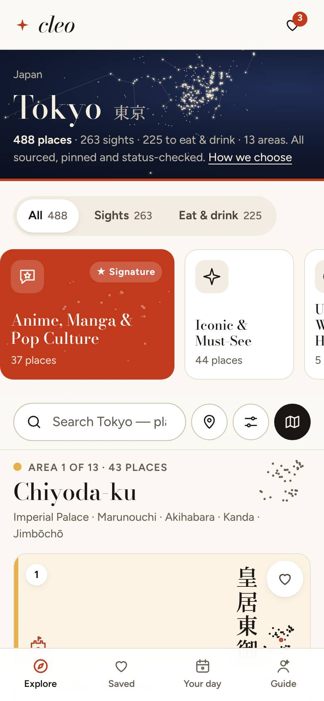
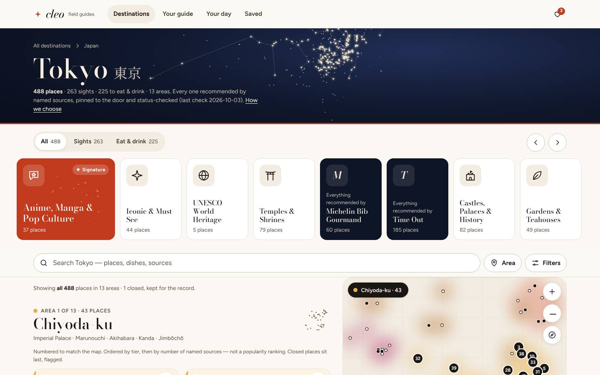

# Cleo beta design system — v2 "Bone & Oxblood" (W7, current)

> Lane: designer. Wave 7, 2026-10-11. Beta only. Decision and evidence: [`style/v2/DECISION.md`](style/v2/DECISION.md) ·
> board: [`style/v2/board.html`](style/v2/board.html) · tokens: [`tokens.css`](tokens.css) · base components:
> [`css/v2.css`](css/v2.css) (bundled last into `beta/assets/cleo.css`) · icons: [`style/v2/icons/`](style/v2/icons/sheet.html).
> The "Constellation" system below this section is **superseded** and kept for history. Where the two disagree, v2 wins.

## v2.1 Principles

1. **Calm, minimal, image-first.** Content and photos carry the colour. The chrome is ground, ink and hairlines.
2. **One accent, spent rarely.** Oxblood is used on four things only: the saved heart, the saved count, the day route and the wordmark star. It is the same for every city.
3. **One sun highlight.** A flat warm wash sits behind data-backed sticker badges and the heart pop. It is never a gradient, never text colour and never chrome.
4. **Ink does the work.** The primary button, the active segment, the pressed chip, the selected pin and the focus ring are all ink.
5. **Two faces, two jobs.** Bricolage Grotesque sets headlines, city names and big numbers. Inter sets everything people read or tap. There are no italics.
6. **Quiet depth.** Resting cards have no shadow. Soft shadows appear only on the search pill, floating controls and sheets.
7. **Honest covers.** Without a credited photo, a place gets the calm cover: a sand ground, one kind glyph and the name in type. The cover never pretends to be a photo.
8. **Trust for every generation.** Body text is 16 px or more, every pair passes AA in light and dark, buttons say what they do, and "Recommended by" is always visible.

## v2.2 Colour

| Token | Light | Dark | Use |
|---|---|---|---|
| `--paper` | `#F9F7F3` | `#131110` | Page ground (warm bone / warm near-black). `--night` aliases here. |
| `--surface` | `#FFFFFF` | `#1C1918` | Sheets, menus, the search pill |
| `--sand` | `#F1EDE7` | `#262220` | Quiet fill: the no-photo cover, the switcher track |
| `--ink` · `--ink-2` · `--ink-3` | `#1C1917` · `#4A4440` · `#68615B` | `#F2EEEA` · `#D0C9C3` · `#A69E97` | Text tiers; ink is also the primary fill and the focus ring. `--gilt` aliases to ink. |
| `--line` · `--line-strong` | `#E7E2DB` · `#CCC5BC` | `#302B28` · `#4B4440` | Hairlines and control borders |
| `--accent` · `--accent-ink` · `--accent-wash` · `--on-accent` | `#7A2A2A` · `#7A2A2A` · `#F5EAE7` · `#FFF` | `#E0A19A` · `#E8B0A9` · `#33201E` · `#1E0E0C` | The one accent. `--city*` aliases here. |
| `--sun` · `--sun-wash` · `--on-sun-wash` | `#E9A93B` · `#FBEBC8` · `#3D2A06` | `#F0BC5E` · `#3B2C10` · `#FBE3B0` | Sticker badge and heart pop only |
| `--open` / `--closed` / `--warn` (+ `-soft`) | green / brick / amber | lifted | Status only |
| `--area-mute`, `--area-mix` | `#948B83`, 50 % | `#766D67` | The data's area colours are mixed toward the palette for pins and dots |

`python3 design/beta/tools/contrast.py` checks **86 pairs: 0 below AA**. The palette generator is
`style/v2/tools/palettes.py`; it writes four directions and exits 1 on any miss.

## v2.3 Type

| Role | Face | Mobile / desktop |
|---|---|---|
| Hero | Bricolage Grotesque 600, −0.035 em | 38 / 60 px |
| Display 1 (city, country) | Bricolage 600, −0.024 em | 34 / 52 |
| Display 2 (sections, sheet titles) | Bricolage 600 | 22 / 28 |
| Card title | **Inter 600** | 16 |
| Lead / body / small = UI / meta / xs | Inter 400–500 | 17·18 / 16 / 14 / 13 / 12 |

- **Five steps between 12 and 17 px:** 12 · 13 · 14 · 16 · 17. Only weights 400 / 500 / 600 / 700 render, and there is no 13.5 px.
  - `style/v2/tools/normalize-v2.py` snaps every raw size and radius in the designer's sources onto tokens, and has a `--check` mode.
  - The probes confirm it: `eval/r6/tools/probe-type.js` and `probe-css.py`. In the designer's CSS the only raw font size left is `.5em` (the native script after a city name), and the only raw radii are `50%` and `3px`.
- **Optical size:** headlines of 40 px and up use Bricolage's opsz 72 instance. Headlines, deks and subtitles use `text-wrap: balance / pretty`.
- Tabular figures appear wherever we count (`--num`).
- CJK falls back to the system sans.
- Fonts are self-hosted OFL subsets (vi, latin-ext, latin), with `font-display: swap`.

## v2.4 Shape, depth, motion, icons

- **Radius:** 8 px for buttons and controls, 12 px for inputs and small media, 16 px for card media and sheets, and pill for chips, search, the switcher and stickers.
- **Elevation:** `--e-1` is none. `--shadow` is used on hover and floating controls, `--shadow-lg` on sheets and dialogs.
- **Motion:** durations are 120, 200, 320 and 480 ms; primary paths stay at 200 ms or less. The signature moment is the tapped cover or pin growing into the sheet: `--dur-grow` 340 ms with `--ease-grow`, using view transitions plus a FLIP fallback. The heart pop is the only spring. `prefers-reduced-motion` sets every duration to 0. Spec: [`style/v2/MOTION.md`](style/v2/MOTION.md).
- **Elevation, three steps:** `--shadow-sm` (the switcher thumb and the heart chip), `--shadow` (the search pill, hover, floating controls) and `--shadow-lg` (sheets and dialogs). Resting cards have none (`--e-1: none`).
- **Icons:** one line set of 73 icons on a 24 px grid, with a 1.5 stroke and round caps (`style/v2/icons/icons.json`). Every subject is generic, never a venue.

## v2.5 Components (base layer, `css/v2.css`)

| Component | v2 spec |
|---|---|
| Top bar | Ground + 1 px hairline, no blur. Wordmark in Bricolage 600 with an accent star. The current nav item gets a 2 px ink underline. |
| Buttons | Primary: ink fill with paper text, 8 px radius. Secondary: transparent with a `--line-strong` hairline. Icon buttons: round, sand on hover. Focus: 2 px ink outline, 2 px offset. |
| Chips / pills | Surface with a hairline; pressed = ink fill. Source credits are underlined text, not filled pills. |
| Search pill | White capsule, hairline, `--shadow`, ink search button. |
| Hero / masthead | On the ground: eyebrow in ink-3, name in display, one line, the count. No night, art, particles, motif or accent bar. |
| Card | No frame, border or resting shadow. Rounded media (16 px), heart top-right, then 2–3 lines: name (Inter 600), area · kind (ink-3), Recommended by. Hover dims the media 3 %; pressed scales it to 0.99. |
| No-photo cover | Sand ground, centred 30 px kind glyph in ink-3, native name 13 px bottom-left. |
| Sticker badge `.sticker` | Sun-wash pill with 12 px semibold text, top-left on media (or inline). Data-backed only; never on closed places. |
| Rails / collection tiles | Surface with a hairline, ink text; pressed = ink inset ring. No purple, motif or shimmer. |
| View switcher | Sand track (pill) with a white thumb and `--shadow-sm`; labels in ink-2 / ink. |
| Sheets, tray, dialogs | Surface, `--shadow-lg`, 16 px top radius. |
| Toast | Ink, paper text, 8 px radius. |
| Tab bar | Surface + hairline; current item in ink with a 2 px stroke icon. |
| Map | Pins on surface with a 2 px muted area underline; selected pin = ink. Clusters get a muted ring; the day route uses the accent. |
| Footer | On the ground, hairline above. |

---

# (superseded) Cleo beta design system — "Constellation"

> Lane: UI/UX (design/beta/, beta/assets/*.css). Wave 0, 2026-10-10. Beta only — nothing here touches the live site.
> Tokens: [`tokens.css`](tokens.css) (shipped copy `beta/assets/tokens.css`) · Components: [`beta/assets/constellation.css`](../../beta/assets/constellation.css)
> Live component sheet: [`mockups/components.html`](mockups/components.html) · Contrast proof: [`CONTRAST.md`](CONTRAST.md)
> Pages + benchmarks: [`specs/README.md`](specs/README.md) · Imagery: [`IMAGERY.md`](IMAGERY.md) · Voice: [`VOICE.md`](VOICE.md) · Why: [`DECISIONS.md`](DECISIONS.md)

## 1. The direction in one paragraph

**Every city is drawn as the constellation of its verified pins.** The owner asked for "luxury yet fun — Airbnb
Experiences meets a hotel butler meets your local guide; wanderlust; clean yet informative", and we have no venue
photos and may not fake any. So the visual anchor is *our own data, made beautiful*: a night-sky masthead where each
star is a sourced coordinate (brighter = must-see, lines join each area's must-sees), and a **typographic plate** on
every card — the place's native script set vertically (浅草寺) or a fashion-Didone initial, on its area's colour,
with an original collection glyph and a locator drawn from that area's real pins. Luxury comes from restraint
(porcelain paper, ink, one gilt distinction colour, a Didone voice — Aman, Rosewood); fun comes from **one local
accent per city** (Tokyo vermilion, Cleveland lake blue — The Hoxton's local skins) and playful functional details
(glyphs that bob, a save "stamp", "Been there" passport stamps). The information architecture is Salon's, kept;
its missing wanderlust and visual anchor are what this replaces.

| Screenshot | |
|---|---|
|  |  |

## 2. Principles (each traceable to the research)

1. **Inventory first** (P1): the first place card is on the first phone screen (Tokyo 0.73–0.79 screens, 14 on-screen controls above it — measured by `tools/shots.js`).
2. **Collections are the front door** (P2): a rail of cover tiles; ★ signature collections first and largest.
3. **Attribution is navigation** (P20): every card says *Recommended by*; every source chip and source tile opens "everything this source recommends".
4. **Distinction is a ladder of original glyphs** (P18/P19), identical on pin, card and sheet, linked to *How we choose*. Closed places never carry one.
5. **One calm frame, one local accent** (P5/P7/P8). The accent is spent only on actions, the active state and distinctions.
6. **Honest art** (P10): typography + map art from verified pins + generic glyphs. No photo that isn't the place; no stock; no AI.
7. **Content never waits for the network**: fonts load non-blocking with system fallbacks; map art renders offline; tiles are a bonus.
8. **No manufactured urgency** (P21): no ratings, "trending", scarcity, prices or hours — we hold none.

## 3. Foundations

### 3.1 Colour (light; dark = "night edition")

| Token | Light | Dark | Use |
|---|---|---|---|
| `--paper` | `#FBF8F3` | `#11100E` | page ground (warm porcelain) |
| `--surface` | `#FFFFFF` | `#1B1916` | cards, sheets, tray |
| `--sand` | `#F2ECE2` | `#24211D` | secondary ground, chips, quiet buttons |
| `--ink` / `--ink-2` / `--ink-3` | `#191613` / `#4B443C` / `#675E54` | `#F3EEE6` / `#D2CABE` / `#A79E91` | text tiers; ink also fills the primary button |
| `--line` / `--line-strong` | `#E7E0D5` / `#CDC3B4` | `#2F2B26` / `#4A443C` | hairlines / control borders |
| `--night` / `--night-2` / `--on-night` / `--on-night-2` | `#0E1526` / `#18213A` / `#F5EEDF` / `#BDB6A8` | deeper | masthead & hero sky |
| `--gilt` / `--gilt-soft` | `#8A6514` / `#F3E7C8` | `#DDB65E` / `#3A2F17` | **distinctions only** (tier glyph, authority chip) |
| `--open` / `--closed` / `--warn` (+ `-soft`) | green / brick / amber | lifted | status chips, caveats |
| `--focus` | `#1F4FD1` | `#8FB0FF` | 2 px focus ring, 2 px offset |
| `--city` / `--city-ink` / `--city-wash` / `--city-on` | per skin | per skin | the one local accent |

**WCAG AA:** 284 token pairs checked in light, dark and every skin — **0 below minimum** ([CONTRAST.md](CONTRAST.md),
`python3 design/beta/tools/contrast.py` exits 1 on any regression). Dark mode follows the OS unless
`data-theme="light|dark"` pins it.

### 3.2 Type

| Role | Family | Mobile / desktop | Notes |
|---|---|---|---|
| Hero | **Bodoni Moda** 500 (opsz axis) | 40–44 / 76 px, lh 1.02 | landing only; italic for the one emphasised word |
| Display 1 (city, place) | Bodoni Moda | 38 / 64 | |
| Display 2 (sections, areas) | Bodoni Moda | 28 / 36 | |
| Display 3 (card name) | Bodoni Moda | 21 / 22 | renders macrons (Sensō-ji, Jōnan) |
| Lead / Body / Small | **Figtree** 450 | 18·16·14 / 20·16·14 | humanist geometric sans — the friendly, "fun" half |
| Eyebrow | Figtree 650, tracked caps .06em | 12.5 | **at most one per block**; everything else sentence case (M1-15) |
| Native script | system Mincho/Gothic first, then Noto Serif JP via Google Fonts `&text=` subset (only the glyphs on the page) | plate 21–34, detail 54–84 | |

Exactly two families + the CJK face. Both stylesheets load with `media="print" onload` (non-blocking); fallbacks are
`Bodoni 72, Didot, Bodoni MT, Georgia, serif` and `system-ui, -apple-system, Segoe UI, Roboto`. With no network the
page reads in Georgia + system sans with identical layout. No text below 12 px.

### 3.3 City skins (one accent per city)

| Skin | Cities (assigned) | `--city` light / dark |
|---|---|---|
| vermilion | Tokyo | `#C23A1C` / `#FF7A57` |
| moss | Kyoto | `#4E6B22` / `#A8C46A` |
| neon | Osaka | `#B8255F` / `#FF74AA` |
| lagoon | Okinawa (+ Singapore/Vietnam regional skin candidates) | `#0B7473` / `#4FD1C9` |
| glacier | Hokkaido | `#2F5F9E` / `#7FA8EA` |
| lake | Cleveland | `#1F5E8A` / `#6FB2E6` |
| saffron | New York | `#9A5B00` / `#F2B54B` |
| plum | Chicago | `#6B3A8C` / `#C79BEA` |

Other cities rotate through the eight; a skin overrides **only** the four `--city*` tokens. Area colours (`AC` in the
data) are used only as plate tints (15 % over surface), the plate's 5 px edge, map washes and the area-head dot.

### 3.4 Space, radius, elevation, motion

- **Space:** 4-pt scale `--s-1…--s-11` = 4 8 12 16 20 24 32 40 56 72 96. Side gutter 16 px mobile, 40 px desktop; max width 1360.
- **Radius:** 6 (chips' inner), 10 (inputs, banners), **16 cards**, 24 sheets/tiles/map pane, pill 999.
- **Elevation:** `--e-1` resting card/control · `--e-2` hover & popovers · `--e-3` bottom sheets · `--e-4` floating map list, hero feature.
- **Motion:** 120 / 220 / 360 / 520 ms; `--ease-out` for everything, `--ease-spring` only for the save stamp and the
  collection-glyph bob. `prefers-reduced-motion: reduce` sets every duration to 0 (and the keyframes inherit it). No
  animation > 300 ms on a primary path (M3-05) — the 360/520 ms durations are decorative only.

### 3.5 Iconography

Original 24-px line set (1.75 stroke, round caps), one inline `<symbol>` sprite per page (`svgkit.py ICONS`): UI
(search, heart, map, list, sliders, close, directions, share, check, chevrons, plus, pin, day, guide, offline, info,
alert, external, globe, route, swap, print, seal, compass, stamp) and **collection / dish glyphs** (torii, castle,
leaf, columns, mountain, steam, awning, moon, bubble-star, tower, ticket, bowl, sushi, noodles, lantern, cup, dango,
flame, cloche, fork-knife, fish, bottle, cake, tv, dumpling, sandwich). Glyphs are generic — "a ramen bowl", never
"this shop's bowl". The brand mark is a four-point compass star. No third-party logo, mascot or monogram anywhere;
Michelin / James Beard / NPS appear as **text** with a gilt dot.

## 4. Components

All sizes are CSS px. "Mobile" = < 640 (cards) / < 900 (chrome); desktop ≥ 1024 (split view). Every interactive
target is ≥ 44 × 44 (dense source chips get an invisible 44 px hit-area pseudo-element).

| Component | Class | Anatomy & spec | States | Mobile / desktop |
|---|---|---|---|---|
| **Top bar** | `.topbar` | compass mark + *cleo* italic wordmark (→ landing), primary nav (Destinations · Your guide · Your day · Saved), search, saved heart with count dot in city accent | default, scrolled (blur), `.on-night` over hero, `aria-current` tab | 60 px, nav hidden / 68 px, nav shown |
| **Tab bar** | `.tabbar` | Explore · Saved · Your day · Guide; active icon in `--city` | active, focus | fixed 64 px + safe-area / hidden |
| **Hero** (landing) | `.hero` | kicker → Didone headline (one italic word in gilt-soft) → computed one-liner → search pill → featured-map card | — | constellation background, 40 px headline / 2-col with 560×600 feature card |
| **Masthead** (hub, city, day) | `.masthead` | crumbs · name + native script · computed facts (`N places · sights · eat & drink · areas · last check`) · *How we choose* link · 3 px accent bar; sky = city constellation | — | ≈ 160 px (0.19 screen; budget ≤ 0.6) / ≈ 228 px |
| **Segmented tabs** | `.seg` | All N · Sights N · Eat & drink N (computed) | selected (surface + e-1), hover, focus | 40 px pills inside 48 px track |
| **Collection rail tile** | `.coll` | glyph tile → title (Didone) → "N places" | default, hover (lift + glyph bob), `aria-pressed` (ink inset), `.sig` (accent fill, constellation of its own pins, ★ Signature badge), `.by-src` (night tile: monogram + "Everything recommended by {source}"), `.all` (dashed "Show all N") | 132×124 / 148×164; sig 210 / 236 wide |
| **Category pill** | `.pill` | glyph + label + count | default, pressed (ink fill), focus | 44 px |
| **Search** | `.search`, `.suggest` | pill input + primary button; suggestions grouped Places / Collections / Sources with `<mark>` highlight and meta | empty, typing, selected option, no result (→ empty state) | 56 px (hero) / 44 px `.compact` (toolbar) |
| **Toolbar** | `.toolbar` | search + Area + Filters (+ Map toggle on mobile); sticky under top bar | sticky blur | icon-only 44 px buttons / labelled |
| **Applied filters** | `.applied` | removable ink chips + "Clear all" | — | 36 px chip, 44 px hit |
| **Area chapter head** | `.area-head` | area dot + "Area n of N · count" eyebrow, Didone name, neighbourhoods line, **silhouette of the area's own pins** | — | order note hidden on mobile (stated in the tray + method page) |
| **Place card** | `.card` | **plate** (native script vertical / Didone initial · area tint + 5 px edge · glyph · locator · pin number) → tier glyph + area · dish → **name** (+ native) → 2-line write-up → *Recommended by* chips (+N) → heart | default, hover (e-2), `.is-focus` (accent ring = pin selected), saved (filled accent heart + stamp anim), visited (rotated "Been there" stamp), **closed** (no tier glyph, grey hatched plate, "Closed · kept for the record" + "checked {date}") | cover card 136 px plate (≥ 2 cards per screen after the first) / grid 2-up, plate 16:9; `.row` compact density for sheets/day plan |
| **Distinction ladder** | `.tier.t1/2/3` | **Must see**: filled compass star in a ring (gilt) · **Worth the detour**: outlined star in a ring + dot · **Deep cut**: open diamond. Text label always present; `title` says "within {area}"; links to How we choose | — | 16 px / 22 px `.lg` in sheets |
| **Authority mark** | `.authority`, `.src.auth` | gilt dot + text "Michelin Bib Gourmand" / "James Beard Foundation" / NPS | — | — |
| **Source chip** | `.src` | sentence-case short label ("Go Tokyo", "News 5 Cleveland #1" keeps the rank note); `.added` dashed "Added by the guide" for ADD/FADD only | hover border, focus | 26 px visual / 44 px hit |
| **Source list** | `.srclist` | monogram · name · domain · "All n Tokyo picks citing {source} →" (in-link) · "Read ↗" (out-link) | — | — |
| **Guide's note / Look for** | `.note`, `.lookfor` | prose `k` → italic Didone note on accent wash; keyword `k` → tag row. Never voice keywords as a sentence | — | — |
| **Detail sheet / page** | `.detail`, `.sheet` | hero plate (map art + vertical native name) → tier + status → name → Didone write-up → Look for → collections → Recommended by → practical facts (address + Directions / Apple Maps / OSM; Open per {source} checked {date}; Pinned to the door {confidence}, {pin source}, verified {date}; "Hours & prices: not in our data") → Close by (straight-line) | — | full-height sheet: grabber, visible Close, sticky Save · Add to day · Directions / two columns with sticky aside |
| **Map split view** | `.split`, `.mappane`, `.mapart` | list left, sticky map ≥ 42 % right; area chip; zoom / near-me; pins numbered per area; selected pin in accent; credit line | pin hover ↔ card focus | — / ≥ 1024 |
| **Mobile map + POI sheet** | `.mapview`, `.poi-sheet` | full-screen map, back · search · filters, area/type chips; sheet with grabber, "n of N in view", visible Close, snap carousel of compact cards, List · Open | peek / half / full detents | full screen / floating 440 px list panel over the map |
| **Filter & sort tray** | `.tray` | Area · Distinction · Recommended by · Sort (guide's order, nearest, A–Z) · More (hide been-there, free only, map style) → "Clear all" + **"Show N places"** | focus-trapped, Esc/Back closes | bottom sheet 88 vh / centred 560 px dialog |
| **Hub city tile** | `.tile` | constellation art + vertical native name + accent bar → Didone name → computed counts → data-derived canon line → ★ signature line | hover lift | 150 px art (Tokyo `.lg` 220, spans 2 cols ≥ 1100) |
| **Guide picker option** | `.interest` | glyph tile · Didone title · description with count · tick | pressed (accent glyph, ink ring, filled tick) | 84 px rows |
| **Day plan** | `.stops`, `.daysum`, `.caveat` | summary (stops · km straight-line · places to eat), caveat, route actions, numbered timeline with dotted accent spine and leg distances | — | map strip on top / sticky route map |
| **Stated gap** | `.gap` | dashed card, eyebrow "Stated gap · {cuisine}", italic Didone headline, the guide's own words verbatim, link to the closest qualifying place | — | — |
| **Empty / error / offline** | `.state`, `.banner`, `.skeleton` | line art + Didone title + one plain sentence + one action. Night banner for offline, amber for storage blocked | — | — |
| **Footer** | `.footer` | wordmark + computed promise, Explore / Plan / Trust columns, legal line with OSM/Esri credit and "no ratings, prices or hours" | — | 2 cols / 4 cols |

## 5. Rules engineers must keep

- Never render a tier glyph on a closed record; closed sorts last within its area.
- Every number on screen is computed from data at build time (`make-mockups.py` does it; the generator must too).
- Pin numbers == card numbers within an area; ordering is "tier, then number of named sources" and the UI says so.
- A collection or interest **reorders or filters a view, never deletes**; "Show all N" restores exactly N.
- Map art draws only verified pins; OSM geometry, if ever drawn, carries a visible "© OpenStreetMap contributors".
- `localStorage` always in try/catch; the storage-blocked banner is the fallback copy.

## 6. Reproduce

```bash
python3 design/beta/tools/make-mockups.py                         # mockups from real records (+ syncs beta/assets/tokens.css)
NODE_PATH=$(npm root -g) node design/beta/tools/shots.js          # screenshots + metrics.json (390×844 @2x, 1440×900)
python3 design/beta/tools/contrast.py                             # WCAG gate over tokens
```
