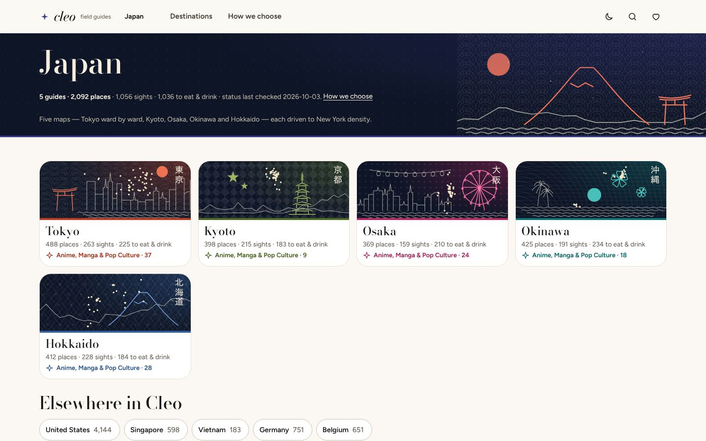
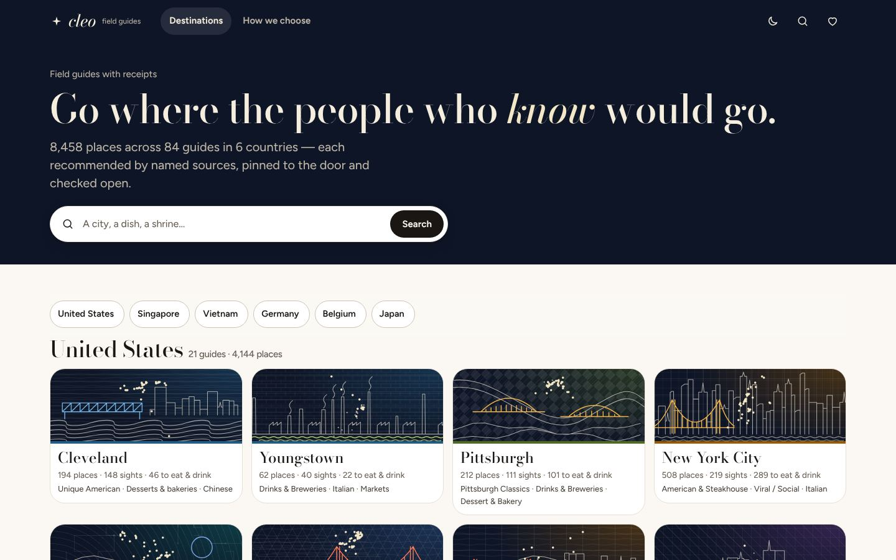
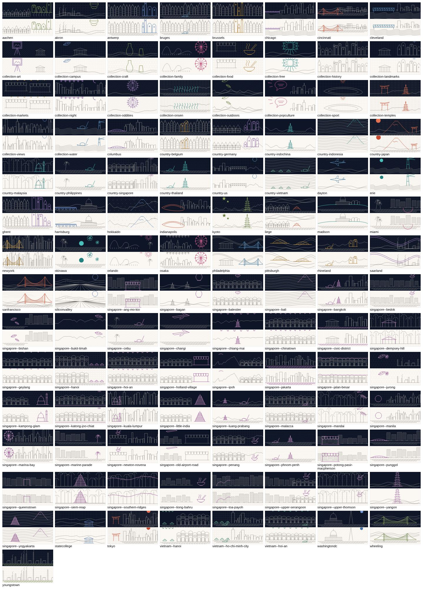

# Imagery strategy — honest wanderlust without a single fake photo

> Lane: UI/UX · 2026-10-10 · Implements UX research §6 (A + B + C now, D later) and backlog M1-13 / M3-04 / LP-02.

## The rule

**An image may only claim what is true.** A photograph next to a place name is read as *that place*; so we show a
photograph only when it really depicts that place, is licensed, and is credited where it is shown. Everything else
is typography, our own map art, or a generic glyph that never pretends to be a venue.

| Tier | What | Where | Status |
|---|---|---|---|
| **A. Typographic plates** | Native script set vertically (浅草寺), or a Bodoni italic initial, on the area's colour (15 % tint) with a 5 px area edge | every card, the detail hero, hub tiles (native city name) | **Shipped W1** — CSS cover on every generated card (M1-11) |
| **B. Map art from verified pins** | City **constellations** (one star per sourced coordinate; brighter = must-see; lines = minimum spanning tree of each area's must-sees), area silhouettes, per-card locators, route lines, offline map washes | mastheads, hero feature card, signature tiles, area heads, plates, day plan, offline map | **Ship now** |
| **C. Original glyphs** | 26 collection/dish glyphs drawn in-house (torii, ramen bowl, dango, lantern, sandwich…) | plates, rail tiles, pills, picker | **Ship now**; a commissioned illustrator set per city is a later "should" (owned outright, no imitation of any brand's style) |
| **D. Wikimedia Commons photographs** | Landmarks only (temples, museums, monuments, parks) | detail hero first, then cards | **Later — blocked on LP-02** (`data/images.json` registry + gate) |
| E. Stock photos | — | never next to a place; at most a city mood header labelled "Illustrative" — we choose not to | **No** |
| F. Generative images | — | anywhere | **Never** (fabrication; EU AI Act Art. 50 disclosure; backlash evidence in research §6) |

## A + B: how the art is made (build time, zero network)

- Generated by the beta generator from the same records the page lists (`svgkit.py` in the mockups: `constellation()`,
  `mini_shape()`, `mapart()`); **only geocode-gated pins** (sourced, not `UNVERIFIED`) are drawn. Nothing is placed by hand.
- Projection: equirectangular with cos-latitude correction, fitted to the frame; long-tail day-trip outliers are
  clipped from the *framing* (3–5 %) so a city is not shrunk by one far pin — they are still listed, never dropped.
- No basemap geometry is drawn, so no OSM credit is legally needed on the art itself; we still credit "Map art from
  our verified pins · live map © OpenStreetMap contributors · Esri" wherever a map frame appears, because the live
  tiles replace the art when they load. If coastlines/streets from OSM are ever drawn in, the "© OpenStreetMap
  contributors" credit must sit visibly beside the art (OSMF attribution guideline), never behind a tap.
- Size: art is inline SVG. Budget per card plate ≤ 0.6 KB (locators reuse one `<symbol>` per area plus one dot per
  card); masthead constellation ≤ 40 KB; a full city page's art ≤ 15 % of HTML weight. The mockup Tokyo page with
  all 488 cards is 0.9 MB uncompressed HTML (105 KB gzipped) — the generator should lazy-hydrate plates below the
  fold (every card still in the DOM/reachable).
- Every card reads completely with the art removed (name, area, tier, write-up and sources are text); art is
  `aria-hidden`; plates have fixed aspect so CLS from art = 0.

## D: Commons photographs — the pipeline (for LP-02 / M3-04)

1. **Candidate:** only records whose sources include a Wikipedia article (≈ 29 % of records); take the article's
   Wikidata **P18** image filename. No search-and-pick by eye.
2. **Registry entry** in `data/images.json` (live-pipeline owned, beta reads only):
   `{place, file, title, author, license, licenseUrl, sourceUrl, depicts (Wikidata QID of the place), fopCountryOk, people: false, crop, width, sha1, verified, verifiedBy}`.
3. **Gate** (like `--geocheck`): depicts-QID must equal the place's QID; licence ∈ {CC0, PD, CC BY, CC BY-SA} (no NC/ND);
   **freedom of panorama** checked per country — US: buildings yes, public art no; Japan: buildings yes, modern public art no;
   Singapore: no 2D works; **Vietnam: none at all**; Germany/Belgium: permanent works from public places; no identifiable
   people; file still exists at the recorded sha1.
4. **Storage:** self-hosted in `beta/assets/img/<city>/<slug>-<w>.webp` at 480 / 960 / 1600 w; never hotlinked (Commons
   renames break links; hotlinking is discouraged). Budget ≤ 60 KB at 480 w, ≤ 600 KB total per city page above the fold.
   `loading="lazy"`, explicit `width`/`height`, typographic plate stays as the placeholder.
5. **Credit — TASL, visible where shown:** a caption strip on the image: *"Sensō-ji" by {author}, {license short name}
   (link), via Wikimedia Commons — cropped.* (`figure.photo figcaption` in `constellation.css`). BY-SA adaptations (crops count)
   stay BY-SA and say so. A page-level "Image credits" list repeats them.
6. **Refresh:** re-verify on every city refresh, exactly like pins and status.

Until that registry exists, **no mockup or beta page shows a photograph**, and the mockups do not imitate one (no
grey "photo goes here" boxes pretending to be imagery).

## Why this beats a photo-led layout for us

Louis Vuitton City Guides, Wallpaper* and Herb Lester build admired guide brands on colour, type and illustrated maps
(research §6). Our constellations are a signature no competitor can copy without our data, and they make the trust
promise visible: *every star is a place someone credible recommended and we pinned to the door.*

## Wave 1 status (2026-10-10)

- **A shipped** on generated pages: every card's cover is the area-colour field + the name in Bodoni Moda (+ native plate
  when FE-A adds `.pl-cover`). **B styled**: the no-tiles map ground and `.mapart` classes are in `cleo.css`; the SVG
  itself is platform's `lib/art.js`. **C**: tier glyphs shipped (`beta/assets/glyphs/`, `.tg`).
- **D stays gated**: no photograph on any beta page; `beta/assets/` holds no raster venue image (`og-cover.png` is the
  generic brand card). Commons waits for LP-02.

## Wave 2 — imagery lane (2026-10-10): original motifs now, photos the moment the owner drops them in

> Lane: imagery · owns `beta/assets/img/**` and `tools/beta/imagery/**` · closes ROUND-1 gap #1 as far as the
> network policy allows. Wikimedia hosts and WebFetch are **blocked** here; nothing was fetched and nothing routes
> around that.

### C+. Original motif art — shipped

- **What:** an original SVG illustration for **every place page (84), every country (11) and 18 collection subjects**
  (food canon, landmarks, pop culture, outdoors, art, temples, history, views, markets, night, water, free, family,
  oddities, onsen, sport, craft, campus). Each is a faint repeating ground + a line-art horizon + one accent stroke in
  the city's skin colour, e.g. Tokyo = wave scales + a generic skyline + a shrine gate + a rising sun; Cleveland = lake
  swell + a truss bridge + a lakefront skyline; Pittsburgh = two rivers + two steel arches; Bruges = stepped gables +
  canal + boat; Chinatown SG = encaustic tiles + shophouse terrace + lanterns.
- **Honest by construction:** subjects are generic (a pagoda, a truss bridge), never a drawing of a specific venue;
  every file's `<desc>` says so. No raster, no external reference, no script (tested).
- **Made by code:** `tools/beta/imagery/draw.js` (vocabulary) + `motifs.js` (recipes, seeded per key, so a build
  is deterministic and no two cities share a line). Accents are parsed from `beta/assets/tokens.css` skins, so a skin
  change re-colours the art.
- **Files:** `beta/assets/img/motifs/<pageKey, / → -->.svg`, `<countryKey>.svg`, `collections/<subject|themeKey>.svg`
  (FE-B's editorial themes — anime, hawker, ramen… — alias to a subject). **Two tones:** `<name>.svg` for the night
  ground (night tiles, mastheads); `<name>.ink.svg` for paper (wash/paper tiles, rail covers), which flips to cream under
  `prefers-color-scheme: dark`. ≤ 6 KB each, loaded as images (0 bytes inline).
- **Where it shows now:** every hub/landing city tile (FE-B's four compositions; ink tone on the light ones), the
  landing's editorial theme rail, every country hub hero, every city masthead (right-anchored, masked away from the
  text). Subject covers are in the index for FE-A's collection rail.
- **How to use it (FE lanes):** `require('tools/beta/imagery').motifSvg(row.imagery.motif, up, {fit, style, tone})`
  returns a decorative `<svg><image href>` layer. Model: `row.imagery.motif`, `country.imagery.motif`,
  `reg.imagery.collections[kind]` + `reg.imagery.collectionKind(id, name)`; static index
  `beta/assets/img/motifs/index.json`. **Caution with `--motif:url(…)`:** Chromium resolves a url() held in a custom
  property against the stylesheet that *uses* the var() — fine when the consuming rule is inline in the page (FE-B's
  `FEB_CSS`), a 404 when it is in `assets/cleo.css` on a root-level page. `motifSvg()`'s `<image href>` has no such trap.

| Hub (Japan, desktop) | Landing tiles | Contact sheet (every motif, night + ink) |
|---|---|---|
|  |  |  |

### D. The photo path — wired, waiting for files

1. **Manifest (the shopping list).** `tools/beta/imagery/manifest.js` reads `data/geocodes.json` read-only through
   the beta model and writes `beta/assets/img/manifest.json`: every beta record whose verified-coordinate source cites
   a Wikipedia article — `{page, id, name, kind, status, country, lang, title, url, cite, match, qid, eligible}`.
   Today: **3,465 records** (1,278 with an exact article URL, 746 with the title written, 1,441 "Wikipedia" without a
   title); **2,901 eligible** for a photo. Not eligible: 23 closed, 85 in Vietnam (no freedom of panorama), 456 food
   places. `match: related` flags an article that may be a containing place (a hawker centre for a stall).
2. **Credits.** `beta/assets/img/CREDITS.json` (owner-edited, never generated) — schema in the file:
   `{file, record:{page,id}, title?, depicts, author, sourceUrl, licence, licenceUrl, modified?, width?, height?}`.
3. **Build hook.** `imagery.build()` (called once from `tools/beta/build.js`) gates every photo; a card renders
   `<figure class="photo pl-photo">` with a visible TASL `<figcaption>` **only** when the local file exists under
   `beta/assets/img/photos/` **and** its credit row is complete. Otherwise the card keeps its plate and the page its motif.
4. **Refusals (build and `npm test`):** a photo file without a credit row; a credit whose file is missing; any missing
   TASL field; a non-https source/licence URL; a licence that is not CC0 / PD / CC BY / CC BY-SA (NC and ND refused);
   a record not on its page; a **closed** place (never a "go here today" photo); any place in **Vietnam**.
   Test: `tools/beta/imagery/test-imagery.js` (in `npm test`).

### Dropping in photos (owner)

1. Pick a row from `beta/assets/img/manifest.json` with `eligible: true` (prefer `cite: url`, `match: same`).
2. Open the article, then its lead image's Commons file page. Check: it shows **this** place; the licence is CC0, PD,
   CC BY or CC BY-SA; no identifiable people; freedom of panorama holds for the country (US/JP: buildings yes, modern
   public art no; SG: no 2D works; DE/BE: permanent works in public places).
3. Save a ~960 px-wide copy (≤ 120 KB, `.webp`/`.jpg`/`.png`) as `beta/assets/img/photos/<page>--<id>-960.webp`
   (`/` in a page key becomes `--`).
4. Add its row to `CREDITS.json` → `credits` (author exactly as credited; `sourceUrl` = the Commons file page;
   `modified` if you cropped — BY-SA stays BY-SA).
5. `cd tools && npm run beta && npm test`. A failing row names the exact problem.

### For the Round 3 Gallery view (card and row-cover sizes)

Every motif is a 480×200 frame whose subject sits in the middle band, so it crops cleanly as a cover:
- **Wide row covers (≥ 2:1):** `object-fit: cover; object-position: 50% 100%`, as the hub tiles already do.
- **Cards (3:2 to 1:1):** the same cover crop keeps the centre third. Side accents (a sun, a gate) may fall outside, but
  the horizon line and the pattern always fill the card. Use `.ink.svg` on light card grounds.
- **Below about 120 px tall:** only the pattern and the horizon read. Pair the cover with the title rather than relying
  on the art.
If Gallery needs portrait covers, the imagery lane will add a square/portrait recipe per key to `motifs.js`. That is
the same vocabulary and needs no new pipeline.

## Unsplash candidates — research now, a mechanical fetch later (2026-10-11)

> Lane: imagery research · owner request "real photographs, from Unsplash among other sources". `api.unsplash.com`
> and `images.unsplash.com` return 403 under this environment's network policy (like Wikimedia). Nothing was
> downloaded and nothing routes around the block. What does work is WebSearch restricted to `unsplash.com`, which
> returns photo **page** URLs and their titles. That is all this manifest is built from.

### What is in `beta/assets/img/unsplash-candidates.json`

One entry per **target**, with up to three **candidates** each, copied verbatim from search results:

| Target type | What it is | Where it may show |
|---|---|---|
| `hero` (`hub:<page or country>`) | a recognisable city or country scene (skyline, a signature view) | hub tiles, country hub hero, city masthead |
| `landmark` (`<page>#<record id>`) | one **tier-1 sight** record, pilots first (Tokyo, Kyoto, Cleveland, New York, Singapore towns), then the other cities and SEA | that record's card and detail hero |
| `cover` (`collection:<key>`) | a **generic** mood image: a noodle bowl, a hawker hall, a shrine gate, a diner… | collection covers **only**, never next to a venue's name |

Each candidate: `pageUrl`, `id` (the last 11-character path token), `title` exactly as returned, `photographer` only
when the result showed it, `depicts`, `confidence`, `reason`, and `flags` where something needs a human look.

**Confidence is strict.** `high` only when the returned title or description names that exact landmark or place
("Kinkaku-ji with a gold roof"). `med` when a search summary or location tag points to it but the title is generic
("A castle with a moat", located at the Gravensteen). `low` when it was merely returned for the query. For covers,
`high` means the title describes exactly the generic subject and names no venue.

**Never assigned.** No photo is attached to a restaurant, shop or other venue: food and venues get only generic
covers. Excluded with a note: Unsplash+ photos (a paid licence), 3-D renders, historical archive images presented
as today, and any result that is really a different place (Kinkaku-ji when searching for Ginkaku-ji, Philadelphia
City Hall for Independence Hall, the U.S. Capitol for Wisconsin's). **Gaps are stated, not filled**: a target with
no honest candidate keeps an empty list and a note (Terminal Tower, West Side Market, Henderson Waves…).

**Flags** (the fetch script skips a flagged candidate unless you pass `--allow-flag <flag>` after looking at it):
`people-visible` (identifiable people), `public-art-check` (freedom of panorama: US and Japan have none for modern
public art), `venue-check` (a legible shop sign or a nameable venue on a cover), `artwork-check` (copyrighted works
in frame), `possibly-plus` (stock-agency style title; the API decides), `fop-vietnam`.

The `summary` block counts targets, candidates by confidence, and lists every gap.

**Status (2026-10-11, about 160 searches):** 146 targets (34 heroes, 93 landmarks, 19 covers) and 250 candidates:
**128 high, 77 med, 45 low**. 121 targets have at least one candidate and 72 have a high one. 23 are stated gaps,
including Terminal Tower, West Side Market, Soldiers' & Sailors', the Arcade and the Cleveland Museum of Art building,
Singapore Botanic Gardens, Henderson Waves, Heian Jingū, Shuri Castle and the Singapore Zoo. Hero Thailand and hero
Indochina reuse the Wat Arun and Angkor Wat candidates. With the defaults (high only, no flags) the fetch script would
try 65 targets; `--min med` and reviewed `--allow-flag`s widen that.

### Licence and credit

Unsplash photos are under the **Unsplash License** (<https://unsplash.com/license>): free use, modification allowed,
no permission needed; attribution is not legally required but the API guidelines require it and our rule shows it
anyway, wherever the photo appears. The credit line is **"Photo by <name> on Unsplash"**, with the name linked to the
photographer's profile and "Unsplash" linked to the photo page, both with `utm_source=cleo_guide&utm_medium=referral`.
The licence does not allow selling unaltered copies or compiling photos into a competing photo service; neither
applies here. Unsplash+ is a different, paid licence and is refused.

The credit gate (`tools/beta/imagery/photos.js`) accepts `Unsplash License` (licence URL must be the one above and the
source must be an `unsplash.com` photo page), renders the Unsplash credit line, and also accepts `slot` rows
(`{type: hero|cover, key}`) for hero and cover photos that do not belong to one record. Everything else is unchanged:
no file without a complete row, no row without its file, no closed or Vietnamese place.

### Fetch and commit

**Owner-approved path: GitHub Actions.** The owner chose to fetch on a GitHub-hosted runner, which can reach both hosts:
`.github/workflows/beta-fetch-unsplash.yml` (orchestrator) runs the script with `UNSPLASH_ACCESS_KEY` from a repository
secret, then `npm run beta && npm run validate && npm test`, and commits `beta/` only if every gate passes. It runs on
manual dispatch or on a push that touches the manifest, the script or the workflow. The sandbox itself still cannot
reach the hosts and never tries to.

Prerequisites (owner): create an Unsplash developer app and put its **Access Key** in the `UNSPLASH_ACCESS_KEY`
repository secret (never in the repo). Demo apps get 50 requests an hour. Each photo costs 2 API calls (photo +
download event), so the script spends at most 45 calls per run (`--budget`), about 22 photos, and stops cleanly. Targets
that already have a credit row are skipped, so the next run resumes where the last one stopped.

```bash
node tools/beta/imagery/fetch-unsplash.js                       # no key: prints the plan, fetches nothing, exit 0
UNSPLASH_ACCESS_KEY=… node tools/beta/imagery/fetch-unsplash.js # fetch (high confidence, no flags, ≤ 45 API calls)
… fetch-unsplash.js --dry-run                                   # plan only, even with a key
… fetch-unsplash.js --type landmark --key landmark:tokyo#senso-ji --min med --allow-flag people-visible
cd tools && npm run beta && npm test                            # the gate renders them, or names the problem
```

Per target the script takes the first candidate that passes, in manifest order:

1. `GET /photos/:id` with `Authorization: Client-ID $UNSPLASH_ACCESS_KEY`. The API, not the search snippet, decides:
   the id must match, the photo must not be Unsplash+/premium, and for a landmark the API's own description, alt text,
   location or tags must contain a word of the target's name. A candidate that fails moves to the next one.
2. `GET` the photo's `links.download_location`, the download event the API guidelines require whenever a photo is used.
3. Download `urls.raw` with `w=960&fm=webp&q=75&fit=max`, resized by Unsplash's image CDN, so no local image library is
   needed. Store it as `beta/assets/img/photos/<page>--<id>-960.webp` (landmarks; `/` in a page key becomes `--`),
   `hero--<key>-960.webp` or `cover--<key>-960.webp`.
4. Write or replace its `CREDITS.json` row: `record` (landmark) or `slot` (hero/cover), `author`, `authorUrl`,
   `sourceUrl` (photo page + utm), `licence: "Unsplash License"`, `licenceUrl`, `provider: "unsplash"`, `unsplashId`,
   `credit: "Photo by <name> on Unsplash"`, `modified`, `fetched`, `confidence`.

Exit codes: **0** when it is done or there is nothing to do, including no `UNSPLASH_ACCESS_KEY` (it prints the plan and
fetches nothing); **1** for a bad option; **3** when either host is unreachable or answered by a policy proxy;
**4** when an API or image request fails. It prints every kept and refused photo with a reason, and the API calls used.
It writes `CREDITS.json` after each photo, so a stop keeps the finished work. It runs only where the hosts are allowed
(the Actions workflow above), never through a proxy, mirror or other workaround.

**One tension for the owner to decide.** The Unsplash API guidelines ask API apps to *hotlink* the returned image URLs,
while our rules self-host every asset (content never depends on a CDN; a blocked CDN costs a map, not a page). The
licence itself allows downloading and self-hosting. The script follows our rule: it triggers the download event and
credits every photo as the guidelines ask, then serves a local copy. If the owner registers a production app, either
confirm with Unsplash that self-hosting downloaded files is acceptable for this use, or use the site's own download
button for each picked photo (the licence covers that) and add the `CREDITS.json` row by hand. The gate is the same
either way.

**Not wired yet:** the renderers attach gated photos to record cards today; hero and cover `slot` rows are validated
and exposed (`loadPhotos().bySlot`), but the hub hero, masthead and collection-cover renderers still show motifs.
Hooking them up is a front-end task for the next round.

## Wikimedia Commons — a keyless photo path through GitHub Actions (W7, 2026-10-11)

> Lane: imagery · W7 brief `design/beta/eval/W7-BRIEFS.md` § "Lane: imagery". Commons needs **no key**, and a
> GitHub-hosted runner can reach it. This sandbox cannot (network policy), so nothing was downloaded here and nothing
> routes around the block: the manifest is built from WebSearch results restricted to `commons.wikimedia.org`, and the
> fetch runs on the runner.

### 1. The manifest — `beta/assets/img/commons-candidates.json`

One entry per **target**, in fetch-priority order:

| Order | Target | Count | What |
|---|---|---|---|
| 1 | `hero:<page or country>` | 40 | city, town and hub heroes: the five pilot pages and the five live country hubs first (Tokyo, Cleveland, New York, Chinatown SG, Wheeling; Japan, US, Singapore, Belgium, Germany), then every other city and region |
| 2 | `landmark:<pilot page>#<id>` | 174 | every tier-1 sight on the pilot pages |
| 3 | `landmark:<page>#<id>` | 1,114 | every other tier-1 sight (not Vietnam) |

Each target carries `names` (the phrases a file must name: the record name and its parts, the native name, the cited
Wikipedia article title, plus a few aliases such as "Hannes Tiedemann House" for Franklin Castle), its cited `article`
when there is one, and `candidates` copied verbatim from search results: the `File:` title, its Commons page, what the
result says it shows, a confidence grade and the reason. **high** = the file title (or its description as the result
showed it) names that exact place; **med** = a description or category points to it but the title is generic, or the
photo may not show the place today. Nothing is guessed: titles from a Commons category listing are marked so in the reason.

**Status (about 150 searches):** 40 heroes, all 40 with a high candidate; 174 pilot sights, 103 with a high
candidate, 65 skipped by rule; 269 candidates in all (255 high, 14 med). Seven pilot gaps are stated, not filled:
Holden Arboretum (only plant close-ups), the Solstice Steps, Bronx Zoo, Queens Museum (only 1939 scans), LeMoyne House
(only its marker), Salt Fork State Park, The Wilds.

**Never a photo (target `skip`):** food places; venues: anything tagged bar, shop, market, mall, hawker, theatre,
arena, entertainment or nightlife, plus pilot venues named one by one (Kabuki-za, Ryōgoku Kokugikan, Radio City, the
Apollo, Yankee Stadium, Luna Park, the Cyclone, teamLab, the Ghibli Museum, the studio tour, Shibuya Sky, Sunshine
City, Severance, Beck Center, Cain Park, 78th Street Studios, two tiny private museums, Quintana's); modern public art
where the country has no freedom of panorama for it (the Free Stamp, the Unisphere, the GE Chandelier, the Yayoi Kusama
façade, manga and animation museums); exhibits inside a building (Lucy, the chess collection, the Percy Skuy
collection); closed places; Vietnam.

**Flags** (the fetch skips a flagged candidate unless `--allow-flag` names it after a person has looked):
`people-visible`, `public-art-check` (the 9/11 Memorial pools, Christopher Park's statue, Storm King, the Hakone
Open-Air Museum, the Noguchi Museum, the Guardians of Traffic), `venue-check` (shop signs on Pagoda Street), `panorama`
(a 360° file), `outdated` (Shuri Castle before the 2019 fire; the Cleveland Museum of Art before its 2013 addition),
`author-check`.

### 2. The fetch — `tools/beta/imagery/fetch-commons.js`

```bash
node tools/beta/imagery/fetch-commons.js --dry-run                  # the plan, no network
node tools/beta/imagery/fetch-commons.js --budget 150               # runner: heroes, then pilot sights (high, unflagged)
node tools/beta/imagery/fetch-commons.js --budget 300 --wiki-lead   # also tier-1 sights everywhere else, from the
                                                                    # lead image of each record's cited Wikipedia article
cd tools && npm run beta && npm test                                # the gate renders them, or names the problem
```

Per target, the first candidate that passes, in manifest order (then, with `--wiki-lead`, the article's lead image):

1. **Re-read from the Commons API** (`action=query&prop=imageinfo|categories&iiprop=url|size|mime|sha1|extmetadata`).
   The API, not the search snippet, decides.
2. **Free licence only:** `LicenseShortName` must be CC0, public domain, CC BY or CC BY-SA (any version or port). NC,
   ND, GFDL-only and anything else are refused. The author (`Artist`, HTML stripped) must be present. Bitmap only,
   at least 640 px wide, no panorama wider than 3:1. Personality-rights restrictions are refused unless
   `--allow-flag people-visible`.
3. **Depicts re-check:** the file title, its `ObjectName`, its description or one of its visible categories must
   contain one of the target's `names`, compared without spaces, punctuation or diacritics. "Kinkaku-ji" never passes
   for Ginkaku-ji.
4. **Sized local copies:** Commons' own server-side thumbnails, never wider than the original. Commons serves only its
   standard thumbnail widths (250, 330, 500, 960, 1280, 1920); any other width answers HTTP 400, which stopped
   workflow run #5 at a 640 px thumbnail. Each asked width therefore snaps to the nearest step, and the thumbnail URL
   comes from the API for that width (`thumb.wikimedia.org` or `upload.wikimedia.org`). Cards: 500 + 960 px. Heroes:
   960 + 1280 px by default; the workflow passes `--widths 500,960 --hero-widths 500,960` to keep Tokyo within 2.0 MB. Stored as
   `beta/assets/img/photos/<base>-<w>.jpg` (`/` in a page key becomes `--`). Nothing is hotlinked. A failed thumbnail
   refuses that candidate; a 429 or 5xx stops the run cleanly, and the next run resumes. The run exits 4 only if
   the API fails or more than 25 % of image downloads fail.
5. **TASL credit row** in `CREDITS.json`: the largest width is `file`, the smaller one is in `variants`, plus `title`,
   `depicts`, `author`, `sourceUrl` (the Commons File: page), `licence`, `licenceUrl`, `provider:
   "wikimedia-commons"`, `commonsTitle`, `sha1`, `modified` ("resized to … px wide"), `fetched`, `confidence`.
   Written after each photo, so a stop keeps the finished work; credited targets are skipped next run.

API etiquette: a descriptive `User-Agent`/`Api-User-Agent`, `maxlag=5`, a 400 ms pause between requests, and a request
budget (`--budget`, default 150). **No network → exit 0 with the plan printed** (this sandbox: `ENOTFOUND`). Exit 4
when a request fails mid-run.

**Workflow:** `.github/workflows/` belongs to the orchestrator. The command to wire in is
`node tools/beta/imagery/fetch-commons.js --budget 150`, run before the beta rebuild and gates. It needs no secret.
Add `--wiki-lead` once the pilots have been reviewed.

### 3. The gate — `photos.js` + `test-imagery.js`

Still refuses anything uncredited. New in W7:
- `variants: [{file, width, height}]`: smaller sizes of the **same** credited image. Each must exist, be a bare image
  name and belong to no other row. A variant without its row is an uncredited photo and is refused like any other.
- `provider: "wikimedia-commons"` rows must link a `commons.wikimedia.org/wiki/File:` page, never an
  `upload.wikimedia.org` hotlink.
- Hero slots work for any city, town or country key. A Vietnam key (country or city) is still refused.

### 4. Rendering

- **Cards** (`li.pl`): `<figure class="photo pl-photo">` with `srcset` (500w, 960w) and
  `sizes="(min-width: 1024px) 30vw, (min-width: 640px) 45vw, 100vw"`, `loading="lazy"`, explicit width and height,
  `alt` = what it depicts, and the TASL `figcaption` laid over the bottom of the photo.
- **Hub heroes and hub/landing city cards** belong to FE-B (`hub.js`, `landing.js`). They call `imagery.heroFor(reg, key)`
  (slot `hero:<country or page key>` from `reg.imagery.slots`) and `imagery.heroHtml(ph, up, 'photo hero-media')`.
  With a media-slot class that is an in-flow, eager figure with `srcset` and its TASL `figcaption`. `photo.srcset` is a
  beta-relative string (`"assets/img/photos/x-480.jpg 480w, …"`). `photo.widths` holds the same sizes as objects.
- **City heroes** (`.masthead .g-hero-x`, `city.js`): `imagery.heroHtml()` with the default class is a full-bleed
  `<figure class="photo hero-photo">` behind the headline. It is eager (`fetchpriority="high"`) with `srcset` at
  `100vw` and a scrim in the hero's ground colour (`--hero-scrim`, default `--night`), so the text stays at AA. It
  replaces the pin sky only when a credited hero exists. `imagery.heroCreditHtml()` puts the credit as a small
  **"Photo: author · licence · Wikimedia Commons (resized)"** line in the text flow, under the actions. Laid over
  the photo it collided with the facts and buttons. With no hero photo the page is byte-identical.
- Not yet: Gallery row cards and the "Start with" lead card are drawn client-side from `data/gallery/<page>.json`.
  Adding `row.imagery.photos[id]` there is an FE-A follow-up (contract: `{src, srcset, w, h, credit}`).

### 5. Credits, subject rules and weight (W7 review round 3)

- **Short credit everywhere a card or hero shows a photo:** `photos.captionHtml(credit)` →
  `Photo: <author> · <licence link> · <Commons File: page link> (resized)`. The file title is the source link's
  `title` and part of its accessible name (`aria-label="“Title” on Wikimedia Commons"`), which covers CC 2.0/3.0's
  title-if-supplied term. The File: page is the full TASL record; there is no separate credits page.
  `captionHtml(credit, {full:true})` gives the whole sentence for a place detail view.
- **Card `sizes`:** `CARD_SIZES = (max-width: 639px) 92vw, (max-width: 1023px) 45vw, 25vw`. Thumbnails pass their own,
  e.g. `figureHtml(photo, up, cls, { sizes: '120px' })`.
- **Subject rules at fetch time** (`fetch-commons.js`): signage, lettering, logos or advertising (`SIGNAGE`), and
  equipment, people or close-ups such as hands, a drone controller, a selfie or a portrait (`CLOSEUP`, which also checks
  categories) are refused unless the target itself is named so (Sign Hill, a portrait gallery). Heroes also refuse
  winter, snow, overcast or fog (`GLOOM`). Every run first **re-scans** the credited photos against their current
  Commons text and prints `RESCAN` lines (report only).
- **One file, one row:** `test-imagery.js` fails if a Commons file is credited twice (two heroes, or a hero and a card).
  Whether a hub hero looks too much like one of its city heroes stays a visual check.
- **Weight:** `tools/beta/imagery/recompress.js` re-encodes credited Commons JPEGs in place: progressive mozjpeg,
  metadata stripped, the highest quality ≤ 72 that meets 45 KB (500 w), 110 KB (card 960 w) or 160 KB (hero 960 w),
  never below 50. It keeps pixel size, writes only when smaller and appends "recompressed (JPEG, quality ≤ 72)" to
  `modified`; it is idempotent. It needs `sharp` (`npm install --no-save sharp` in `tools/` on the runner) and exits 0
  without it. The first pass took `photos/` from 36 MB to 17 MB.

### 6. W8 coverage (R7 gap 1), weight (gap 7) and colour (gap 3)

- **Targets.** Every non-Vietnam guide's gallery lead card and first rail row are targets (`priority: lead | row`),
  fetched right after the heroes; then the pilot pages' tier-1 sights, then every other tier-1 sight.
  `fetch-commons.js --scope heroes | priority | pilots | all` (default `priority`) says what a run may fetch.
- **Article lead images.** A target citing a Wikipedia article carries `wikiLead`: when no candidate passes, the
  fetch tries that article's lead image under every check. Heroes carry `articles` (the town, then an iconic
  sight), tried in order. Maps, coats of arms, flags, montages and logos are refused (`NOT_A_PHOTO`), and so is a
  file already credited to another row (one file, one row). Vietnam guides keep their motif hero, with the reason
  stated in the manifest.
- **Stated gaps.** Brand stores (the branding is the subject), Poké Lid character art, venues (by tag, and by name:
  theatre, opera house, playhouse, ballpark, arena, stadium, concert hall; each name-matched skip is listed in the run
  summary for review). `node tools/beta/imagery/coverage.js` reports hero / lead / first-row / tier-1 coverage per
  guide.
- **Widths per class (repo size).** Heroes, lead cards and first-row cards: 500 + 960. Every other card: 500 only
  (≈ 35 KB, ≈ 21 MB for the whole tier-1 set).
- **Weight.** recompress.js: every 960 w JPEG ≤ 120 KB (cards ≤ 110 KB), 500 w ≤ 45 KB, quality floor 40. A tall or
  very detailed photo that still misses its target is scaled down (0.85× steps) and its row's width/height updated.
- **Dominant colour.** recompress.js writes `color: "#rrggbb"` on each Commons row; the gate exposes it as
  `photo.color` for a fade-in placeholder.
