# Page specs — Wave 0 (with benchmark comparison)

> M0-06. Each page: purpose → structure (mobile / desktop) → states → acceptance hooks → **benchmark** (which leader
> pattern it answers, and why it is at least as good). Mockups are generated from real records by
> `design/beta/tools/make-mockups.py`; screenshots by `design/beta/tools/shots.js` (390×844 @2x, 1440×900, JPEG q70).
> Metrics below are from [`../screenshots/metrics.json`](../screenshots/metrics.json): overflowX = 0 on every page and
> viewport; 0 off-origin requests needed (fonts optional).
> Pattern ids (P1–P24, M1–M9) refer to `design/research-2026-10/ux-competitive/README.md`; M0/M1/M2 ids to `docs/BETA-BACKLOG.md`.

Shared chrome on every page: top bar (wordmark → landing; Destinations · Your guide · Your day · Saved), mobile tab
bar, footer with computed totals and OSM/Esri credit. Components are specified in [`../DESIGN-SYSTEM.md`](../DESIGN-SYSTEM.md).

---

## 1. Landing — [`mockups/landing.html`](../mockups/landing.html)

| Mobile | Mobile, scrolled | Desktop |
|---|---|---|
| 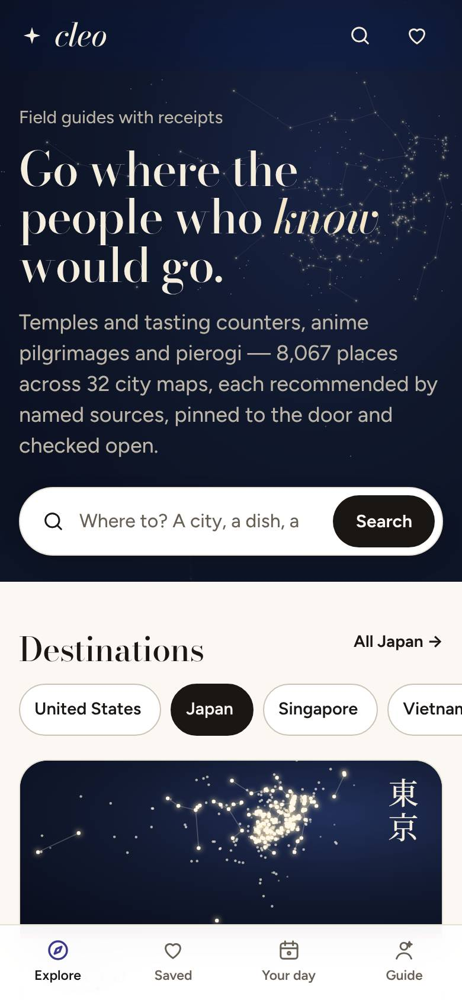 | 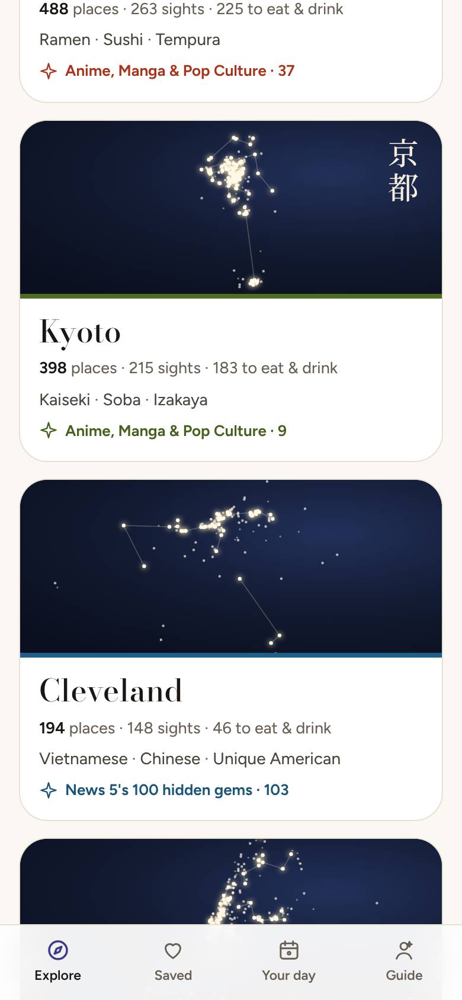 | 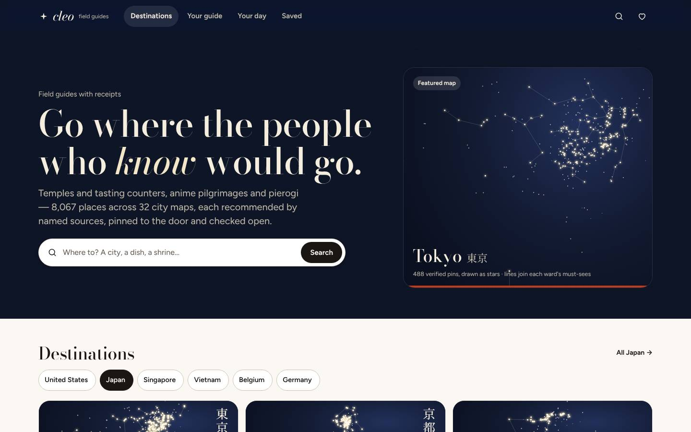 |

**Structure.** Night hero (Didone headline "Go where the people who *know* would go", computed line "8,067 places
across 32 city maps…", search pill) with a featured-map card (Tokyo constellation, 488 pins) on desktop and the
constellation as the hero sky on mobile → **Destinations** (country pills + city tiles with computed counts, data-derived
canon line and ★ line) → **Signature collections** rail (Tokyo anime 37, Cleveland News 5 picks, Kyoto ★, Michelin Bib,
Free to visit) → **Your guide** interests → **Why trust a Cleo pick** → footer.
**States.** Search suggestions (component sheet), country switch (pressed pill), offline banner.
**Acceptance hooks.** M1-17 (first city tile visible at 390×844), M1-20 (every number computed), M2-09 (search entry).

**Benchmark.** Answers **P1 inventory-first** (Klook / Airbnb put inventory on screen 1; ours shows the first city tile at ≈ 0.76
screens on mobile and city tiles directly under the hero on desktop) and **P2 collections as the front door** (Airbnb
Categories, GetYourGuide Explorer). At least as good because the hero image is *the product's own proof* — a city drawn
from 488 verified pins — rather than a stock photo that can't be checked, and signature collections sit on the landing,
which GetYourGuide's Originals do not (research §4.4).

## 2. Country hub (Japan) — [`mockups/hub-japan.html`](../mockups/hub-japan.html)

| Mobile | Mobile, scrolled | Desktop |
|---|---|---|
| 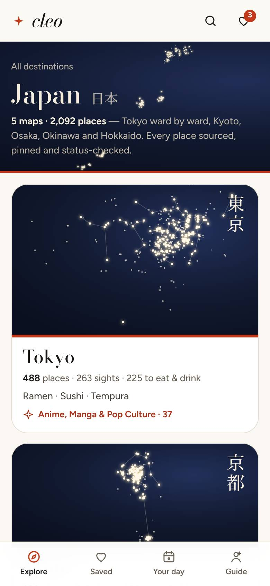 | 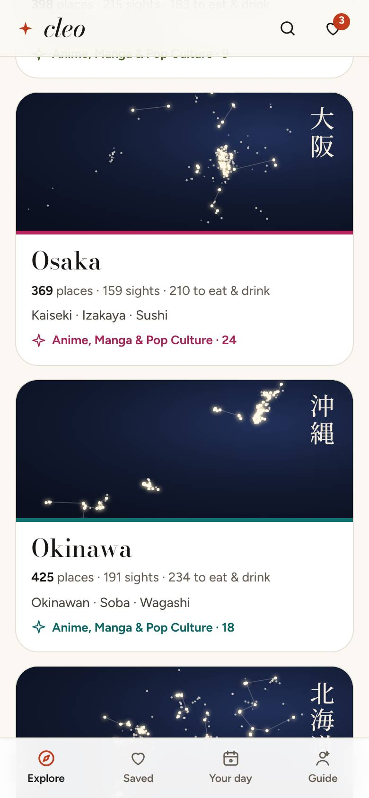 | 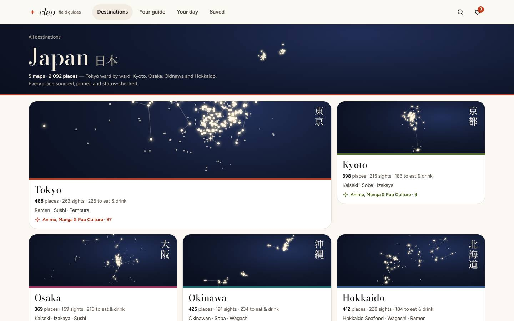 |

**Structure.** Compact masthead (Japan 日本, "5 maps · 2,092 places", sky = all Japan pins) → city tiles (Tokyo large,
spanning two columns on desktop; Kyoto, Osaka, Okinawa, Hokkaido), each in its own skin → Signature collections across
Japan → "Elsewhere in Cleo" country pills. **Acceptance.** M1-17: ≥ 2 cities visible at 390×844 (Tokyo full + Kyoto art).

**Benchmark.** Fixes Salon's "hub shows no city above the fold" (§7.2(2)). Answers **P7/P8 one system, local skins**
(The Hoxton, Belmond): five cities, five accents, one frame. As good as Apple Maps Guides' cover grid because each
cover carries counts, the dish canon and the signature collection — browse *and* decide in one glance.

## 3. City page — Tokyo [`mockups/city-tokyo.html`](../mockups/city-tokyo.html) and Cleveland [`mockups/city-cleveland.html`](../mockups/city-cleveland.html)

| Tokyo mobile | Tokyo mobile, scrolled | Tokyo night edition |
|---|---|---|
|  | 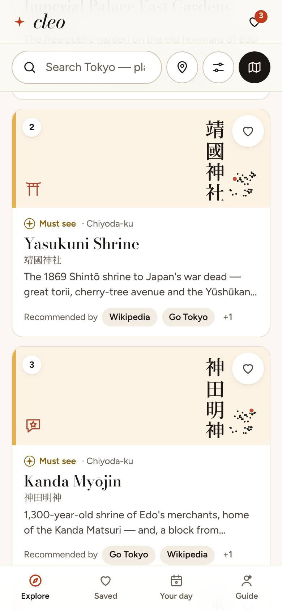 | 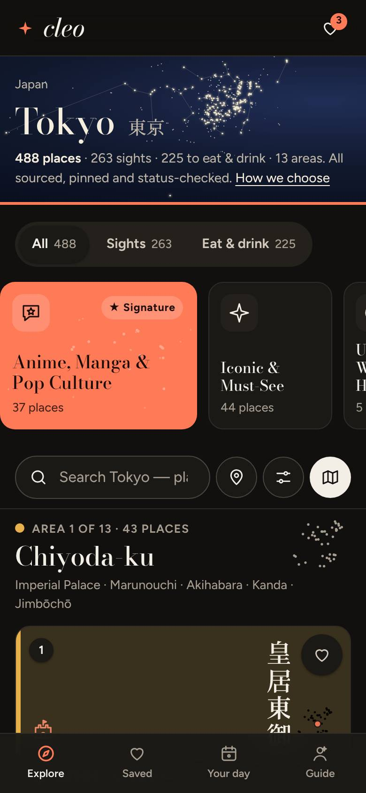 |

| Tokyo desktop | Tokyo desktop, scrolled (split view) |
|---|---|
|  | 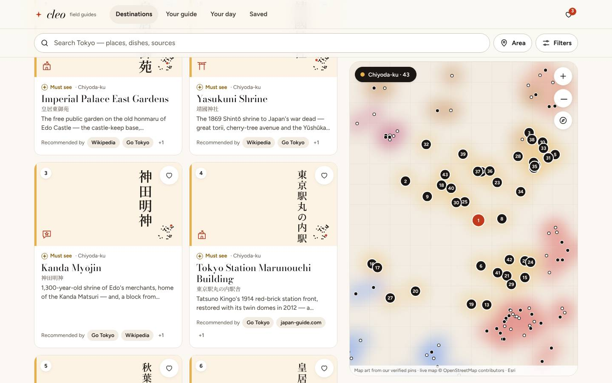 |

| Cleveland mobile | Cleveland stated gap | Cleveland desktop |
|---|---|---|
| 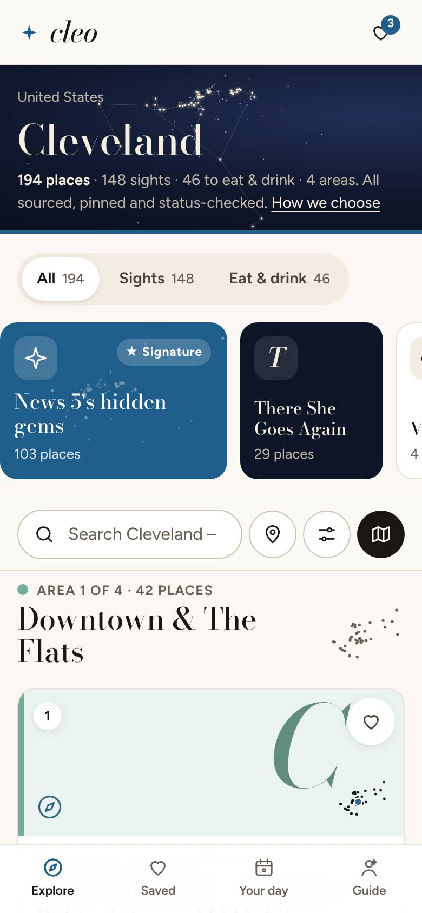 | 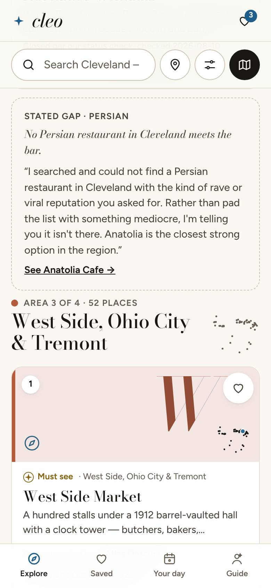 | 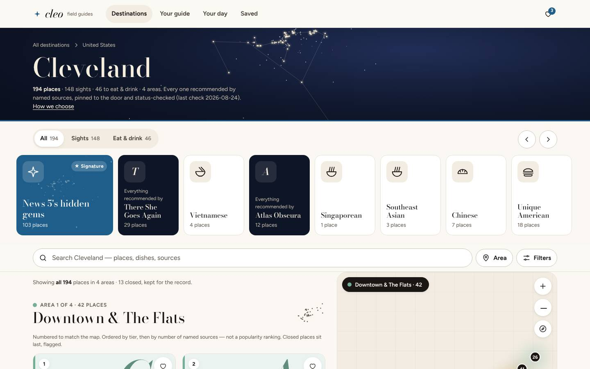 |

**Structure.** Masthead (≈ 160 px mobile) → segmented All / Sights / Eat & drink with counts → collection rail
(★ signature first; Tokyo: Anime 37, then collections and **source tiles** "Everything recommended by Michelin Bib
Gourmand / Time Out"; Cleveland: News 5 hidden gems, There She Goes Again, Atlas Obscura, then cuisines) → sticky
toolbar (search · Area · Filters · Map toggle on mobile) → area chapters (dot, "Area n of N · count", Didone name,
neighbourhoods, pin silhouette) → cover cards numbered to match the map → *How we choose* → footer. Desktop: split
view, sticky map art of the first area with numbered pins (selected = accent).
**Every place renders:** Tokyo 488/488, Cleveland 194/194 (the generator asserts it). Closed: Tokyo 1, Cleveland 13 —
muted, no tier glyph, sorted last. Cleveland's Persian gap is stated verbatim after University Circle.
**Measured.** First card at **0.73–0.79** screens (Tokyo) / **0.75** (Cleveland) on mobile with **14** on-screen
controls above it (M1-01 budget: ≤ 1.0 and ≤ 14); ≤ 1.0 screen on desktop. Salon: 0.9 / 14; live: 4.9 / 81.
**States.** Filter tray, applied chips, 0 results, tiles failed, storage blocked — see the component sheet.

**Benchmark.** Answers **P1, P2, P11 split view (Baymard), P12 numbered pins (Eater 38, with the "not ranked" rule
stated), P18 ladder (Michelin), P20 attribution as navigation (Apple Maps Guides publisher → guides)** in one page.
At least as good as Airbnb's category-rail + card grid because each card also shows *who* recommends it and *how
strongly within its own area*, and as good as the Eater map+list because it adds a sticky split view on desktop
and a list-first mobile flow NN/g recommends. Beats Salon on wanderlust: plates, constellations and per-city skins
make Tokyo ≠ Cleveland at a glance.

## 4. Place detail — [`mockups/place-tokyo.html`](../mockups/place-tokyo.html) (Sensō-ji)

| Mobile sheet | Mobile, scrolled | Desktop |
|---|---|---|
| 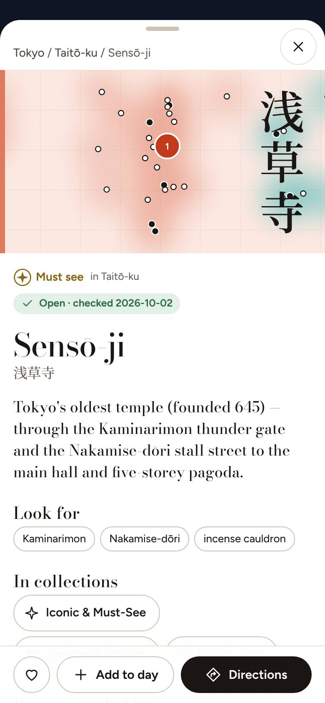 | 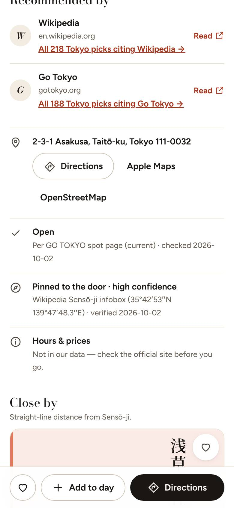 | 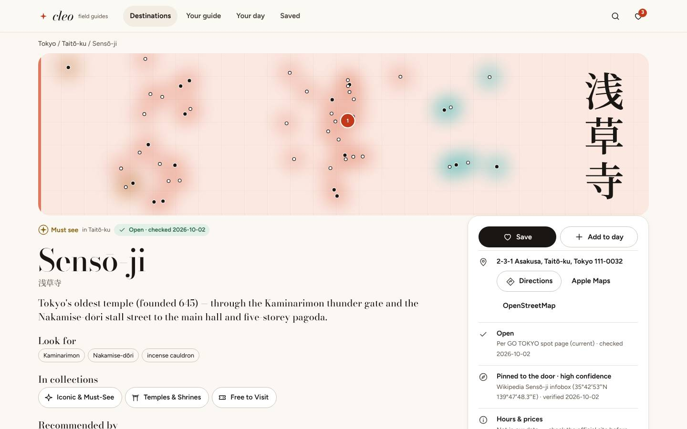 |

**Structure.** Mobile = full-height sheet (grabber, visible Close, sticky Save · Add to day · Directions). Desktop =
page with sticky practical aside. Hero plate = map art of the 1.2 km around the place with the place as pin 1 +
浅草寺 set vertically. Then tier ("Must see in Taitō-ku") + "Open · checked 2026-10-02" → name + native → write-up in
Didone → **Look for** (Sensō-ji's `k` is keywords, so tags, not a "note") → collections → **Recommended by** list
(Wikipedia, Go Tokyo: domain, in-link "All n Tokyo picks citing…", out-link "Read ↗") → address + Directions / Apple
Maps / OpenStreetMap → status with source and date → "Pinned to the door · high confidence · Wikipedia infobox ·
verified 2026-10-02" → "Hours & prices: not in our data" → Close by (4 nearest, straight-line metres).
**Acceptance.** M1-12, M1-10, M1-08.

**Benchmark.** Answers **P13** (sheet with a visible close and detents — NN/g, WWDC21) and **P19/P20** (Atlas
Obscura "added by/edited by"; Michelin inspector write-up). As good as an Airbnb Experience page's host block because
the "host title" becomes the *source title*, and better on trust: no OTA shows the pin's provenance and the status
check date on the place page.

## 5. Mobile map sheet — [`mockups/map-sheet.html`](../mockups/map-sheet.html)

| Mobile | Desktop (map-first variant) |
|---|---|
| 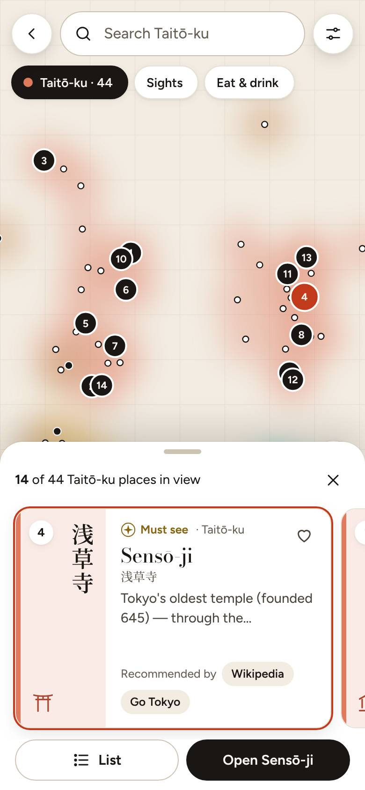 | 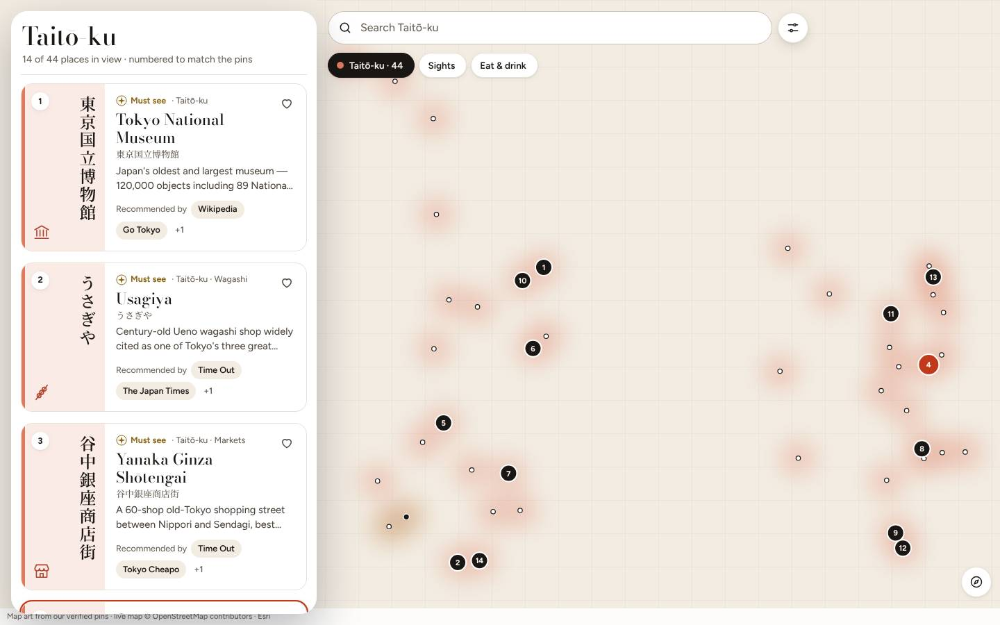 |

**Structure.** Full-screen map (art offline; Esri/OSM tiles when online), back · search · filters, area/type chips;
numbered pins (14 of Taitō-ku's 44 in view; selected Sensō-ji = accent). POI sheet: grabber, "14 of 44 Taitō-ku places
in view", visible Close, snap carousel of compact cards (selected first, focus ring), List · Open. Detents: peek
(carousel), half, full (= place sheet). Desktop: floating 440 px list panel over the map, numbered to match.
**Acceptance.** M1-05 (≥ 2 detents, visible Close, Back/Esc), M1-06.

**Benchmark.** Answers **P13 tappable pins → sheet** (Trip.com/Airbnb praised; Booking critiqued) and **P11/P14**.
At least as good: pins and cards share numbers (Eater), and the map never goes blank — offline art from verified
pins instead of a grey "tiles failed" box, which none of the leaders offer.

## 6. "Your guide" picker — [`mockups/guide-picker.html`](../mockups/guide-picker.html)

| Mobile | Mobile, scrolled | Desktop |
|---|---|---|
| 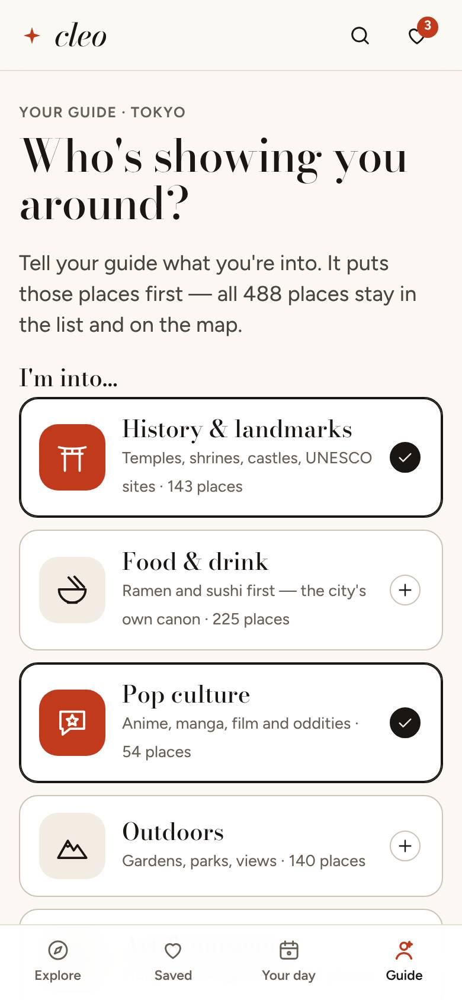 | 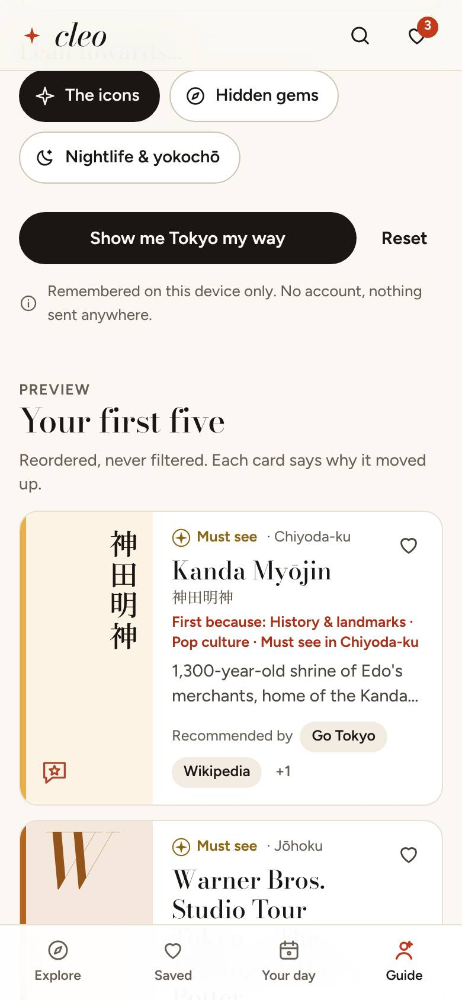 | 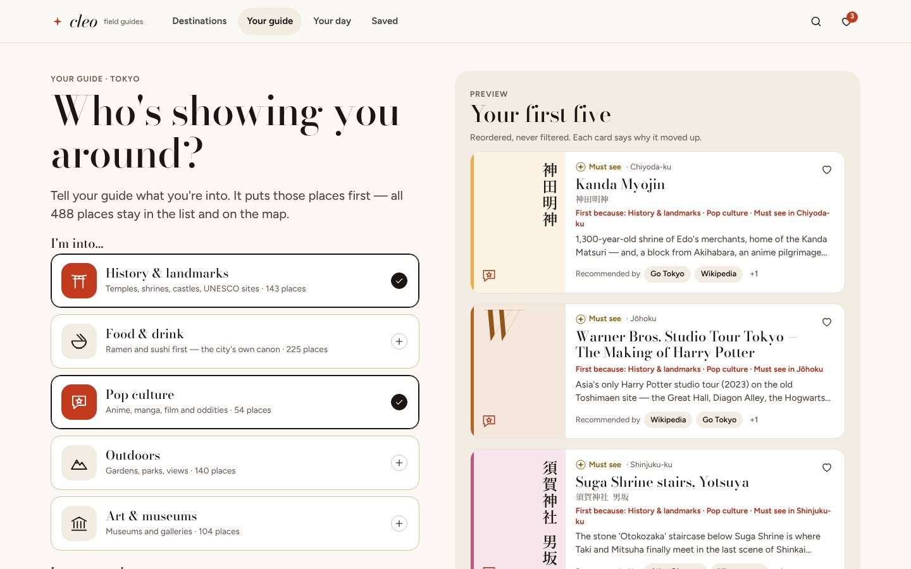 |

**Structure.** "Who's showing you around?" → five interests from M2-05 (History & landmarks · Food & drink · Pop culture
· Outdoors · Art & museums), each with its computed count and mapped **only to collection/cuisine ids** → "Lean
towards" (The icons · Hidden gems · Nightlife & yokochō — the last is Tokyo's `NIGHT` collection, not an invented
"after dark") → "Show me Tokyo my way" + Reset → device-only note → **preview "Your first five"**, each card saying
"First because: History & landmarks · Pop culture · Must see in Chiyoda-ku". Promise: all 488 stay.
**Acceptance.** M2-05 (reorder never hide; why-first line; ribbon entry, not auto-open).

**Benchmark.** Answers **P17 personalisation that reorders verified data and says so** (Ask Bonvoy answers only from
verified data; Mindtrip praised for cross-checkability) and the brief's "local guide who's into what you're into".
Better than an AI chat for us: deterministic, explainable per card, and it cannot invent a place.

## 7. Day plan — [`mockups/day-plan.html`](../mockups/day-plan.html)

| Mobile | Mobile, scrolled | Desktop |
|---|---|---|
| 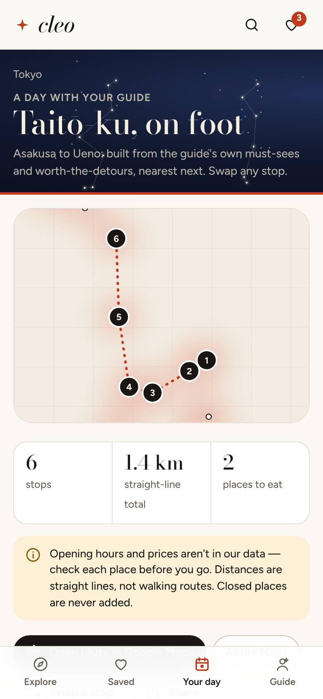 | 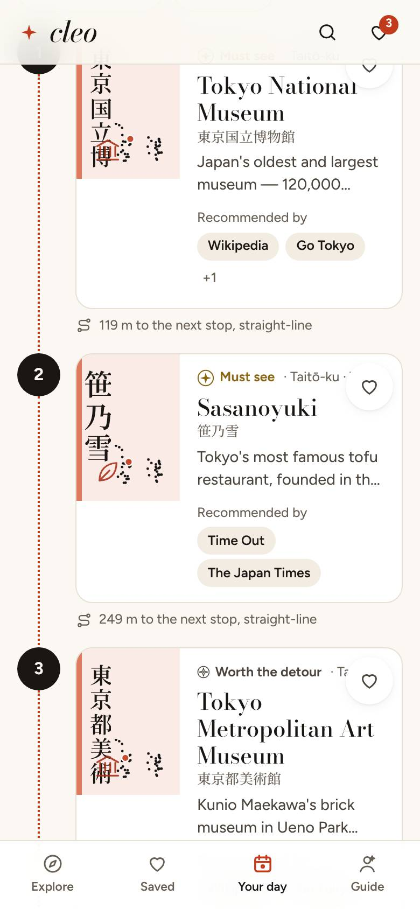 | 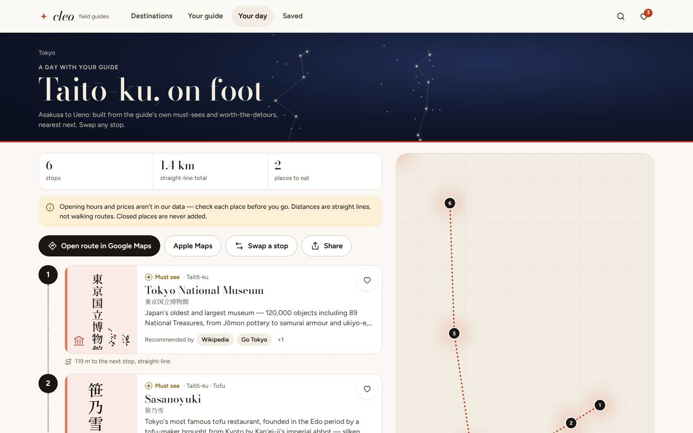 |

**Structure.** Masthead "Taitō-ku, on foot" → route map (numbered, dotted accent route line) → summary (6 stops ·
1.4 km straight-line · 2 places to eat) → caveat (hours/prices not in data; straight lines; closed never added) →
Open route in Google Maps / Apple Maps · Swap a stop · Share → numbered timeline with leg distances.
Stops are computed: the area's top-ordered must-see sight, then nearest-next alternating sight/food among open
tier-1/2 places (`day_stops()` in the generator).
**Acceptance.** M2-06 (excludes closed/unpinned; legs labelled straight-line; shareable/exportable).

**Benchmark.** Answers **P23 the day as the unit, route line, per-day totals** (Wanderlog). As good as Wanderlog's
day view for a visitor, and better on honesty: every stop is a sourced pick and the totals say what they are; export
to Apple/Google is free (Wanderlog gates it behind Pro).

## 8. Saved list — [`mockups/saved.html`](../mockups/saved.html)

| Mobile (offline state) | Desktop |
|---|---|
| 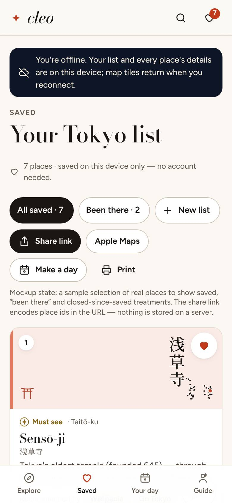 | 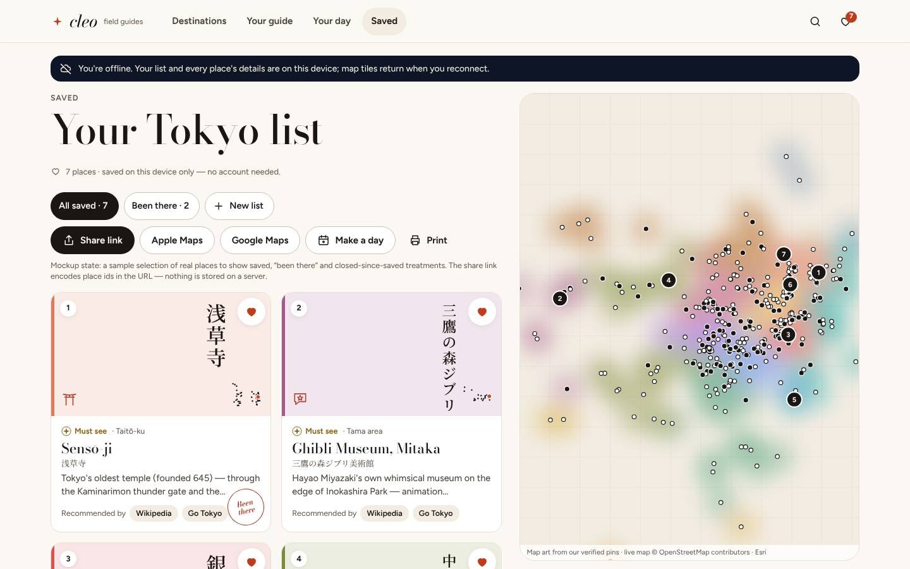 |

**Structure.** Offline banner (state demo) → "Your Tokyo list" · "7 places · saved on this device only" → list tabs
(All saved · Been there · New list) → Share link · Apple Maps · Google Maps · Make a day · Print → cards numbered to the
map, with filled hearts, "Been there" stamps, and a **closed-since-saved** card (Tokyo's one closed record) flagged.
Desktop: split view with the saved pins. The selection is labelled on the page as a mockup sample of real places.
**Acceptance.** M2-03, M2-04 (URL-encoded ids, no server), M3-01 offline.

**Benchmark.** Answers **P22 save → list → share → been-there** (Google Lists, Michelin lists, Atlas Obscura "Been
There"). As good without accounts: share-by-URL and on-device storage; and it warns when a saved place has closed,
which none of the benchmarks surfaced in our evidence.

## 9. Component sheet — [`mockups/components.html`](../mockups/components.html)

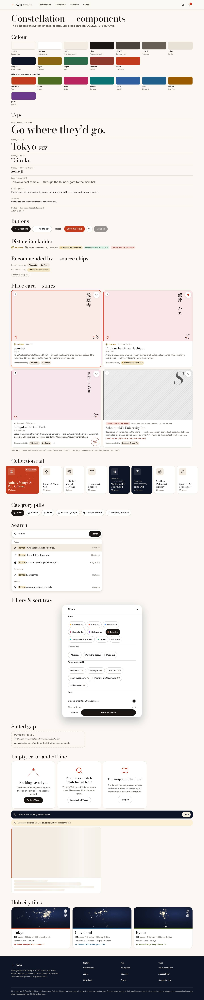

Colour, skins, type, buttons, tier ladder, source chips (incl. "Added by the guide"), card states (selected, saved,
been there, closed), collection rail, pills, search + suggestions, filter tray, stated gap, empty / no-results / tiles
failed, offline and storage banners, skeleton, hub tiles. Mobile frames: `components-m-m*.jpg`.

## Scorecard vs the research checklist (UX §1 top-10)

| # | Pattern | Live beta | Salon | Constellation mockups |
|---|---|---|---|---|
| 1 | Inventory on first screen | 3.1 screens | 0.9 | **0.73–0.79** (14 controls) |
| 2 | Collections rail as front door | chips | dropdown | **rail, ★ first, source tiles** |
| 3 | Split view / list-first + map sheet | map above list | ✔ | ✔ + offline map art |
| 4 | Distinction ladder + method | text badge | seal | **3 original glyphs → How we choose; none on closed** |
| 5 | Attribution as navigation | filter chips | chips out | **chips + source tiles + in-links** |
| 6 | Filter tray + Show N | wall | partial | ✔ tray, applied chips |
| 7 | 2 families, sentence case, 1 accent | 4–5 families | ✔ | ✔ Bodoni Moda + Figtree (+CJK) |
| 8 | Local skin per city | — | — | **8 skins** |
| 9 | Visual anchor without photos | none | none | **plates + constellations + glyphs** |
| 10 | Save / share / day plan + route | checkbox | ✔ | ✔ + been-there, closed-since-saved |
