# View styles for the city page — specification

> 2026-10-10 · view-styles design lane · Round 3 input · beta scope only.
> Study: [`STUDY.md`](STUDY.md) · Mockups: [`mockups/`](mockups/index.html) · Screenshots: [`screenshots/`](screenshots/) ·
> Build plan: [`PLAN.md`](PLAN.md). Rules: [CLAUDE.md](../../../CLAUDE.md), [BETA-PROGRAM](../../../docs/BETA-PROGRAM.md),
> [RFC §4.2, §5, §5.5, §9.1](../RFC-architecture.md), [DESIGN-SYSTEM](../DESIGN-SYSTEM.md).
> Mockups regenerate with `python3 design/beta/views/tools/make-views.py` and re-shoot with `tools/views-shots.js`.

The city page today has one layout, built around the map. Round 3 gives it **four switchable views of the same
records**: **Gallery** (image- and art-led cards), **Atlas** (map plus a ranked tray), **Guidebook** (chapters you can
print) and **Insights** (charts). The pattern comes from the owner's own site, melon-seek (its Chart · Map · Insights
switch). A view is a **lens and a layout, never a different record set**.

## 1. Non-negotiables for every view

1. **Same record set.** Every view renders, or can reach in one step, all N places of the page. The generator's count
   assert (RFC §7.1) holds unchanged, and a new **per-view reachability gate** (PLAN P-04) asserts that every
   `<page>/<id>` can be reached in every view through scroll, the pager, search, every filter, `#p=` and print.
2. **Paging is allowed only with all four of these:**
   - page navigation (previous, numbers, next);
   - an "all N places" total that is always visible;
   - a show-all control that puts every match on one page;
   - search, filters, deep links and print that run on the **full** set, never on the rendered page.
3. **Attribution, closures, gaps.**
   - "Recommended by" is on every card, row and entry in every view.
   - Closed places stay, flagged "Closed · kept for the record", and never carry a tier.
   - Stated gaps stay verbatim.
4. **No fabrication.**
   - Copy is the record's own write-up `w` and note `k`. Template prose may only combine computed numbers and record names.
   - No photos except credited ones from the imagery lane's photo path (`CREDITS.json`, TASL shown). Every other cover
     is data-drawn: area pin art plus a typographic plate.
   - No ratings, prices, hours, booking or availability. The only outbound actions are honest deep links: the venue's
     official site when a source *is* the official site, the source article, and directions.
5. **No CDN.**
   - Every view renders with no network.
   - Charts are inline SVG.
   - Map tiles are OSM or Esri only, and the map is progressive enhancement over the pin art.
   - No `document.write`. Every storage call goes through `Cleo.store` (try/catch, in-memory fallback).
6. **Naming.** The views are **Gallery, Atlas, Guidebook, Insights**. No third-party travel, hotel, review or
   guidebook brand is named or alluded to in code, class names, copy or docs. Source labels on cards come verbatim
   from the data registry, because they are attribution and not a design reference.

## 2. Shared model

All four views read one client model and one set of lenses. Nothing in this section belongs to any one view.

### 2.1 Records, order and counts

| Thing | Definition | Source |
|---|---|---|
| Record set | Every `li.pl` of the page (RFC §5.5), or `places[]` in `data/places/<page>.json` | platform |
| **Rank in area** | Open places first; then tier ascending; then the number of named sources, descending; then live order. Closed places come last. `rank` is 1…n within the area. | **new** `model.rank` (P-01) |
| View order | Area order (data), then rank. The same order everywhere: Gallery grid, Atlas tray, Guidebook chapters, the Insights index, and the sheet's previous / next. | P-01 |
| Count line | "All N places · S sights · F eat & drink · A areas · C closed, kept for the record · status checked to D". Shared component, computed (R-15). With a lens on, it reads "**n of all N places**". | P-02 |
| Kind triad | `sight` / `food` / `pop` (`pop` = a record in a `guide.popCulture.c` collection). Used by Insights and the Guidebook "Pop culture" section. A place counts once. | P-01 |

### 2.2 Lenses (filters) — one predicate set for every view

| Key | Meaning | Status |
|---|---|---|
| `mode=sights\|food` | Kind | existing |
| `c=<COLL>` / `cz=<CUISINE>` | Collection / cuisine (ids only, Wenwen rule) | existing |
| `src=<id>` | Source view | existing |
| `q=<text>` | Text lens (accent-folded, all matches) | existing |
| `a=<AREA>` | Area lens | **new** |
| `t=1\|2\|3` | Tier. Excludes closed places, because they carry no tier. | **new** (today it lives in the tray only) |
| `closed=1` | Closed places only (the "Recently closed" lens) | **new** |

- A lens sets `hidden` and never removes a node.
- "Show all N" clears every lens in one tap.
- A deep link to a hidden place makes the lenses yield (RFC §5.1).
- The tray, the quick chips, the Insights bars and the Gallery "See all" buttons all write these same keys.

### 2.3 Paging (Gallery grid only)

- Page size is 24 on phones (< 640 px) and 48 on desktop.
- Hash keys `pg=<n>` and `all=1`. Both are omitted at their defaults.
- The pager reads: "‹ 1 2 **3** … 21 ›", then "Showing 49–72 of 488 — all 488 places", then
  "Show all 488 on one page". With a lens on, it reads "Showing 1–24 of 71 (all 488 places in the guide)".
- Print, `#p=`, search and lenses ignore the page and work on the full set.
- The Atlas tray, the Guidebook and the Insights index are **not paged**. They rely on progressive area rendering
  (RFC §5.3 templates), which stamps everything before search, a lens, `#p=` or print.

### 2.4 The view switcher and the URL

| | Spec |
|---|---|
| Hash key | `view=gallery\|atlas\|guidebook\|insights`, in the existing `Cleo.route` grammar (`k=v&k=v`). It combines with every other key: `#view=atlas&a=CYD&p=kanda-myojin`. |
| Default | **Gallery**: the strongest first screen, and the round's look-and-feel goal. When the view equals the default, `view=` is left out of the hash. |
| Precedence | 1. `view=` in the hash. 2. The visitor's last view, from `Cleo.store.get('view')`. 3. The default. An unknown value falls back to the default silently and is rewritten with `replaceState`. |
| Remember | On every switch, `Cleo.store.set('view', v)` (try/catch inside `Cleo.store`; with storage blocked, the memory holds for the session). This is a preference, not state. |
| Share | Share buttons (sheet, list, page) **always write `view=` explicitly**, so a link reproduces what the sender saw, whatever the receiver's preference. |
| History | A view switch is one history entry (Back returns to the previous view). Lens changes push entries. While an overlay (tray, sheet, switcher sheet) is open, changes rewrite its entry (the melon-seek M-3 pattern). |
| `#list=`, `#day=` | Unchanged: these routes belong to the saved page and day plans, and the list codec is untouched. A `#day=` link opens Atlas (it needs the map) unless `view=` says otherwise. |
| Markup | `nav.views[data-cleo-views] [role=group][aria-label=View]` › `button[data-view][aria-pressed]` × 4. **Buttons, not hash links** (RFC §4.2 markup contract). It is rendered `hidden` and revealed by JS. With no JS the page shows the canonical list, which is the Atlas list without the map. |
| Placement | Mobile: a full-width 4-segment control under the top bar (label only below 400 px, icon + label above). Desktop: in the top bar, right of the crumb, before Saved. It is 44 px tall in both. |
| `html[data-view]` | Set before first paint by an inline 6-line script in `<head>` that reads the hash, then the store (try/catch). CSS keys on it, so there is no layout flash. |

### 2.5 Saved lists, the detail sheet and the tray across views

- **Saved.** The heart on every card, row and entry is the same `Cleo.saved.toggle(ref)`. The count badge updates in
  every view. Nothing about a view is stored with a saved ref.
- **Detail sheet.** One sheet (FE-A `sheet.js`) for all views, opened by `#p=`. Two additions:
  - **"n of N in this view"** with previous / next, in the current view order over the lensed set (from melon-seek);
  - **"Where it sits"**: "No. 3 of 43 in Chiyoda-ku".

  In **Gallery**, the sheet's full detent (mobile) or the desktop layout is the **experience page** (§3.1). In the other
  views it keeps today's layout. Close and Back always return to the same scroll position in the same view.
- **Tray.** The same filter tray (FE-A `tray.js`) in every view, with "Show n places". Insights shows the lensed numbers.
- **Day plans.** "Add to day" lives in the sheet. A day plan opens in Atlas.

## 3. The views

### 3.1 Gallery — image- and art-led cards

| Mobile | Desktop |
|---|---|
| 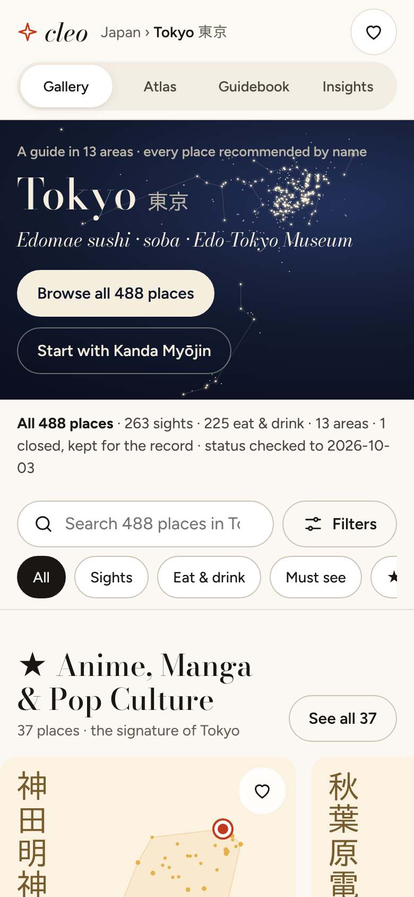 | 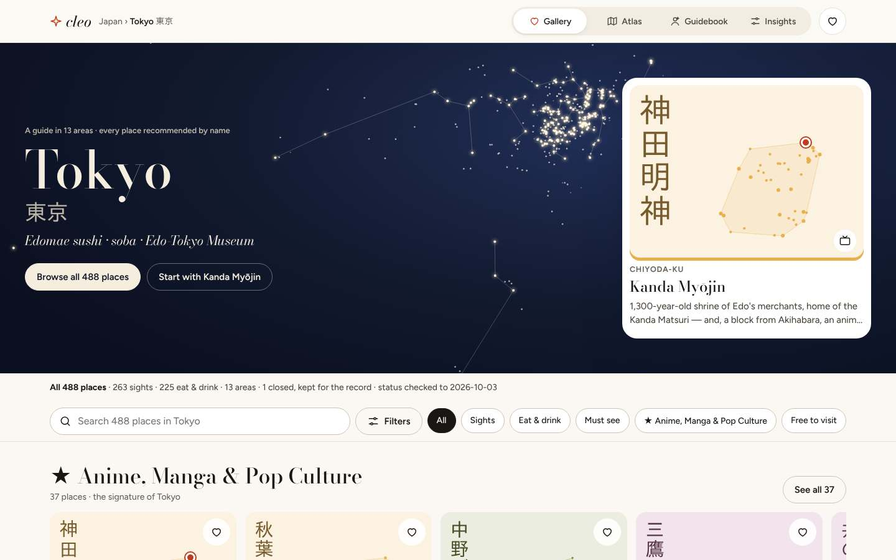 |
| 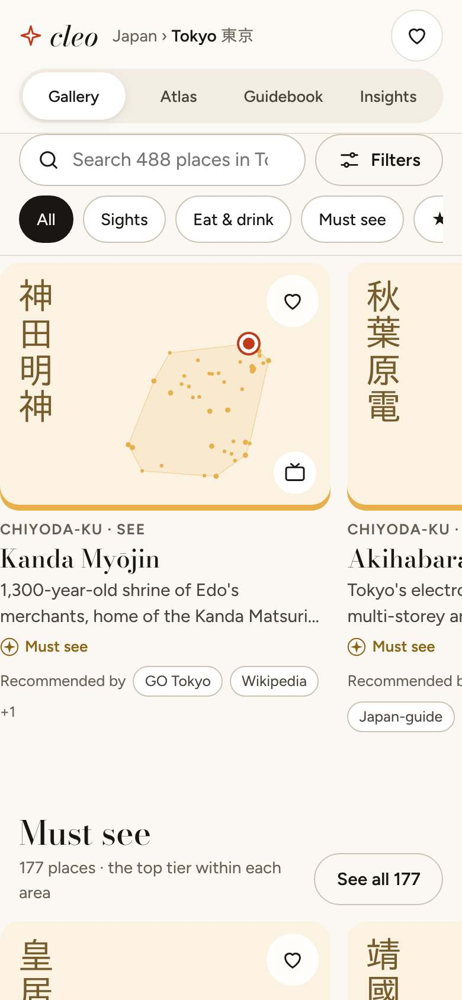 | 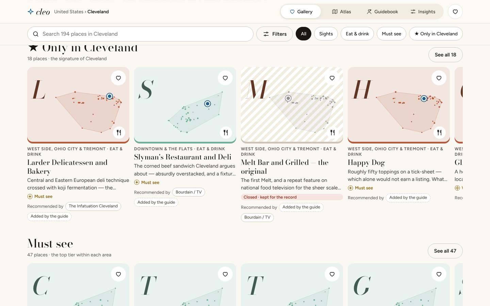 |
| 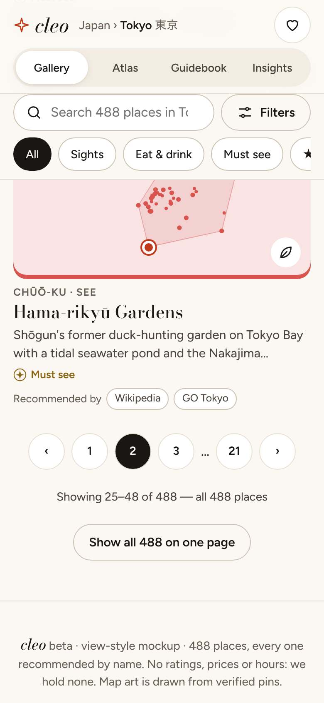 | 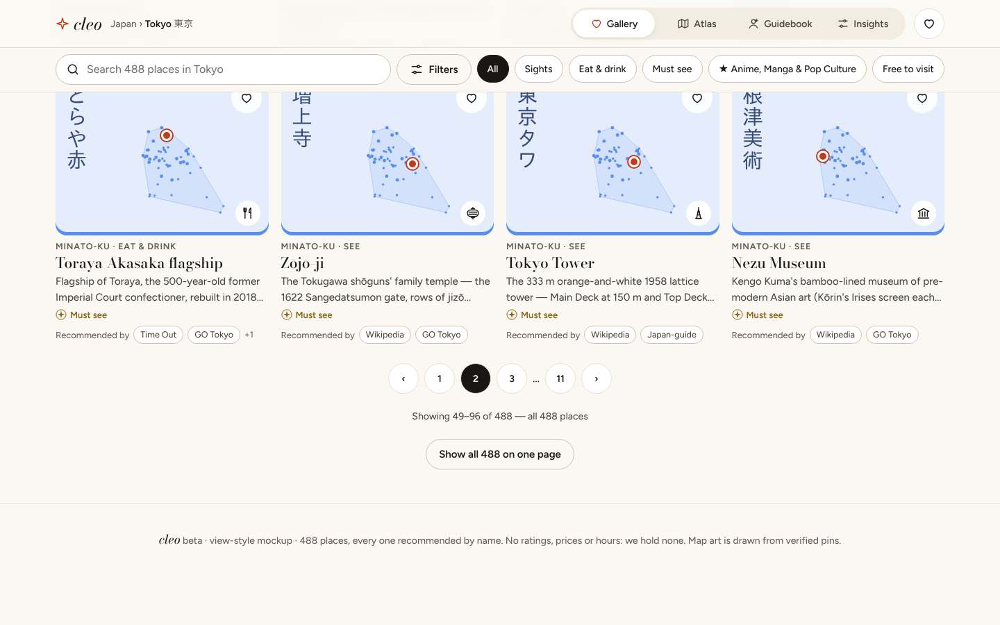 |

**First screen.**
- A night-sky hero built from the city's verified pins (the existing constellation art). Over it:
  - a kicker ("A guide in 13 areas · every place recommended by name");
  - the city name in Didone, with its native name;
  - `guide.tileLine.text` as an italic lead;
  - two actions: **Browse all N places** (to the grid) and **Start with {lead}**. The lead is the first open
    tier-1 record of the ★ signature, else the first must-see.
- On desktop a lead card floats right. On a phone the lead card is dropped, so the first rail starts at about 0.9
  screens; the toolbar and quick lenses sit right under the hero.

**Category rows** (scroll sideways, snap per card, about 1.25 cards visible on a phone, 4.5 on desktop). In this order:
1. ★ signature (`guide.signature`);
2. Must see (open, tier 1);
3. the food canon (`guide.canon`, with its `dishes` as the subtitle) when it differs from the signature;
4. up to 3 largest collections;
5. Recently closed (`guide.closed`, newest check first).

Each row has a Didone title, a computed subtitle ("37 places · the signature of Tokyo") and **See all n**, which applies
the lens to the grid. A rail shows up to 12 cards. Rails are client-stamped from `<template>`, so there are no duplicate
server nodes (DOM budget).

**All N places grid.** 1 / 2 / 4 columns. It is the canonical card list (`li.pl`, restyled), paged per §2.3.

**Card.**
- **Cover**, 4:3:
  - area tint at 15 %, with a 5 px area-colour edge;
  - the area's pin art (`assets/art/<page>/<AREA>.svg`, one cached file per area), with **this place ringed in the
    city accent**;
  - the native script set vertically (at most 4 glyphs, never clipped) or a Didone initial;
  - the collection glyph.
- Then eyebrow (area · See / Eat & drink), name (Didone), 2-line write-up, tier glyph, Recommended by (2 + "+n"), heart.
- When the imagery lane's photo path has a credited file for the record, the photo replaces the tint and pin art; the
  plate stays and the credit sits on the cover.
- Closed: hatched grey cover, no tier, "Closed · kept for the record".

**Experience page** (detail). 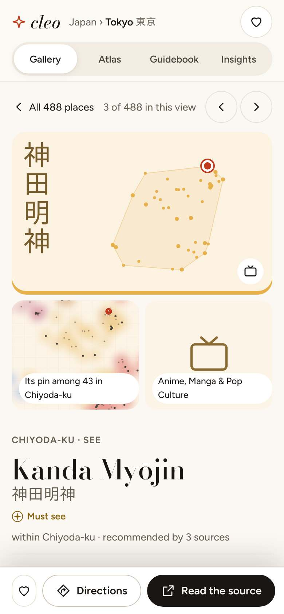 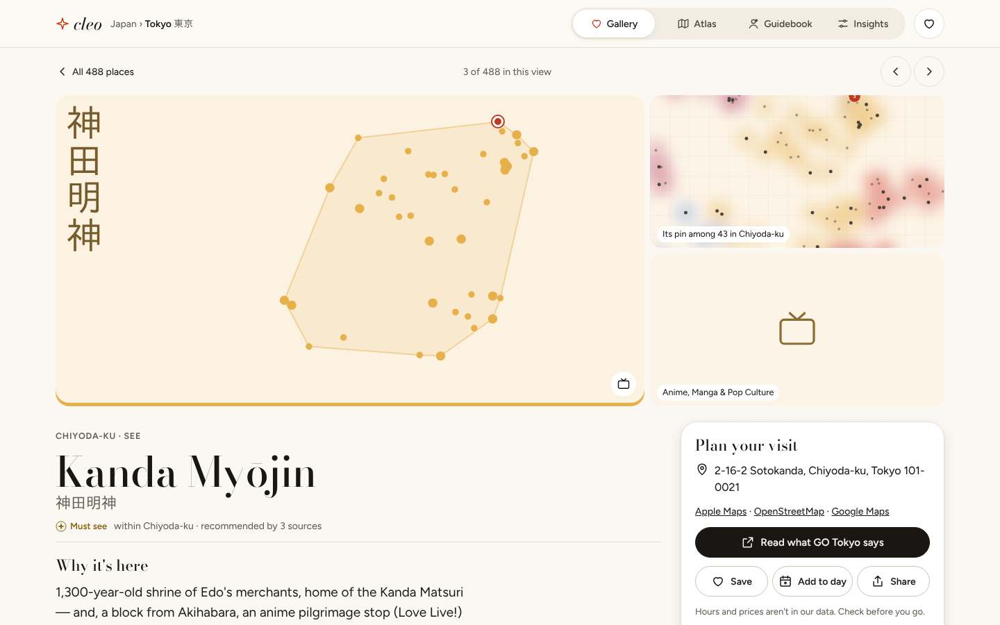
- **Nav row**: "‹ All N places" · "n of N in this view" · previous / next.
- **Art mosaic**:
  - the large cover;
  - the map art of the area with this pin selected ("Its pin among 43 in Chiyoda-ku");
  - the collection glyph tile.
- **Main column**:
  - eyebrow, name, native name;
  - tier + "within {area} · recommended by n sources";
  - **Why it's here** (`w`);
  - **Look for** (`k`, on the accent wash);
  - **Recommended by**, as host-style credentials: a monogram, the source name, and "All n {city} picks citing it →"
    (the source view);
  - **Part of** (collection and cuisine pills that apply lenses);
  - **Close by** (4 nearest open places, straight-line km).
- **"Plan your visit" panel** (sticky on desktop; a bottom bar on a phone):
  - address;
  - Directions (Apple Maps · OpenStreetMap · Google Maps);
  - **one** primary deep link: "Visit the official site" only when one of the record's sources is the official site,
    otherwise "Read what {source} says";
  - Save · Add to day · Share;
  - "Hours and prices aren't in our data. Check before you go.";
  - status with its date, pin confidence with its date, "No. 3 of 43 in {area}".
- It reads like an experience page, but **nothing on it can be bought, booked or priced**.

**Voice.** "Warm host" comes only from layout and labels ("Why it's here", "Plan your visit", "Look for"). The words in
the body are always the record's `w` and `k`, verbatim. Never "we loved", never invented praise.

### 3.2 Atlas — the map, with a ranked tray

| Mobile (half detent) | Mobile (full detent) | Desktop split |
|---|---|---|
| 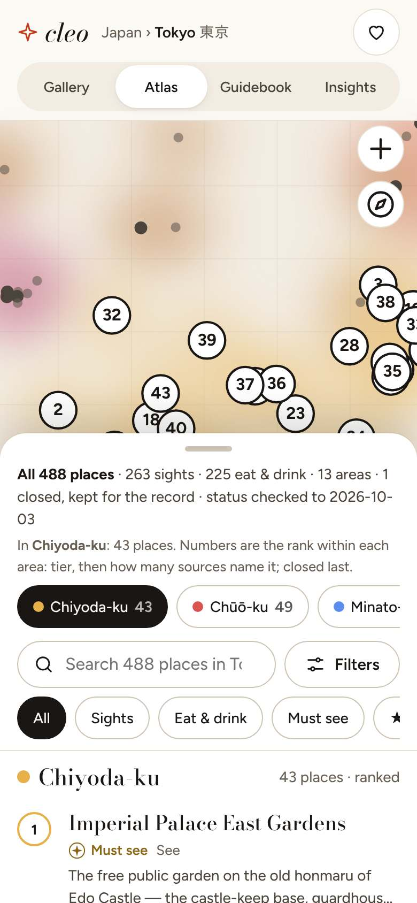 | 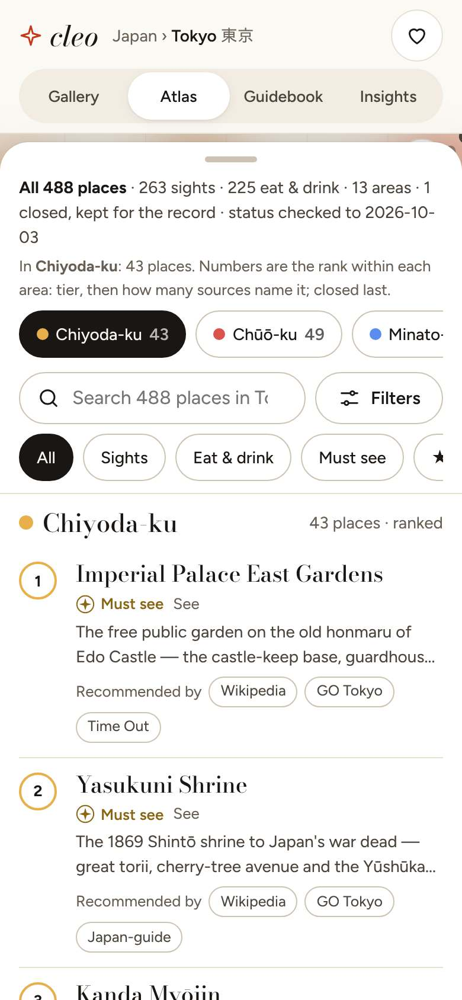 | 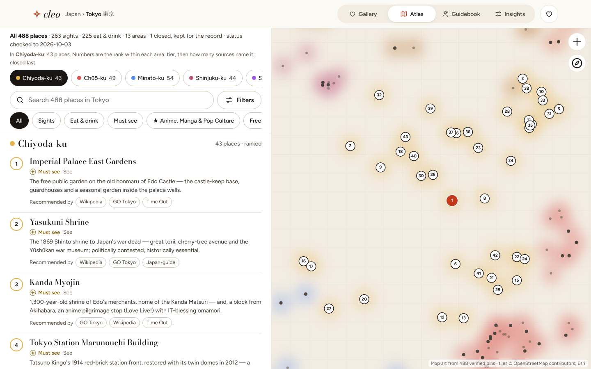 |

- **Mobile.** A full-bleed map under the top bar, with a **bottom tray** in three detents:
  - peek, 150 px: the count line;
  - half, 52 vh: the default;
  - full: down to the top bar.

  A grab handle and a swipe move between detents; the button cycles them for keyboard users. Esc and Back go down one
  detent.
- **Desktop.** A split view: the tray is a left panel at 46 %, the map is sticky at **54 % (≥ 40 %, ROUND-1 gap #6)**.
- **Tray head:**
  - the shared count line;
  - "In {area}: n places. Numbers are the rank within each area: tier, then how many sources name it; closed last.";
  - area chips (colour dot, name, count; the focused area is pressed);
  - search + Filters;
  - quick lens chips: All · Sights · Eat & drink · Must see · ★ signature · Free to visit.
- **Rows**, grouped by area under sticky area heads, every row in rank order:
  - a **rank badge** (area-colour ring) that **matches the numbered pin**;
  - name, tier glyph, kind, "No verified pin" when the pin is low confidence;
  - a 2-line write-up;
  - **Recommended by** chips (3 + "+n") as the social proof;
  - a closed flag.
- **Map:**
  - pin art from verified pins first, with tiles as enhancement;
  - numbered pins for the focused area at every zoom; other areas as dim dots;
  - the selected pin in the accent.

  Scrolling the tray to an area head fits the map to that area. Tapping a pin scrolls the tray to its row and
  highlights it. Tapping a row opens the sheet and flies to the pin.
- **Unpinned places** (Okinawa `low` pins, R-17) are **listed, never dropped**, with a floating map badge
  "n without a verified pin · listed below" (melon-seek's "Remote" badge pattern).
- The Atlas is today's FE-A city page, re-laid out. It keeps every existing behaviour: the `#map=1` mobile map toggle
  becomes the half/full detent, and peek ≤ 40 % (gap #6) stays.

### 3.3 Guidebook — chapters you can read and print

| Mobile | Desktop | Print |
|---|---|---|
| 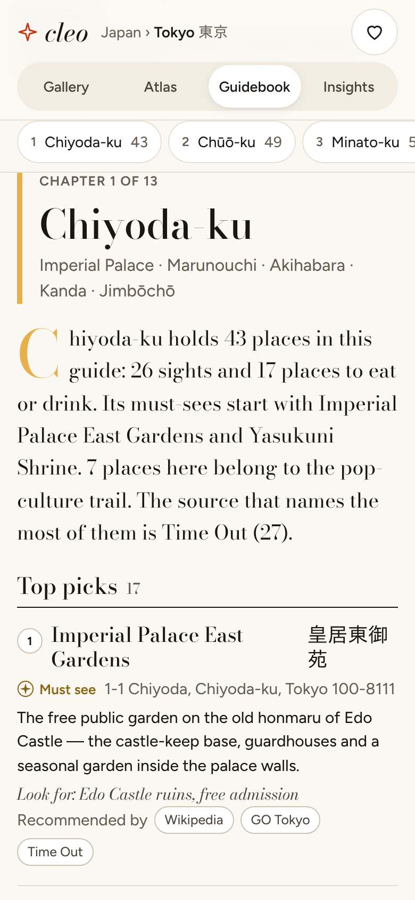 | 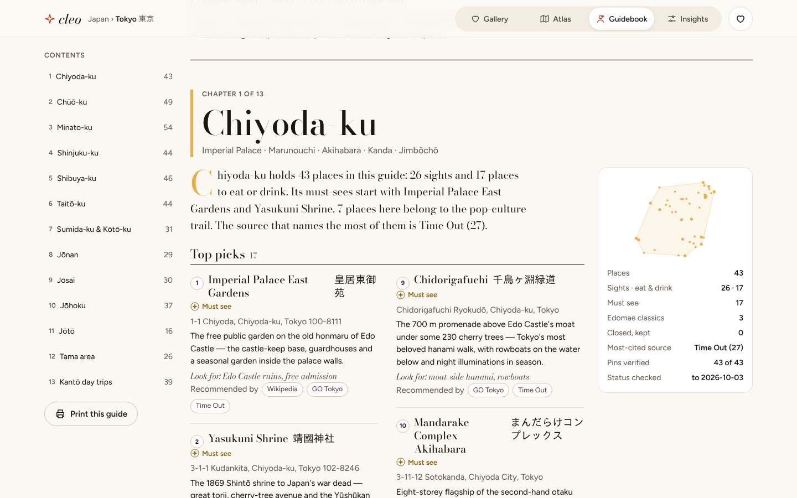 | 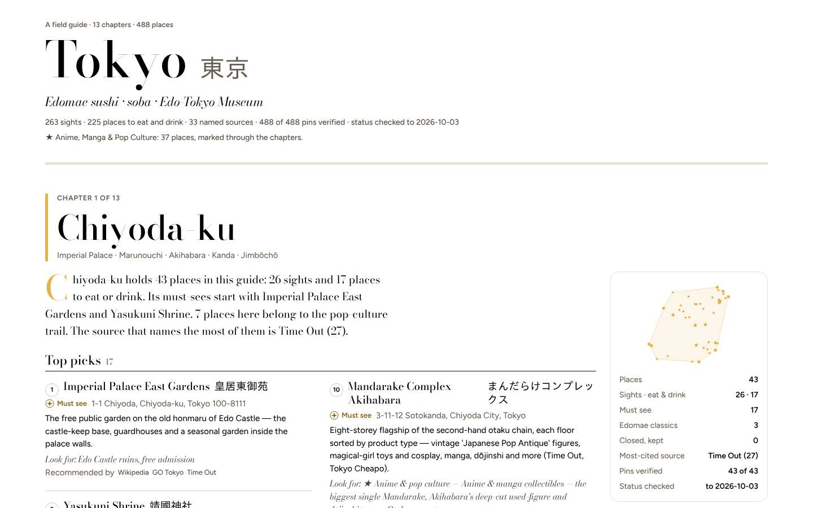 |

- **Cover:**
  - "A field guide · 13 chapters · 488 places";
  - the city name at hero size, with its native name;
  - the tile line;
  - a computed facts line (sights, places to eat, named sources, verified pins, status date);
  - the ★ signature line.
- **Contents.** Mobile: a sticky chip bar of chapters. Desktop: a sticky left column with counts and a **Print this
  guide** button.
- **A chapter per area:**
  - "Chapter n of A", the area name, and its neighbourhoods line from the data;
  - **intro prose built only from data**, with a drop cap in the area colour. It is a fixed template filled with
    counts, the first two must-see names, the pop-culture count, the most-citing source and the closed count. Example
    (Tokyo · Chiyoda-ku, computed): "Chiyoda-ku holds 43 places in this guide: 26 sights and 17 places to eat or
    drink. Its must-sees start with Imperial Palace East Gardens and Yasukuni Shrine. 7 places here belong to the
    pop-culture trail. The source that names the most of them is …";
  - sections in order:
    1. **Top picks** (open tier 1);
    2. **See** (other sights);
    3. **Eat** (other food);
    4. **Pop culture** (pop-collection places not already a top pick);
    5. **Kept for the record** (closed).

    Every place appears **exactly once** (the generator asserts it).
  - Each entry: rank, name (+ native), tier, address, `w`, "Look for: `k`", Recommended by.
- **Sidebar facts** (sticky on desktop ≥ 1200 px, inline above the sections otherwise):
  - the area's pin art;
  - places, sights · eat & drink, must-sees, canon places, closed;
  - the most-cited source (n), pins verified (n of N), status checked to {date}.
- **Print** (`@media print`):
  - chrome, switcher, tray and hearts hidden;
  - one chapter per page (`break-before: page`), two-column entries, `break-inside: avoid`;
  - source chips print as plain text;
  - a final page lists every source with its URL and the method note (B-03).

  Print stamps every template first (RFC §5.3).

### 3.4 Insights — the guide in numbers

| Mobile | Desktop |
|---|---|
| 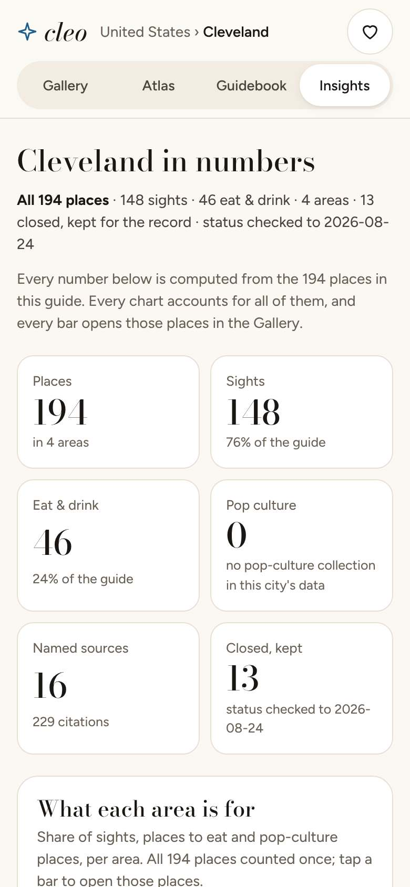 | 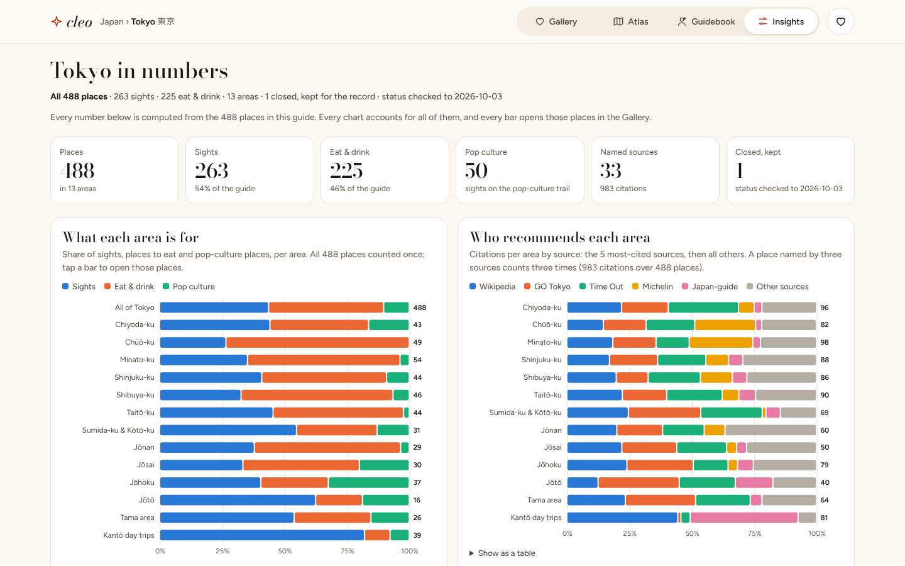 |
| 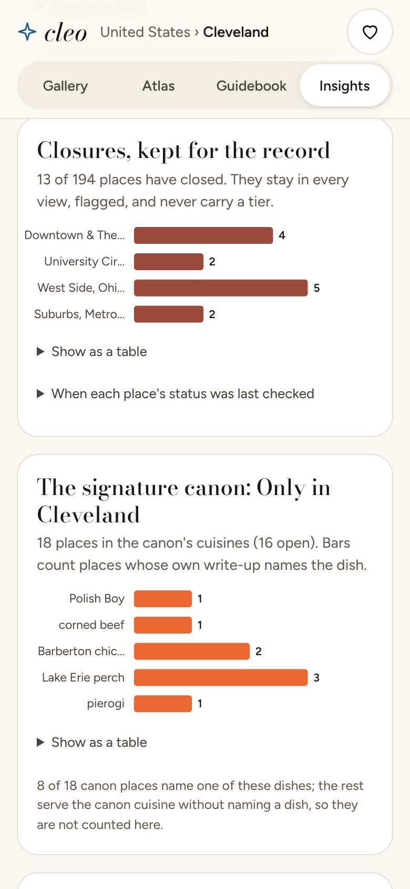 | 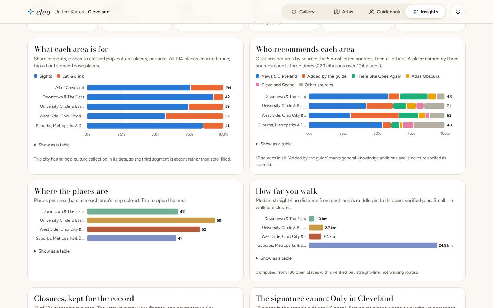 |

- **Header:** "{City} in numbers", the count line, and "Every number below is computed from the N places in this guide.
  Every chart accounts for all of them, and every bar opens those places in the Gallery."
- **Stat tiles** (2 columns on a phone, 6 on desktop): Places · Sights · Eat & drink · Pop culture · Named sources
  (+ citations) · Closed, kept (+ status date). A city with no pop-culture data says so in its tile.
- **Charts** (1 column on a phone, 2 on desktop). Each is a card with a Didone title and a one-line caption naming the
  measure and its denominator:

| Chart | Form | Data | Tap → |
|---|---|---|---|
| **What each area is for** | 100 % stacked bars, a "whole city" row first | kind triad per area | Gallery `a=` + `mode=` / `c=` |
| **Who recommends each area** | 100 % stacked bars | citations: the 5 most-cited sources + "Other sources" | Gallery `a=` + `src=` |
| **Where the places are** | bars, area colours | places per area | Gallery `a=` |
| **How far you walk** | bars | median straight-line km from each area's middle pin (open, verified pins) | Atlas `a=` |
| **Closures, kept for the record** | bars + a status-check table by month | closed per area | Gallery `a=` + `closed=1` |
| **The signature canon** | bars | `guide.canon.dishes` (places whose own write-up names the dish) | Gallery `cz=` |
| **The tier ladder per area** | stacked bars | open places by tier | Gallery `a=` + `t=` |

- **Chart rules** (from the dataviz method, validated):
  - one axis per chart, never two;
  - a categorical palette in fixed order: blue, orange, aqua, yellow, magenta, violet, plus a neutral "Other". The light
    and dark sets were both validated: all checks PASS. The contrast WARN on the light surface is answered with a
    legend, value labels and a table;
  - a 2 px gap between stacked segments; 4 px rounded ends;
  - values at the bar ends;
  - a `<title>` tooltip on every mark;
  - **"Show as a table"** under every chart;
  - every bar is a link to the lens;
  - **every chart footnotes what it does not count** (closed places carry no tier; canon places without a named dish;
    "absent rather than zero-filled");
  - two renders per chart (a 640-wide and a 360-wide viewBox), so chart text stays ≥ 12 px at 390 px;
  - dark mode uses the dark set, never an automatic flip;
  - area colours appear only where the chart's identity is the area (density, spread).
- **All N places index** at the end: by area in rank order, each name linking to its entry, closed places flagged. This
  keeps every place reachable in Insights.
- Insights reads `data/places/<page>.json` (`stats`, `sourceIndex`, `guide`). The **numbers are precomputed at build
  time** into a new `insights` block (P-03), so the client only draws them.

## 4. Mobile and desktop at a glance

| View | Phone (390) | Desktop (1440) |
|---|---|---|
| Gallery | Hero ≈ 0.75 screen → rails (≈ 1.25 cards) → 1-col grid, 24/page; detail = full-screen sheet + bottom action bar | Hero with lead card → rails (4.5 cards) → 4-col grid, 48/page; detail = page layout with sticky Plan panel |
| Atlas | Full map + tray (peek / half / full) | 46 % ranked list ‖ 54 % sticky map |
| Guidebook | Chip contents bar, single column, facts box inline | Contents column ‖ chapter ‖ sticky facts box; print layout |
| Insights | 2-col tiles, 1-col charts (360 viewBox), table toggles | 6 tiles, 2-col charts (640 viewBox) |

## 5. Accessibility and performance

- The switcher is a `role=group` of `aria-pressed` buttons. A switch moves focus to the view's `h1`/`h2` and announces
  "Gallery view, 488 places" via the existing live region.
- Every target is ≥ 44 px (source chips use the 44 px pseudo hit area). AA contrast holds in light and dark
  (`contrast.py` gains the chart tokens).
- `prefers-reduced-motion`: detent and view transitions are instant.
- DOM budget (M3-06, ≤ 3,000 initial nodes):
  - one canonical card set, with the other views' extras (rails, chapter intros, charts) client-stamped from templates
    or the page JSON;
  - the mockups render every card server-side to prove reachability, which is why they are heavy (Tokyo Gallery about
    0.96 MB). The shipped page must not do that.
- The view switch never refetches. Insights loads its JSON lazily, and the area art SVGs are shared and cached by the
  service worker.

## 6. Mockup provenance

`tools/make-views.py` reads `beta/data/places/{tokyo,cleveland}.json` read-only, asserts the record count per view
(Gallery grid, Atlas rows, Guidebook entries, Insights index: 488 / 194 each), and writes static HTML. Screenshots come
from `tools/views-shots.js` with every off-origin request aborted. The covers use the platform's pin art. No photo,
rating, price, hours or quote appears. The mockups' view links are plain file links, because they are separate static
files. The shipped switcher is buttons over one page (§2.4).
