# View styles — study of melon-seek

> 2026-10-10 · view-styles design lane · beta scope only (`design/beta/views/**`).
> Subject: the owner's own site melon-seek, snapshot at [`design/reference/melon-seek/`](../../reference/melon-seek/SNAPSHOT.md)
> (commit `15ed02b`). Read with its offline mock data layer (`?mock=1`, localhost only; the UI labels it "Mock data").
> Screenshots: [`study/`](study/) at 390×844 (DPR 2, touch) and 1440×900. Reproduce with
> [`tools/study-shots.js`](tools/study-shots.js). The URL hash of every scene is recorded in [`study/hashes.json`](study/hashes.json).

melon-seek plots a company's whole job board as listings: every posting is a record with a salary range, a team,
places and skills. It shows the **same record set** three ways — **Chart**, **Map** and **Insights** — with one shared
filter model, one shared results list and one shared detail drawer. That is exactly the shape the owner wants for the
city page: our records are places with an area, a kind, a tier, sources and a pin.

Sandbox notes: the snapshot leaves out its `vendor/leaflet/` copy, so the shot script serves Leaflet from
`tools/node_modules/leaflet`. Tile hosts are blocked here, so the map ground is a flat stub: **the empty map ground is a
sandbox artefact**, not a design choice. The pins, controls and attribution line are real.

## 1. The view switcher

| Desktop | Mobile |
|---|---|
| 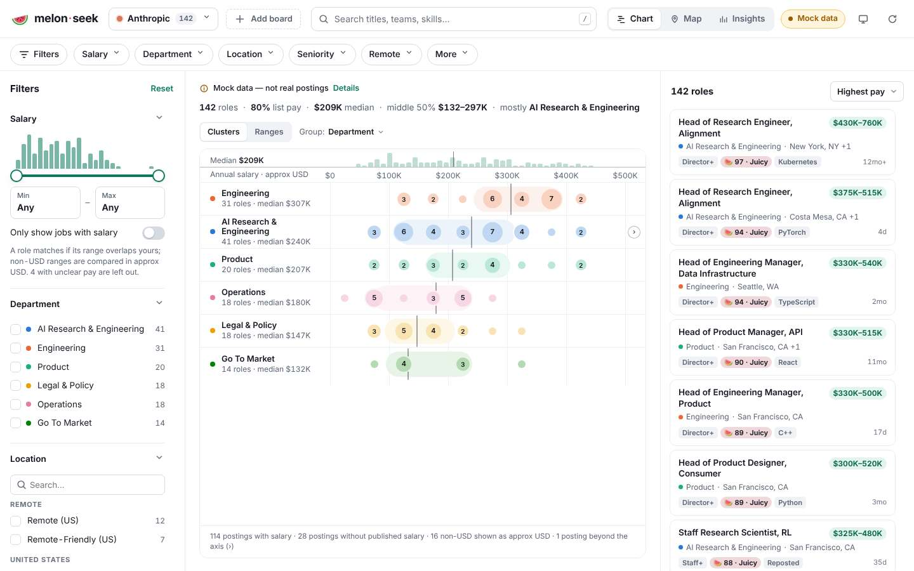 | 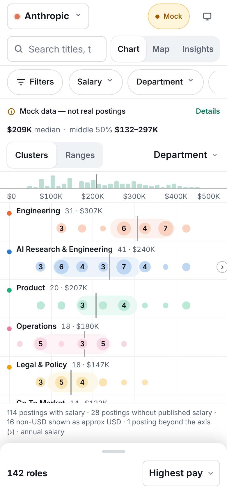 |

- **A three-way segmented control** (`.seg[role=group][aria-label=View]`, `button[data-mode][aria-pressed]`) sits in the
  top bar, right next to search: *Chart · Map · Insights*, each with a 20 px line icon and a word. It is always visible;
  on a phone it moves to the second row beside search and keeps the words.
- **The view is a lens, not a page.** Switching view never reloads data, never resets filters and never closes the
  results list. Only the centre pane changes (`#chartHost`, `#mapHost`, `#insightsHost`); the left filter rail and the
  right results list stay put.
- **A sub-switch lives inside a view** (Chart: *Clusters · Ranges* and *Group: Department / Location / Seniority /
  None*). It only appears in the view it belongs to, so the top switcher stays three items.
- **One summary line above every view** ("142 roles · 80 % list pay · $209K median · …") is computed from the
  filtered set. It is the same in every view, so a visitor never loses the count.
- **Honesty banner.** When the data is synthetic, a banner says so above every view ("Mock data — not real postings ·
  Details"). We need the same reflex for stated gaps and closures.

**Take:** a 4-way segmented control in the toolbar, always labelled; the view changes the centre pane only; one computed
count line shared by all views.

## 2. URL-hash state: every view is shareable

| Filtered + shared | Chart sub-view in the hash |
|---|---|
| 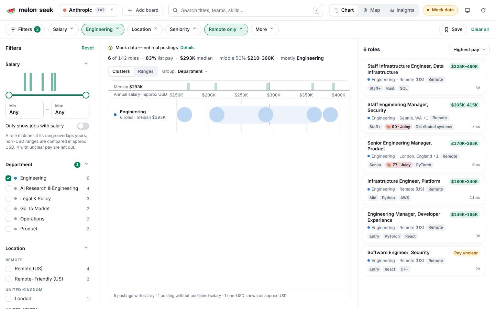 | 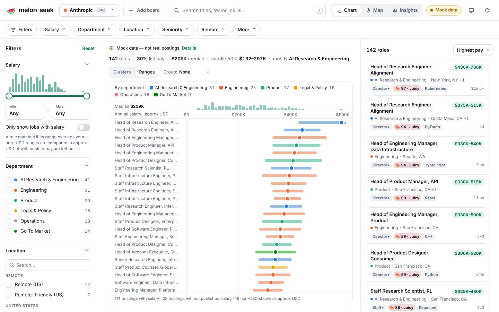 |

- **All state lives in `location.hash`** as `URLSearchParams`: board `c`, view `m=chart|map|insights`, chart sub-view
  `v`, group `g`, query `q`, salary `smin/smax`, multi-value filters as repeated keys (`d=Engineering&d=Product`),
  sort, map colouring `mc`, and the open record `job`. Recorded examples (study/hashes.json):
  `#c=…&m=map`, `#c=…&m=insights`, `#c=…&d=Engineering&r=remote`, `#c=…&job=…`.
- **Defaults are omitted** from the hash (`serialize()` skips any value equal to its default), so the plain URL is the
  default view and links stay short.
- **A fixed key order** (`ORDER`) makes the same state always produce the same string, so links compare and cache.
- **Unknown or stale values fall back silently** (`parseHash` validates every enum and resets it to the default), so an
  old link never breaks the page.
- **History is used carefully.** A filter change pushes one entry. While a phone overlay (filter sheet, menus) is open it
  owns one history entry: Back closes the overlay instead of undoing a filter, and the changes made inside it land as
  one entry when it closes.
- **What is *not* in the hash is stated in code**: a transient map area selection ("not shareable, so not in hash").
- **Preferences are not state.** Theme and "filters collapsed" go to `localStorage` (in try/catch); the view does not.
  The view is in the hash so a link reproduces it.

**Take:** our `Cleo.route` grammar (`k=v&k=v`) already matches this. Add one key, `view=`, omit it when it equals the
default, validate it on parse, and keep the open place (`p=`) and filters (`c=`, `cz=`, `mode=`, `q=`, `src=`) orthogonal
to it. Remember the last view as a *preference* (`Cleo.store`) that only applies when the hash names no view.

## 3. Map vs chart vs insights

| Map | Insights (headline) | Insights (charts) |
|---|---|---|
| 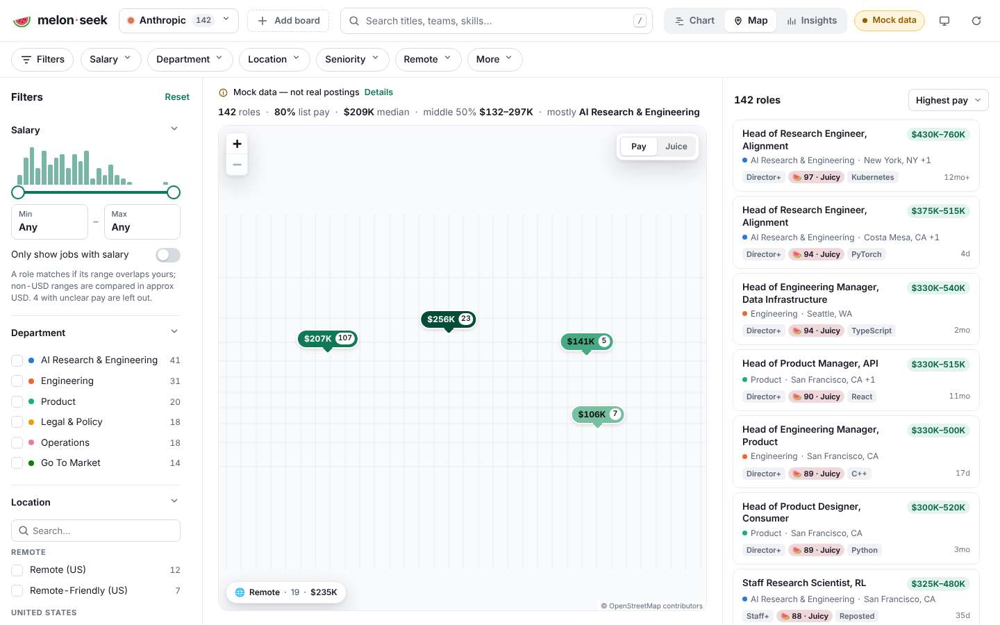 | 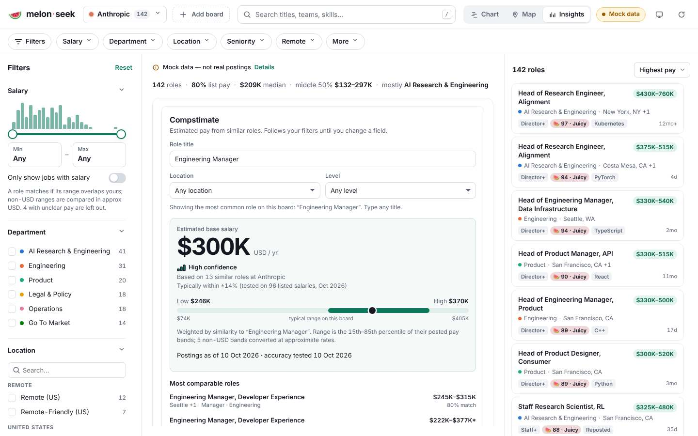 | 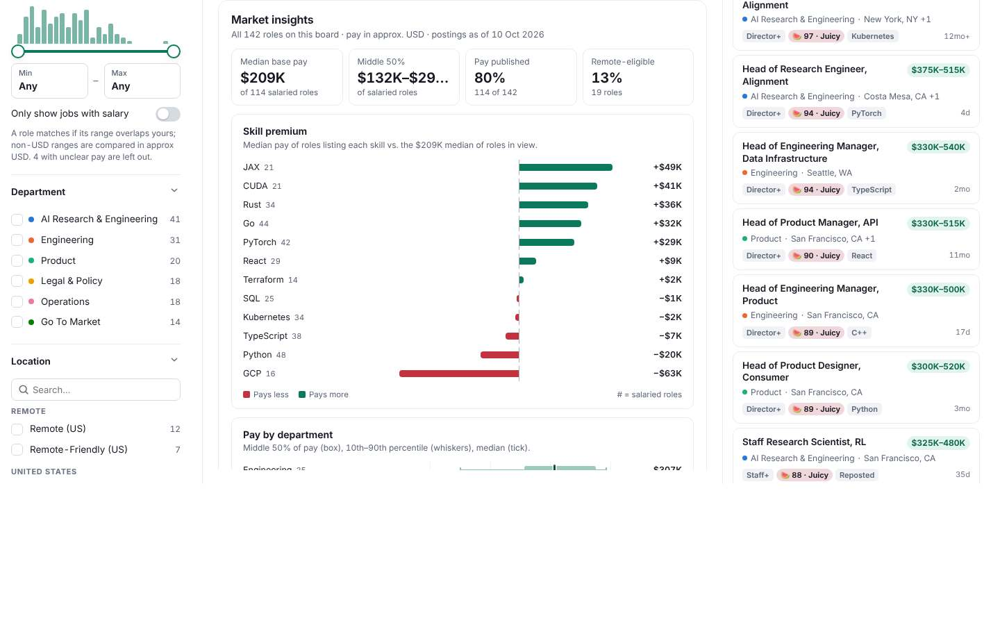 |

- **Chart** is the default and the densest view: one row per group, each record a dot on a shared axis, dots merged into
  numbered clusters, a median tick per row, a distribution strip above the axis, and a footnote that accounts for every
  record the axis cannot place ("28 postings without published salary · 1 posting beyond the axis"). **Nothing is
  silently dropped from a chart; the footnote counts it.**
- **Map** clusters records into label pins ("$207K · 107": a value plus a count), never overlapping at the current zoom,
  with records that have no place gathered in a separate floating badge ("Remote · 19") instead of being dropped. A
  small *Pay | Juice* toggle recolours pins. The tile credit is shown.
- **Insights** turns the filtered set into cards: four headline stat tiles (median, middle 50 %, share with pay, share
  remote), then diverging bar charts ("Skill premium": positive and negative bars from a shared zero line), box plots per
  group, hot locations and common responsibilities. Every card has a one-line subtitle that says what it measures and
  over which records ("All 142 roles on this board · pay in approx. USD · postings as of 10 Oct 2026").
- **Charts are filters.** Insight bars and chart rows call `onFilter`: tapping "Engineering" applies that filter and
  every view follows. Charts are a way in, not a dead end.
- **Charts are hand-built SVG** (`viz/chart.js`, `features/insights.js`) with no chart library and no CDN. Colour is
  per group from one palette module (`viz/palette.js`) shared by chart, map and cards, so the same team is the same
  colour everywhere.

**Take:** our Insights view gets the same anatomy: stat tiles → captioned SVG charts → each bar is a button that applies
the matching lens. Our area colours (`colors` in the page data) are the shared palette. A "beyond the axis" style footnote
becomes our rule that every chart accounts for 100 % of the records (closed ones and unpinned ones are counted, not
hidden).

## 4. Filters

| Desktop rail + quick chips | Mobile filter sheet |
|---|---|
| 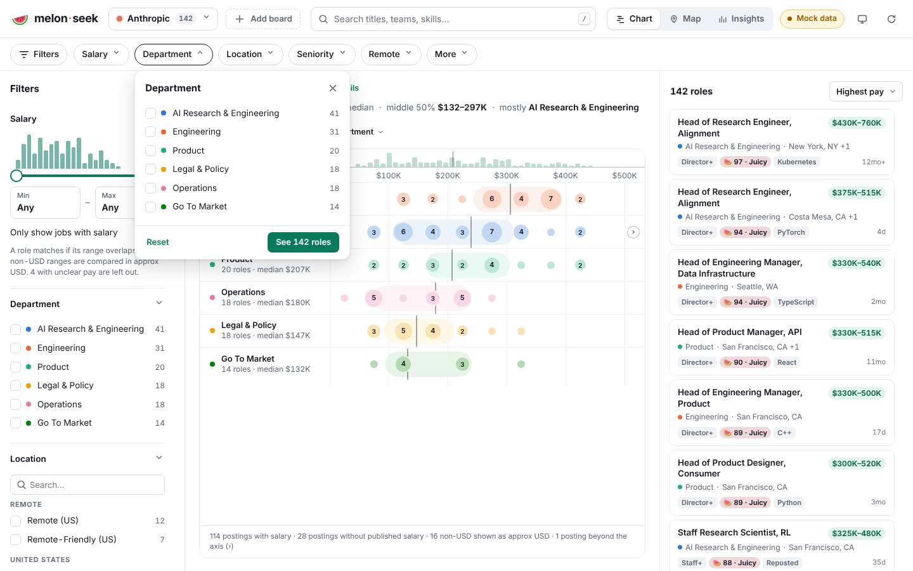 | 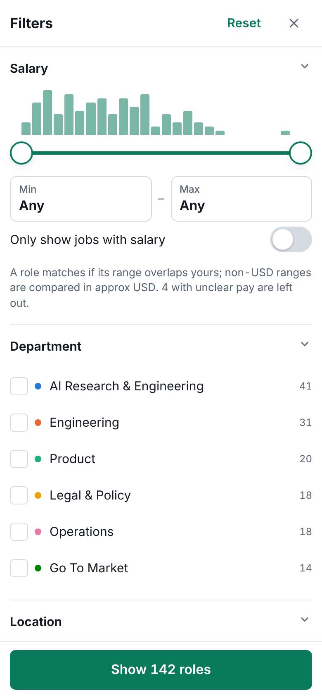 |

- **Two tiers.** A row of quick chips (*Filters · Salary · Department · Location · Seniority · Remote · More*) opens a
  popover per facet; the full rail (desktop) or bottom sheet (mobile) holds every facet. Both write the same state.
- **Counts on every option** ("AI Research & Engineering 41"), computed from the current set.
- **A distribution strip on the range facet** (a histogram behind the salary slider) shows where the records are
  before you filter.
- **A live result button** in the mobile sheet ("Show 142 roles") and *Reset* / *Clear all* everywhere.
- **The filter count badge** on the Filters chip shows how many facets are active.

**Take:** we already have the tray with "Show N places" and applied chips. Views must share it unchanged; the only new
pieces are quick-facet chips above the Atlas tray and the Insights charts acting as filters.

## 5. How the detail opens

| Desktop drawer | Mobile full-screen |
|---|---|
| 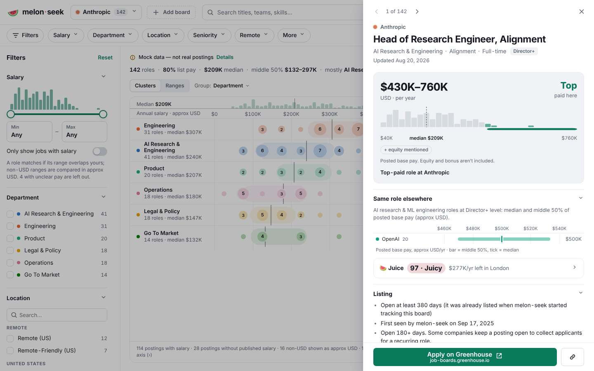 | 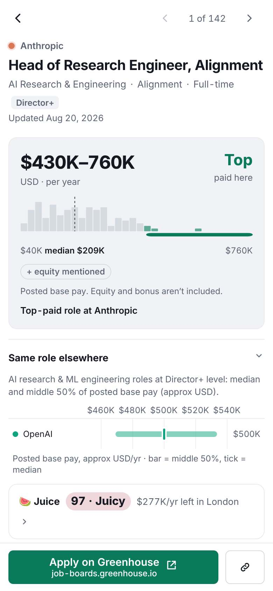 |

- **A right-hand drawer on desktop** (`role=dialog`, `aria-modal`), over a dimmed view that stays visible; **full screen
  on a phone**, with a back chevron in place of ✕.
- **"1 of 142" with previous / next** inside the drawer: the visitor walks the filtered set without closing it. The
  order is the current sort.
- **The record is in the hash** (`job=`), so the drawer is a permalink, and Back closes it.
- **One honest primary action** at the bottom: a deep link to the record's own page, with its domain printed under the
  label, plus a copy-link button. No action is pretended.
- **Context inside the detail**: where this record sits in the whole set (a histogram with this record's range marked;
  "Top-paid role here").

**Take:** our sheet already has the permalink, Back and the honest deep links. Add **"n of N in this view" with
previous / next** in the current view's order, and a **"where it sits"** line (rank within its area, the area's place
count) — both computed.

## 6. Density and pagination

| Desktop: results page end | Mobile: results sheet |
|---|---|
| 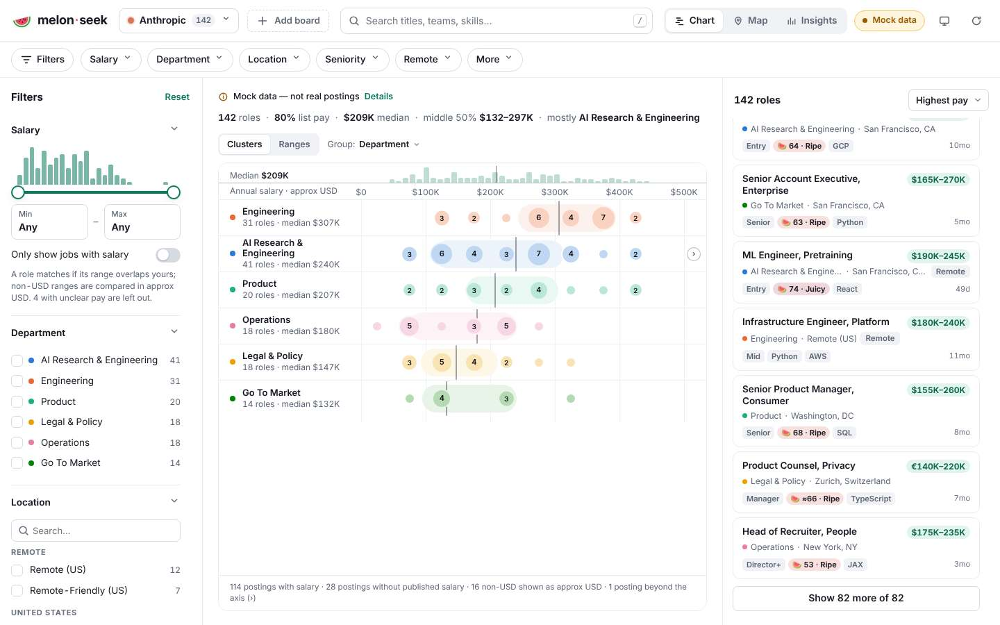 | 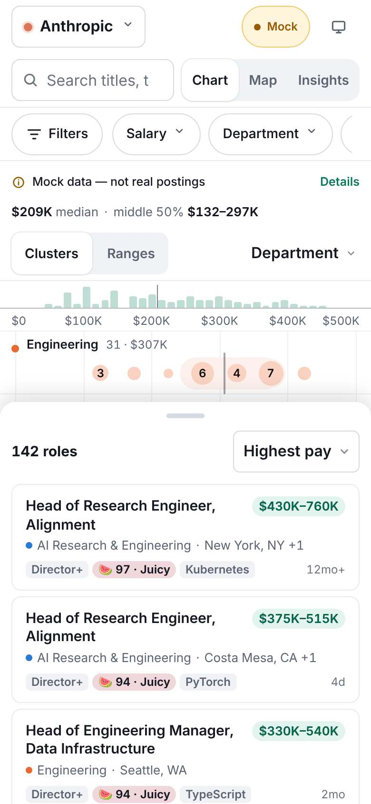 |

- **Pages of 60 (desktop) or 24 (phone)** (`PAGE`). The end of the list is a full-width button
  "Show 120 more of 82" that appends in place, without rebuilding the list or losing scroll position.
- **On a phone the next page loads as the end nears** (an IntersectionObserver appends four cards per frame), so
  scrolling never stalls; the button stays as the fallback.
- **The total is always in the list head** ("142 roles") and in the summary line; paging never hides how many records
  match.
- **Search and filters always run on the full set**, never on the rendered page.
- **The phone results list is a bottom sheet** with a grab handle over the chart or map, collapsed to its head
  ("142 roles · Highest pay"), so the view and the list share one screen.
- Cards are dense: title, value pill, team dot + place, three small tags, age. About 6–7 per desktop screen.

**What we must do differently.** melon-seek's paging has no "show all" and no page numbers. Our rule (BETA-PROGRAM
non-negotiable 1) is stricter: a view that pages must show **page navigation, an "all N places" total and a show-all
control**, and search, filters, deep links and print must reach every record. See [`SPEC.md` §2](SPEC.md#2-shared-model).

## 7. What we take, what we leave

| melon-seek pattern | Take | Leave / change |
|---|---|---|
| Segmented view switcher in the top bar | Yes: *Gallery · Atlas · Guidebook · Insights* | — |
| All state in the hash, defaults omitted, enums validated | Yes: one new key `view=` in the `Cleo.route` grammar | — |
| View is a lens over one record set and one filter model | Yes | — |
| One computed summary line for every view | Yes | — |
| Clustered value pins | Numbered pins in the Atlas | No price labels: we hold no prices |
| Records without a place collected in a badge | Yes: "N without a verified pin" badge | — |
| Charts as filters | Yes | — |
| Every chart accounts for all records (footnote) | Yes, as a rule | — |
| Drawer with n of N and prev / next | Yes | — |
| Pages of 24 / 60 with "show more" | Pages, plus page numbers, "all N" and show-all | No silent caps |
| Value-led ranking ("Highest pay", score badges) | No | We rank by tier and named sources only |
| Synthetic demo data path | No | We never show invented data |
