# What world-class travel UX looks like in 2026, and how far Cleo is from it

> **Status: research for the owner. Nothing here ships.** Everything lives under
> `design/research-2026-10/ux-competitive/`. No live page, engine, builder, dataset or registry was touched.
>
> **Method and limits.** This document draws on about 45 products in four groups. Competitor evidence came from
> about 130 `WebSearch` queries run on 2026-10-10. WebFetch and direct page loads are blocked by the org egress
> policy, so every competitor claim rests on a **search-result summary of the linked page**, not on a hands-on
> session. Where a search found nothing, this document says *unknown*; it does not guess. The raw notes, with a
> URL on every bullet, are in [`evidence/`](evidence/). Every URL is listed by product in [`sources.md`](sources.md).
> Only **our own** pages were screenshotted ([`screenshots/`](screenshots/), JPEG q70). The harness and metrics
> are in [`tools/shots.js`](tools/shots.js) and [`metrics.json`](metrics.json). No competitor was screenshotted.

**Brief, restated.** The owner looked at `beta/cleveland.html` and said it "looks kinda horrible and looks
NOTHING like what one would experience on Airbnb or a modern tourism / Marriott page." The target is *luxury yet
fun, wanderlust-driven, clean but informative*: Airbnb Experiences, crossed with a hotel butler, crossed with a
local guide who shares your interests (history and landmarks, food, pop culture), in high fashion.

## Contents
1. [Executive summary](#1-executive-summary)
2. [What world-class looks like in 2026: 24 recurring patterns](#2-what-world-class-looks-like-in-2026)
3. [Teardown matrix (45 products × 12 patterns)](#3-teardown-matrix)
4. [Deep dives: the six most relevant](#4-deep-dives)
5. [Pattern library mapped to our content model](#5-pattern-library-mapped-to-our-content-model)
6. [Photography strategy (we have no venue photos and must not fabricate)](#6-photography-strategy)
7. [Honest critique: our beta and the "Salon" proposal](#7-critique-of-our-beta-and-salon)
8. [Prioritised recommendations: must, should, could](#8-recommendations)
9. [Reproduce](#9-reproduce)

---

## 1. Executive summary

**The beta is a re-skin of a developer tool; the leaders are inventory-first.** Measured at 390×844, every
leader puts *the thing you came for* on the first screen. That means Airbnb's category rail, Klook's category
grid that "fits one phone screen", and Baymard's finding that search or inventory must be the main homepage
content. `beta/cleveland.html` puts its first place **3.1 screens** down, behind **55 controls**, and
**832 of 841** controls are under 44 px tall. The information architecture is byte-for-byte the live page's. The
beta changed paint (Fraunces and brass on ink), not structure, and raised uppercase-tracked text nodes from
388 to **701**. That is why it still feels like a tool.

**The leaders share one grammar.** It has five parts:
- **Inventory-first screens.** The first screen shows places or collections, not explanation.
- **Collections as the front door.** Curated, named, illustrated rails sit above the long list.
- **Map and list as one object.** Desktop uses a split view with a sticky map. Mobile shows the list first, with a map toggle and a bottom sheet.
- **Distinctions as a ladder with their own glyphs.** The badge is consistent from card to detail page and is backed by a stated method.
- **Attribution as navigation.** A publisher's mark opens "everything they recommend".

On top of that grammar, luxury brands show **restraint**: classical proportions, one quiet signature colour, serif
display type (Aman, Rosewood, Ritz-Carlton). Lifestyle brands show **local fun**: a palette and illustration per
neighbourhood (The Hoxton), playful functional motion (Airbnb 2025).

**Our content is better than most of theirs.** Every place carries multiple named sources, a verified pin and a
checked open/closed status. Michelin, Eater and Apple Maps Guides build trust from exactly these things.
The gap is presentation, not substance.

**"Salon" (the earlier proposal) fixes the information architecture but not the wanderlust.** It moves the first
place to **0.9 screens** with 14 controls above it, and adds a split view, a detail sheet and a day plan. But
it is still **a column of text cards with no visual anchor**. Its hub shows no city on the first screen. Its
offline map reads as a diagram, and its "guide's note" voices raw keyword fields. It is a strong base to
build on, not the answer.

**Top 10 patterns we are missing.** Each is detailed in §2 and prioritised in §8.

| # | Pattern | Evidence (examples) | Ours today |
|---|---|---|---|
| 1 | Inventory on the first screen | Baymard, Klook, Airbnb | 3.1 screens to first place (beta) |
| 2 | Collections and category rails as the front door | Airbnb Categories, Apple Maps Guides, Eater 38 | 14 identical chips; ★ anime layer buried |
| 3 | Split view on desktop, list-first with map sheet on mobile | Baymard, NN/g, Kayak, Wanderlog | Map above a 55-control stack |
| 4 | Distinction ladder with glyphs and a method page | Michelin, Guest Favourite, Trip.Best | Text badge only; closed places still badged |
| 5 | Attribution as navigation (tap source, see its picks) | Apple Maps Guides, Atlas Obscura | Source filter chips; URLs as text |
| 6 | Filter tray with Apply and applied-filter chips | NN/g | Always-open filter wall |
| 7 | Typographic system: 2 families, sentence case, one accent | Time Out, Aman, Airbnb | 4–5 families, 701 uppercase nodes |
| 8 | One system, local skin per city | The Hoxton, Belmond, Expedia themes | Same brass skin everywhere |
| 9 | Visual anchor without photos (type, illustration, map art) | Louis Vuitton City Guides, Wallpaper*, Herb Lester | No visual per place |
| 10 | Save, share, day plan with a route line | Google Lists, Michelin lists, Wanderlog | Checkbox and export only |

---

## 2. What world-class looks like in 2026

Each pattern shows **what leaders do**, then **examples with citations**, then **what it means for us**.

### A. First screen and information architecture

**P1. Inventory-first first screen.** The first viewport shows bookable or visitable things, not explanation.
- Baymard reports that 25–30% of travel sites fail to make the booking search the main homepage content, and counts this as a defect ([Baymard](https://baymard.com/research-articles/travel-site-ux-best-practices)). Klook's category grid "fits one phone screen" ([Landing Doctor](https://landingdoctors.com/teardowns/klook-com)). Airbnb's 2022 homepage was rebuilt around 50+ categories in a horizontal rail ([Airbnb 2022](https://www.airbnb.com/2022-summer); [Fast Company](https://demo.fastcompanyme.com/?p=5079)).
- *For us:* the city name, one sentence, then collections and places, all within the first screen.

**P2. Categories and collections as a horizontal rail.** Named, iconic, scrollable, and above the long list.
- Airbnb Categories ([Rental Scale-Up](https://www.rentalscaleup.com/video-brian-chesky-airbnb-2022-summer-release/)), Klook's icon row ([screensdesign](https://screensdesign.com/showcase/klook-travel-hotels-leisure)), Apple Maps Guides as covers ([MacRumors](https://macrumors.com/how-to/use-guides-in-apple-maps-ios)), GetYourGuide's magazine-style Explorer guides ([screensdesign](https://screensdesign.com/showcase/getyourguide-plan-book)).
- *For us:* the ★ anime layer, "signature dishes" and "must see" become cover cards, not chip #2 of 14.

**P3. The home screen changes with context.** It shows the next useful action, not a static menu.
- Marriott moves Mobile Key to the home screen after check-in ([Business Traveller](https://www.businesstraveller.com/news/marriott-bonvoy-unveils-app-redesign/)). citizenM uses a dashboard card for "the most relevant next action" ([Red Dot](https://www.red-dot.org/project/citizenm-55160)).
- *For us:* "Near you", "After dark" and "Continue your day" modules. Only use data we actually have; there are no opening hours in our records.

**P4. Editorial and utility on one surface.** Reading leads straight to doing.
- Rosewood's 2025 site blends editorial, shop and experiences ([Skift](https://skift.com/2025/10/08/rosewood-bets-on-discovery-and-experiences-in-brand-refresh/)). W merges The Angle magazine with city guides ([Sweden Unlimited](https://swedenunlimited.com/products/w-hotels)). Ritz-Carlton's "Journey" pages report about 4 minutes average reading time (a vendor figure) ([Deloitte Digital](https://www.deloittedigital.com/us/en/work/ritz-carlton.html)).
- *For us:* our write-ups are the editorial. Every paragraph sits one tap from Save, Map or Directions.

### B. Visual language

**P5. One restrained accent on neutral surfaces.**
- Airbnb uses its coral "sparingly": the search CTA, the active tab and the wishlist heart ([superdesign](https://superdesign.dev/blog/airbnb-design-system), unofficial). Time Out uses black, red and white ([Design Week](https://www.designweek.co.uk/time-out-magazine-redesigns-with-focus-on-colour-and-space/)). Rosewood has a single "Discovery Green" ([Rosewood](https://www.rosewoodhotels.com/en/media-hub/press/2025/discovery-awaits-as-rosewood-unveils-a-new-chapter)).
- *For us:* the beta spends brass on badges, chips, links, eyebrows and borders at once. Spend the accent only on what is actionable or distinguished.

**P6. Serif for the voice, sans for the interface, sentence case.**
- Time Out pairs Tiempos (long reads) with Franklin Gothic ([Transform](https://www.transformmagazine.net/articles/2016/spotlight-on-time-out/)). Aman uses serif headings, sans navigation and hierarchy by size ([shadcn.io Aman](https://www.shadcn.io/design/aman), unofficial; [The Drum/Inviqa](https://www.thedrum.com/profile/inviqa/article/aman-boosts-revenue-with-new-digita-experience)).
- *For us:* two families at most. Drop tracked uppercase from everything but tiny eyebrows.

**P7. Luxury is restraint; fun is local character.**
- Aman uses "classical proportions" and "understated elegance" ([The Drum](https://www.thedrum.com/profile/inviqa/article/aman-boosts-revenue-with-new-digita-experience)). The Hoxton gives each location a palette drawn from its photography and **illustrations commissioned from artists native to the neighbourhood** ([DEPT](https://deptagency.com/en-nl/?p=4251900)).
- *For us:* a calm shared frame (luxury), with a city-specific colour and motif inside it (fun).

**P8. One design system, local skins, light and dark by token.**
- Belmond unified 60+ sites on a modular system ([Matter of Form](https://creativepool.com/matterofform/projects/belmond-for-belmond)). Expedia runs three brand themes over a shared structure ([Code and Theory](https://www.codeandtheory.com/work/expedia-group)). Skyscanner's Backpack has light and dark themes on web, iOS and Android ([Supernova](https://www.supernova.io/blog/top-design-system-documentation-sites-created-with-supernova)).
- *For us:* we have 30+ city pages cloned from one engine. Tokens make a per-city skin a few lines of CSS.

**P9. Depth and functional delight, after flat design.**
- Airbnb's 2025 app brought back 3D icons that animate on tap. Its VP of Design says "the delightful moments always have a utility behind them" ([Design Week](https://www.designweek.co.uk/it-was-a-bit-nuts-teo-connor-on-designing-the-new-airbnb-app/); [Bloomberg](https://www.bloomberg.com/news/articles/2025-06-13/apple-airbnb-ditch-flat-app-icons-for-new-3d-ui-design)). Airbnb also commits to honouring reduced-motion settings ([Airbnb accessibility](https://airbnb.com/d/accessibility)).
- *For us:* one small animated glyph per collection (a torii, a ramen bowl, a pierogi) that responds to taps, with `prefers-reduced-motion` respected.

**P10. Authentic imagery, or none at all.**
- Airbnb's Experiences photo rules ban staged shots and text overlays ([Airbnb](https://sk.airbnb.com/e/experiences-best-practices)). Design-led guides such as Louis Vuitton (colour per city, named illustrators), Wallpaper* (colour-coded maps) and Herb Lester (illustrated maps) build their identity without photographs ([Livres Hebdo](https://www.livreshebdo.fr/article/nouveau-format-pour-les-guides-de-voyage-louis-vuitton); [Rizzoli](https://www.rizzolibookstore.com/product/wallpaper-city-guide-helsinki-2014); [Metropolis](https://metropolismag.com/projects/pocket-sized-maps-part-infographic-part-travelogue/)).
- *For us:* see §6.

### C. Discovery

**P11. Map and list are one object.**
- Baymard: 70% of hotel sites default to a list without a map, and users miss the "Map View" link. Baymard recommends a **split view** ([Baymard](https://baymard.com/research-articles/accommodations-split-view)). NN/g, for phones: default to the **list** with a map toggle, show distance in the list, and avoid a big map users must scroll past ([NN/g](https://www.nngroup.com/articles/mobile-maps-locations/)). Kayak keeps map and list filters in sync ([Koddi](https://koddi.com/blog/kayak-and-trivago-enhance-destination-search-experiences/)). Wanderlog joins places in visit order with a route line ([App Store](https://apps.apple.com/ua/app/id1476732439)).
- *For us:* split view at ≥1024 px. On mobile, list first, with a "Map" toggle that opens a full-screen map and a bottom sheet.

**P12. Numbered pins that match the list, with honest ordering.**
- The Eater 38 shows a full-width map with numbered markers matching the list, plus an explicit **"not ranked"** note ([UT rhetoric-of-food](https://sites.dwrl.utexas.edu/rhetoric-of-food/2017/03/29/1398/)).
- *For us:* pin numbers equal card numbers within an area. State the ordering rule ("ordered by tier, then by number of sources").

**P13. Tappable points on the map open a bottom sheet with detents and a visible close.**
- A critique of Booking's iOS map singles out its untappable icons, and praises Trip.com and Airbnb for pins that open a sheet ([Pratt IxD](https://ixd.prattsi.org/2024/09/design-critique-booking-com-ios-app/)). iOS sheets support medium and large detents ([WWDC21](https://developer.apple.com/wwdc21/10063)). NN/g calls the reachability benefit of bottom sheets "largely a myth". It says to support Back, show a Close button, never stack sheets, and keep sheets for short tasks ([NN/g](https://www.nngroup.com/articles/bottom-sheet/)).

**P14. Cluster sparingly, and keep list and pins in sync even inside clusters.**
- Unclustered dense pins overwhelm, as on Hotels.com ([ClickZ](https://clickz.com/?p=94783)). Clusters hide data and force extra zoom and pan steps, so cluster only dense regions ([MetaLocator](https://support.metalocator.com/en/articles/1659899-map-marker-clustering)). Hover-sync silently fails for clustered markers unless it is handled explicitly ([ecoinformatics](https://projects.ecoinformatics.org/ecoinfo/issues/6274)).

**P15. Filters live in a tray with a batch Apply ("Show 42 places"), plus applied-filter chips.**
- On mobile, use a tray overlay with an Apply button, and show applied filters as chips ([NN/g faceted search](https://www.nngroup.com/articles/mobile-faceted-search/); [NN/g filters course](https://www.nngroup.com/contents/self-paced-courses/filters-and-sorting-the-complete-design-guide/)). Users find Kayak's long filter list tedious ([Prototypr](https://blog.prototypr.io/usability-case-study-kayak-30c94d47aa42)).
- *For us:* base map, source, rank and visited filters move into the tray. Nothing is removed.

**P16. Situational filters ("perfect for…") alongside type and area.**
- The Infatuation's "Perfect For" tags, such as Late Night Eats ([Mobelux](https://www.mobelux.com/projects/the-infatuation)). GetYourGuide's duration and language filters ([screensdesign](https://screensdesign.com/showcase/getyourguide-plan-book)).
- *For us:* derive these only from fields we already have (`FREE`, collection ids, cuisine). Never invent attributes.

**P17. Personalisation and AI that reorder verified data and say so.**
- Ask Bonvoy answers **only from Marriott-verified property data** ([CX Dive](https://www.customerexperiencedive.com/news/marriott-bonvoy-ai-powered-search-personalize-vacation/712221/)). Mindtrip was a tester's favourite because users could **cross-check** maps, links and reviews ([FlowingData](https://flowingdata.com/?p=75091)). Google labels AI trip plans "may include inaccurate or misleading information" ([TechCrunch](https://techcrunch.com/2025/03/27/google-rolls-out-new-vacation-planning-features-to-search-maps-and-gemini)), and a hands-on test of Ask Maps found a mislocated place ([Let's Data Science](https://letsdatascience.com/news/google-integrates-gemini-into-maps-itinerary-planning-35d9431b)).
- *For us:* "For you" reorders and highlights, and never hides or invents. That matches our gate philosophy exactly.

### D. Trust

**P18. Distinctions are a ladder with their own glyphs, consistent from card to detail page.**
- Michelin uses Stars, Bib Gourmand, Green Star, and (for hotels) Keys ([Michelin](https://guide.michelin.com/th/en/michelin-guide-inspectors); [The Caterer](https://thecaterer.com/all-content/guide-to-michelin-keys)). Airbnb's Guest Favourite covers the top 1, 5 and 10% and appears on the card, at the top of the listing and above reviews ([Airbnb help](https://www.airbnb.com/help/article/3495)). Tripadvisor's Travelers' Choice is the top 10% and Best of the Best the top 1% ([Tripadvisor](https://tripadvisor.mediaroom.com/Travellers-Choice-Best-of-the-Best-restaurants-2025)). The Infatuation uses a coloured 1–10 scale ([Mobelux](https://www.mobelux.com/projects/the-infatuation)).

**P19. A stated method behind every badge.**
- Trip.Best scores on four criteria, refreshes monthly and features the top 1% ([Time Out HK](https://www.timeout.com/hong-kong/travel/plan-an-unforgettable-trip-overseas-with-trip-bests-recommendations)). The Infatuation re-verified 2,000+ ratings, each based on a visit in the past year ([Infatuation](https://www.theinfatuation.com/all/features/why-were-removing-ratings-from-the-infatuation)). Time Out's Best Cities surveyed 18,500 locals across 44 criteria ([Time Out](https://www.timeout.com/news/its-official-time-out-has-crowned-the-worlds-best-city-in-2025-011525)).
- *For us:* a "How we choose" page. Our merit bar, the ≥2-credible-sources gate, within-region tiers and status checks *are* a method. Publish it, link it from every tier glyph, and stamp check dates.

**P20. Attribution is navigation.**
- In Apple Maps Guides the **publisher's logo sits on the guide cover**, and tapping it lists that publisher's other guides ([iPhoneLife](https://iphonelife.com/content/how-to-browse-apple-maps-guides-publisher)). Atlas Obscura shows **Added by / Edited by** with dates on every place ([Atlas Obscura](https://atlasobscura.com/places/lake-claire-community-land-trust)). NN/g finds users trust external testimonials more than reviews hosted on the site itself, and Baymard counts 85% of sites that never link to third-party reviews ([NN/g](https://www.nngroup.com/articles/trustworthy-design/); [Baymard](https://baymard.com/research-articles/travel-site-ux-best-practices)).
- *For us:* our sources *are* the external reviewers. Make each source chip open "Everything Time Out recommends in Tokyo (23)".

**P21. No manufactured urgency.** This is the anti-pattern the regulators named.
- The CMA took action against six OTAs over pressure selling ([CNN](https://edition.cnn.com/travel/article/booking-com-misleading-sales-tactics-cma)). Which? found Booking.com's "1 room left" claims inaccurate in 5 of 10 checks ([Which?](https://www.which.co.uk/news/article/booking-com-still-misleading-holidaymakers-with-1-room-left-claims-aSNln2j8gkGl)). The FTC settled with Hopper for $35M over pre-selected fees ([Consumer Finance Monitor](https://www.consumerfinancemonitor.com/2026/07/16/hopper-reaches-35-million-agreement-with-the-ftc/)).
- *For us:* never add "popular now" or "trending". We have no data for it, and fabricating it would break our core promise.

### E. Planning, ergonomics, accessibility

**P22. Save, then list, then share, then vote, with a "been there" log.**
- Google Maps collaborative lists use emoji votes ([Google](https://blog.google/products/maps/google-maps-updates-november-2023/)). Expedia's Trip Planner supports likes and comments ([ShortTermRentalz](https://shorttermrentalz.com/news/expedia-group-fall-release-ai-trip-planner-2023/)). Michelin offers shareable lists ([spark.mwm](https://spark.mwm.ai/en/apps/the-michelin-guide/1541129177)). Atlas Obscura has lists and a "Been There" tracker ([App Store](https://apps.apple.com/app/id1563250221)).

**P23. The day is the unit of an itinerary, with a route line, per-day totals and one-tap reordering.**
- Wanderlog offers drag reordering, an optimiser, and per-day time and distance totals ([App Store](https://apps.apple.com/ua/app/id1476732439)). Four Seasons' app had a multi-city trip planner and "Go Local" itineraries ([Hospitality Net](https://www.hospitalitynet.org/news/4094747.html)). Mandarin Oriental's first app (2025) centres on the itinerary ([Journal des Palaces](https://www.journaldespalaces.com/en/pressrelease-74401-mandarin-oriental-launches-transformed-guest-recognition-programme-and-industry-leading-guest-app.html)).

**P24. Concierge voice, human and local.**
- Four Seasons Chat: "There are no chatbots here." It is human-staffed, covers 100+ languages and replies in about 90 seconds ([Hospitality Net](https://www.hospitalitynet.org/news/4085206.html)). The Hoxton's cheeky Shoreditch "Survival Guide" ([Hoxton](https://guests.thehoxton.com/shoreditch/survival-guide/)). Withlocals lets you chat with a host to tailor a tour ([App Store](https://apps.apple.com/app/id655695313)). Booking runs a 70+ person UX-writing community, B.Writes ([designproject.io](https://designproject.io/jobs/ux-writer-ii-organic-marketing-at-booking-com-bq8pr1)).
- *For us:* voice is a copy system, not a font. Write a voice guide and voice only real tips.

**Cross-cutting: mobile ergonomics, performance and accessibility.**
- Mobile-first is stated outright by Aman, The Hoxton, Mandarin Oriental and Marriott ([The Drum](https://www.thedrum.com/profile/inviqa/article/aman-boosts-revenue-with-new-digita-experience); [DEPT](https://www.deptagency.com/en-au/?p=4267614); [CX Network](https://www.cxnetwork.com/omnichannel/articles/how-mandarin-oriental-digitalized-its-luxury-hotel-experience/amp); [Instrument](https://www.instrument.com/work/marriott)).
- Instrument validated Marriott's motion in native Swift for "performant expressions" ([Instrument](https://www.instrument.com/work/marriott)).
- Skeleton screens reduce *perceived* wait ([NN/g](https://www.nngroup.com/videos/skeleton-screens-vs-progress-bars-vs-spinners/)), though one study found the opposite ([CyberOptik](https://www.cyberoptik.net/glossary/skeleton-screen/)).
- Users value reliability over polish: Hilton's "basic" app is praised for working ([LoyaltyLobby](https://loyaltylobby.com/2024/11/18/battle-of-the-hotel-chain-apps-which-one-is-superior/)).
- Hilton targets WCAG 2.1 AA ([Hilton](https://www.hilton.com/en/p/accessibility/)). Airbnb tests with VoiceOver, TalkBack, JAWS and NVDA ([Airbnb](https://www.airbnb.com/help/article/3928)). Booking claims full screen-reader support ([Booking](https://www.booking.com/content/accessibility_statement.en-us.html)).
- **Dark mode:** no source confirmed dark mode for any of the hotel, experience or OTA apps searched. Backpack documents dark themes. Treat dark mode as a nice-to-have, not table stakes.

---

## 3. Teardown matrix

**Legend:**
- ● the cited evidence documents the pattern
- ◐ partial or indirect evidence
- · not found in our searches. This means *unknown*, not *absent*.

Per-product notes and URLs are in [`evidence/`](evidence/).

**Column key:**
- **P1** inventory first
- **P2** collection rail
- **P3** contextual home
- **P7** restraint or local skin
- **P10** imagery strategy
- **P11** map–list sync
- **P13** POI sheet
- **P18** badge ladder
- **P20** attribution as navigation
- **P22** save/share
- **P23** itinerary
- **P17** AI or personalisation (grounded)

| Product | P1 | P2 | P3 | P7 | P10 | P11 | P13 | P18 | P20 | P22 | P23 | P17 |
|---|---|---|---|---|---|---|---|---|---|---|---|---|
| **Hotels** | | | | | | | | | | | | |
| Marriott Bonvoy (app) | ◐ | · | ● | · | · | · | · | · | · | · | · | ● Ask Bonvoy |
| Ritz-Carlton (web) | · | ◐ guides | · | ● six-diamond | ◐ video | · | · | · | · | · | · | · |
| W Hotels (web) | · | ● city guides | · | ● | · | · | · | · | · | · | · | · |
| EDITION (web) | · | · | · | ● film-led | ● NOWNESS | · | · | · | · | · | · | · |
| Hilton Honors | · | · | ● upgrade at 72 h | ◐ "basic" | · | · | · | ◐ tier meter | · | · | · | · |
| World of Hyatt | · | · | ◐ | · | · | · | · | · | · | · | · | · |
| IHG One / Six Senses | · | · | ● personal home | · | · | · | · | ◐ milestones | · | · | · | ◐ |
| Four Seasons (+Chat) | · | · | · | · | · | · | · | · | · | · | ● Go Local | ● human chat |
| Aman | · | · | · | ● classical | · | · | · | ◐ quiet | · | · | · | · |
| Rosewood | · | ● editorial | · | ● one green | · | · | · | · | · | · | · | · |
| Mandarin Oriental | · | · | · | ● quiet status | · | · | · | ● no points | · | · | ● | · |
| Belmond | · | ◐ | · | ● system | · | · | · | · | · | · | · | · |
| The Hoxton | · | ● neighbourhood guides | · | ● local skin | ● local illustrators | · | · | · | · | · | · | · |
| citizenM | · | ◐ city guide | ● next action | ● playful | · | · | · | ● passport stamps | · | · | · | · |
| **OTAs & metasearch** | | | | | | | | | | | | |
| Booking.com | ● | · | · | ◐ dense | · | ● map view | ◐ critiqued | ● Genius | · | · | · | ● AI planner |
| Agoda | · | · | · | · | ● Gallery View | · | · | · | · | ◐ My Trips | · | ● |
| Expedia / Hotels.com | · | · | · | ● 3 themes | · | ◐ | · | · | · | ● Trip Planner | ● | ● Romie |
| Trip.com | · | ● Trip.Best | · | · | · | · | ● | ● Trip.Best | · | · | · | ◐ |
| Kayak | · | · | · | · | · | ● filter-synced | ● POI layer | · | · | · | · | ● AI Mode |
| Skyscanner | ● Everywhere | ◐ Explore | · | ● Backpack | ◐ illustration | · | · | · | · | · | · | ● |
| Google Travel/Hotels | · | · | · | · | · | ● Canvas | · | · | · | ● | ● | ● (disclaimed) |
| Hopper | · | · | · | ● playful | · | · | · | ◐ colour calendar | · | · | · | ● |
| **Experiences & local** | | | | | | | | | | | | |
| Airbnb (Exp + Services) | ● | ● Categories | ● Trips | ● depth | ● no staged | ◐ | ● | ● Guest Fav | ◐ host title | ◐ | ● Trips | ● Explore |
| GetYourGuide | ◐ | ● Explorer | · | ● | · | · | · | ● Originals | · | ● wishlists | · | ● AI summaries |
| Viator / Tripadvisor | · | · | · | ● electric lime | ● UGC | · | · | ● TC 10% / 1% | · | ◐ | ● AI Trips | ● |
| Klook | ● grid | ● | · | · | · | · | · | · | · | ● heart | · | ◐ |
| KKday / Headout / Withlocals | ◐ | · | · | · | · | · | · | · | ◐ host chat | · | · | · |
| Atlas Obscura | · | · | · | ◐ | ● credited UGC | ● one map | · | · | ● Added/Edited by | ● Been There | · | · |
| Time Out | · | ● Best of | · | ● 3 colours | · | · | · | ● Best Cities | ● via Apple Guides | · | · | · |
| Eater (38/Heatmap) | ● map+list | ● | · | · | · | ● numbered | ● nearby | ◐ "not ranked" | ● | · | · | · |
| Michelin Guide | · | ● expert lists | · | · | · | ● filter by distinction | · | ● Stars/Bib/Green/Keys | ● inspectors | ● | · | · |
| The Infatuation | · | ● Perfect For | · | ● colour scale | · | ● | · | ● 1–10 | ● dated visits | ● | · | · |
| Culture Trip / Spotted by Locals | · | · | · | · | · | ● offline map | · | · | ● vetted Spotters | · | · | · |
| **Itinerary & map-first** | | | | | | | | | | | | |
| Wanderlog | · | ◐ guides | · | · | · | ● route line | · | · | · | ● collab | ● optimise | · |
| Google Maps Lists / Ask Maps | · | · | · | · | ● Immersive | ● | ● | · | · | ● emoji votes | ● | ● (mislocation found) |
| Apple Maps Guides | · | ● covers | · | ◐ Liquid Glass | · | ● | ● detents | ● Michelin in Maps | ● publisher logo | ● Library | · | ◐ NL search |
| Roadtrippers / Stippl | · | · | · | · | · | ● stops on route | · | · | · | · | ● day planner | ● Autopilot |
| Layla / Mindtrip | · | · | · | · | · | ● maps in plan | · | · | ● cross-checkable | ● group | ● | ● |
| **Cleo beta (ours)** | ✕ 3.1 screens | ✕ chips | ✕ | ◐ | ✕ none | ◐ map above list | ◐ popups | ◐ text badge | ✕ filter chips | ◐ checkbox+export | ✕ | ✕ |
| **Salon proposal** | ● 0.9 screens | ◐ dropdown + ★ chip | ◐ For you | ● | ✕ none | ● split / sheet | ● | ◐ seal | ◐ chips | ● save | ● day plan | ● reorder-only |

---

## 4. Deep dives

### 4.1 Airbnb: Experiences, Services, Guidebooks
**What they do.**
- The May 2025 release put Stays, Services and Experiences side by side. A new **Explore** tab carries recommendations, and a **Trips** tab assembles the itinerary ([9to5Mac](https://9to5mac.com/2025/05/13/airbnb-app-redesign-services-experiences-originals/); [Airbnb News](https://news.airbnb.com/en-uk/2025-summer-release-now-you-can-airbnb-more-than-an-airbnb)).
- The visual system is "dimensional": 3D icons that animate on tap, softer and rounder surfaces, and an 18-month in-house project ([Design Week](https://www.designweek.co.uk/it-was-a-bit-nuts-teo-connor-on-designing-the-new-airbnb-app/); [It's Nice That](https://www.itsnicethat.com/articles/airbnb-app-redesign-140525)).
- Experiences are vetted for expertise and "connection to the city". **Originals** are hosted by notable people ([Matador](https://matadornetwork.com/read/airbnb-experiences-update-2025/)).
- Detail pages lead with a 4-image grid (guests, host, key detail, location), then itinerary steps with small photos ([Airbnb photo brief](https://www.airbnb.ca/e/exp-photo-brief)). The host block carries a "host title" that says what makes the host unique ([Airbnb](https://sk.airbnb.com/e/experiences-best-practices)).
- Guidebooks are basic: a welcome book with an interactive map, which hosts call inflexible ([Hostfully](https://www.hostfully.com/blog/airbnb-guidebook-alternatives)).

**Take for Cleo:**
- The **three-tab mental model**: Sights, Eat & drink, Your day.
- **One playful glyph per collection.**
- The **"host title"** idea becomes a **source title**, e.g. "Go Tokyo, the city's official guide" and "Michelin, anonymous inspectors".
- A **Trips/Your day** surface.

**Don't take:**
- Photo-led cards. We have no photos (§6).
- Coral as a colour, the Bélo mark, Cereal type, or any Airbnb trade dress.
- A critic warns the new app "may feel cluttered" ([Substack](https://summitstocks.substack.com/p/airbnbs-2025-summer-release)). Keep three tabs, not five.

### 4.2 Marriott Bonvoy, plus Aman as the ultra-luxury counterpoint
**What Marriott does.**
- Instrument overhauled "navigation, typography, photography, motion, color, illustration and accessibility". It moved the app from a booking engine to a travel ecosystem, and validated motion natively for performance ([Instrument](https://www.instrument.com/work/marriott)).
- The home screen changes with the stay: Mobile Key after check-in, offers "front and center" ([Business Traveller](https://www.businesstraveller.com/news/marriott-bonvoy-unveils-app-redesign/)).
- **Ask Bonvoy** (beta, June 2026) is grounded only in verified property data ([CX Dive](https://www.customerexperiencedive.com/news/marriott-bonvoy-ai-powered-search-personalize-vacation/712221/)).
- Ritz-Carlton's web relaunch (Code and Theory, 2023) added typography that echoes its key cards, a six-diamond pattern and editorial destination guides ([Hotel Dive](https://www.hoteldive.com/news/ritz-carlton-website-refresh/690895/)).
- Users still call the app "not user friendly" ([App Store](https://apps.apple.com/us/app/marriott-bonvoy-book-hotels/id455004730?ls=1)). Complaints across chains centre on reliability, not looks ([Unstar](https://unstar.app/blog/marriott-hilton-hyatt-ihg-choice-hotel-loyalty-apps-ranked-2026)).

**What Aman does.**
- A mobile-first site with "classical proportions" and new type, to strip clutter for "understated elegance", preceded by international user research ([The Drum/Inviqa](https://www.thedrum.com/profile/inviqa/article/aman-boosts-revenue-with-new-digita-experience)).
- Serif headings, sans labels, zero radius, and hierarchy by size and spacing ([shadcn.io](https://www.shadcn.io/design/aman), unofficial).
- Membership is quiet: private apps, no public points theatre ([App Store](https://apps.apple.com/app/id6443803190)). Mandarin Oriental likewise dropped points for invitation-only tiers ([Paris Select Book](https://www.parisselectbook.com/en/2025/05/28/mandarin-oriental-reinvents-loyalty-with-a-tailor-made-app/)).

**Take for Cleo:**
- Contextual "next action" modules.
- A signature *pattern* (ours could be the compass-rose or a per-city motif), used once and not as wallpaper.
- Aman's restraint: fewer borders, more space, size-led hierarchy.
- AI only over verified data.

**Don't take:**
- Loyalty mechanics, or any brand's monogram or diamond motif.

### 4.3 Booking.com
**What they do.**
- Dense, commercial, blue and yellow (unofficial token extraction) ([webdesignhot](https://www.webdesignhot.com/design.md/booking-com/)).
- A 70-writer content-design community, B.Writes, that localises into 44+ languages ([designproject.io](https://designproject.io/jobs/ux-writer-ii-organic-marketing-at-booking-com-bq8pr1)).
- Full screen-reader claims, landmarks and keyboard support ([Booking](https://www.booking.com/content/accessibility_statement.en-us.html)).
- An AI Trip Planner that hands chat results off to priced cards ([Hospitality Net](https://www.hospitalitynet.org/news/4124415/bookingcom-enhances-travel-planning-with-new-ai-powered-features-for-easier-smarter-decisions)).
- Its map POIs are critiqued as untappable ([Pratt](https://ixd.prattsi.org/2024/09/design-critique-booking-com-ios-app/)).
- It is also the **cautionary tale**: regulators in the UK, the EU and the Netherlands have targeted its scarcity messaging ([Which?](https://www.which.co.uk/news/article/booking-com-still-misleading-holidaymakers-with-1-room-left-claims-aSNln2j8gkGl); [Brussels Times](https://brusselstimes.com/1063448/only-one-room-left-booking-com-reprimanded-for-misleading-consumers)).

**Take for Cleo:**
- Treat UX writing as a discipline: a voice guide, microcopy rules, and plain error and empty states.
- Accessibility as a published statement.

**Don't take:**
- Density.
- Urgency messaging of any kind.

### 4.4 GetYourGuide and Klook
**What they do.**
- GetYourGuide has its own design system, **Compass** ([weloveproduct](https://weloveproduct.nuxt.dev/jobs/product-designer-design-system-getyourguide-gnqu9m)).
- GetYourGuide **Originals** are a quality tier, but they don't appear in the hero ([Landing Doctor](https://landingdoctors.com/teardowns/getyourguide-com)).
- GetYourGuide offers themed wishlists, magazine-style Explorer guides, and duration and language filters ([screensdesign](https://screensdesign.com/showcase/getyourguide-plan-book)).
- GetYourGuide added AI summaries of verified reviews in 2026 ([Skift](https://skift.com/2026/04/22/getyourguide-ai-updates/)).
- Klook leads with value and a category grid that fits one screen; saving is a heart on the thumbnail corner ([screensdesign](https://screensdesign.com/showcase/klook-travel-hotels-leisure); [Landing Doctor](https://landingdoctors.com/teardowns/klook-com)).

**Take for Cleo:**
- A first screen that is a category grid or rail.
- Themed saved lists.
- "Originals" as a model for our **★ signature collections** (anime pilgrimage, city-unique dishes): our own curated tier, surfaced *in the hero*, which GetYourGuide fails to do.

**Don't take:**
- Discount and flash-sale framing. It is not luxury, and not our business.

### 4.5 Michelin Guide
**What they do.**
- A distinction ladder with dedicated glyphs: Stars, Bib Gourmand, Green Star, and Keys for hotels ([Michelin](https://guide.michelin.com/th/en/bangkok/to-the-stars-and-beyond-th); [The Caterer](https://thecaterer.com/all-content/guide-to-michelin-keys)).
- Anonymous inspectors who pay their own bills. Stars judge food only ([Michelin](https://guide.michelin.com/th/en/michelin-guide-inspectors)).
- The app has near-me search, shareable lists, lists by experts, and a map filtered by distinction ([appfollow](https://appfollow.io/ios/the-michelin-guide/1541129177?country=be)).
- Inspector write-ups appear on detail pages ([Michelin SG](https://guide.michelin.com/sg/en/article/news-and-views/download-for-free-the-michelin-guide-singapore-2018-app)).
- The distinctions now appear inside Apple Maps ([iThinkDiff](https://www.ithinkdiff.com/apple-maps-michelin-stars-hotel-reviews/)).

**Take for Cleo:**
- A three-step **tier ladder** (Must see, Worth the detour, Deep cut) drawn as three original glyphs, used identically on pins, cards and sheets. The wording echoes Michelin's ladder but is our own text, and the glyphs must not resemble Michelin's flower or Bib mascot.
- A "what we judge" statement for each tier.
- A map filtered by tier.
- Michelin and James Beard keep appearing as **sources** with their names, as they do now. Show their distinctions as text ("Michelin Bib Gourmand"), never their logos.

### 4.6 Wanderlog
**What they do.**
- Map-first planning: each place is pinned, with **lines in visit order**, drag to reorder, a route optimiser, and per-day time and distance totals ([App Store](https://apps.apple.com/ua/app/id1476732439)).
- Real-time collaboration and community guides ([WhistleOut](https://www.whistleout.com/CellPhones/Apps/wanderlog-group-trip-planning-app)).
- A competitor concedes it is "the best map-first organiser" ([Stippl](https://docs.stippl.io/blog/stippl-vs-wanderlog)).
- Its pain point: offline access and Google Maps export sit behind Pro ([WhistleOut](https://www.whistleout.com/CellPhones/Guides/wanderlog-group-trip-planning-app)).

**Take for Cleo:**
- "Your day" with a numbered route line, straight-line distance totals clearly labelled as such, and swap or reorder.
- Export to Apple and Google Maps, which we already have, kept free.
- Offline as a differentiator (§8 C2).

**Don't take:**
- The Google-Maps base map. Key-required tiles are forbidden here.

---

## 5. Pattern library mapped to our content model

Fields as built by `tools/build-*.py` and documented in `docs/DATA-SCHEMA.md`:
- `P`/`F` records `{t, a, n, ad, w, k, g[], cz[], s[[source, url]]}`
- areas `AREAS`/`AC`, collections `cats`, cuisines `cuisines`, the sources registry `S`/`FS`
- `data/geocodes.json` entries `{address, lat, lng, source, verified, confidence, status, statusSource, statusChecked}`

| Our concept | Pattern(s) | Component spec | Hard-rule check |
|---|---|---|---|
| **Places with tiers** (`t` 1/2/3: Must see · Worth the detour · Deep cut; e.g. Tokyo sights 76/163/25) | P18 ladder, P19 method | A **tier glyph** (three original marks, e.g. filled, half and outline compass points) on pin, card and sheet. Pin size also encodes tier. Each glyph links to "How we choose". Tiers are labelled *within area* ("Must see in Taitō-ku"). | All places shown. The tier filter is a tray option and is off by default. |
| **Areas** (`a`, `AREAS`, `AC` colours) | P11, P7 local skin, P12 | An area is a **chapter**: an area cover card with name, native script, the neighbourhood list *in small type below* (not in the chip label), count, and a mini-map silhouette drawn from the area's own sourced pins. Desktop splits list and sticky map, with pins numbered per area to match the cards. | No coordinates invented. The silhouette comes from verified pins only. |
| **Collections** (`g` ids → `cats`), incl. **★ anime layer** | P2 rail, P9 delight, P4 | A **collection rail** under the masthead. ★ signature collections come first and get a larger cover with an original glyph (anime: a speech-bubble star; temples: a torii line icon). Opening a collection gives a filtered list and map with an intro line. Ordinary collections are smaller cards. | A collection is a lens, never a gate: "Show all 488" stays one tap away. |
| **Cuisines with named dishes** (`cz` → `cuisines`; editorial rule "tag requires a named dish") | P16 situational, P2 | A **dish-first rail** ("Edomae sushi", "Pierogi", "Polish Boy"). Each card names the dish in the eyebrow ("Order: shōyu chūka soba") taken from `w`, never generated. The empty-state component is a **stated gap** card: "No Persian restaurant in Cleveland meets our bar." | Tag only on the restaurant's own tradition. No auto-tagging from dish keywords (CLAUDE.md). |
| **Multi-source attribution** (`s[]`, `S` registry) | P20, P19, P24 | Cards show **"Recommended by"** with up to 3 source names in sentence case, an authority mark for Michelin, James Beard and NPS, and "+N". The sheet lists every source with title, domain and link. **Source pages**: "Everything Go Tokyo recommends (41)". `ADD`/`FADD` render as "Added by the guide (general knowledge)". | Attribution visible on every card. No relabelling of `ADD` as sourced. |
| **Open/closed status** (`status`, `statusSource`, `statusChecked`) | P18 consistency, P21 honesty | **Closed** gets a muted card, a struck tier glyph, the label "Closed: kept for the record", and the source and date ("per Cleveland Scene, checked 2026-08-10"). It sorts to the end of its area, is excluded from "Your day" and is still searchable. Open places carry a small "Status checked {date}" line in the sheet. | Closed places stay, flagged (CLAUDE.md rule 4c). No tier badge advertising a closed venue (see §7.1). |
| **Verified pins** (`confidence`, `source`, `verified`) | P13 sheet, P20 | The sheet shows **"Pinned to the door"**: confidence (high/med), source ("OSM node", "Wikipedia coords") and date, plus links to Apple Maps, OSM and Google directions. The list shows straight-line distance from the user or the previous stop (NN/g: distance in list). | Esri/OSM tiles only, no key-required hosts. The offline schematic is only a fallback. |
| **Know-before** (`k`, inconsistent: real tips in Tokyo, keywords in Chicago) | P24 voice | Voice it as **"Your guide's note"** only when `k` is a sentence. Otherwise render it as **"Look for:"** with the keywords as tags. | No invented tips. |
| **Saved / visited** (existing checkbox + Visited, localStorage in try/catch) | P22, P23 | A heart on every card. A **"Your list"** sheet with Share (URL-encoded ids, no backend), Export to Apple/Google, and "Been there" stamps. "Your day": pick an area, then a 4–6-stop numbered route line. | Storage wrapped in try/catch with an in-memory fallback (rule 5). |
| **Counts and freshness** | P19 | The masthead reads "488 places · 13 areas · every one sourced, pinned, status-checked · last checked {max(statusChecked)}", computed at build time, never hand-typed. | Fixes the stale-count drift noted in the Salon audit. |

---

## 6. Photography strategy

**Constraint.** We have no photos of venues and must not fabricate. The evidence says this is a design
opportunity, not a handicap. Several of the most admired guide brands (Louis Vuitton City Guides, Wallpaper*,
Herb Lester) are typographic, colour-coded or illustrated ([Livres Hebdo](https://www.livreshebdo.fr/article/nouveau-format-pour-les-guides-de-voyage-louis-vuitton); [Lovely Package](https://lovelypackage.com/louis-vuitton-city-guide); [Rizzoli](https://www.rizzolibookstore.com/product/wallpaper-city-guide-helsinki-2014); [Metropolis](https://metropolismag.com/projects/pocket-sized-maps-part-infographic-part-travelogue/)).
Even Airbnb confines illustration to category icons ([opendesigner](https://opendesigner.io/design-systems/airbnb)).

| Option | Honesty | Effort | Legal notes | Verdict |
|---|---|---|---|---|
| **A. Typographic cover cards.** Name set large, native script (東京, 浅草寺), area colour field, tier glyph, dish or collection eyebrow | Perfect: shows only true data | Low (CSS only) | None | **Default everywhere** |
| **B. Map art from our own verified pins.** Per-area silhouette, per-place locator inset, day-route line | Perfect: it *is* the data | Low–medium (SVG at build time) | If OSM geometry (coastlines, streets) is drawn in, show "© OpenStreetMap contributors" visibly near the art, never behind an interaction ([OSMF Attribution](https://osmfoundation.org/wiki/Attribution); [OSMF FAQ](https://osmfoundation.org/wiki/Licence_and_Legal_FAQ)). Pins-only art needs no OSM credit. | **Default for areas and the "Your day" view** |
| **C. Commissioned or original illustration.** Per-city motif and collection glyphs | Honest when generic (a ramen bowl glyph, not "this shop's bowl") | Medium; commission or draw in-house | Own the rights by contract. Don't imitate other brands' illustration styles. | **Should**: the "fun" layer (P7, P9) |
| **D. Wikimedia Commons images for landmarks only** (museums, shrines, bridges, parks) | Good *if* the file really depicts the subject and is checked like a pin | Medium: 3,044 of our 10,465 records (29%) already cite a Wikipedia article. Wikidata P18 gives the representative image filename ([Wikidata P18](https://www.wikidata.org/wiki/Property:P18)). | **TASL credit** on every image: title, author, source, licence link, and a note of any crop ([CC best practices](https://wiki.creativecommons.org/Best_practices_for_attribution)). **BY-SA adaptations stay BY-SA** ([Commons](https://c.enwp.org/wiki/Commons:Reusing_content_outside_Wikimedia/licenses)). Hotlinking is allowed but "problematic". Use standard thumbnail widths, an identifying User-Agent, and expect renamed files to break links ([MediaWiki](https://www.mediawiki.org/wiki/Instant_Commons); [Phabricator T37721](https://phabricator.wikimedia.org/T37721)). **Freedom of panorama** (see table below). | **Could**: landmarks only, self-hosted thumbnails, with an image registry like `geocodes.json` |
| **E. Stock photos (Unsplash, Pexels)** | **Misleading next to a named venue.** A stock ramen bowl implies it is that shop's ramen. | Low | Pexels forbids implying endorsement by brands or people shown ([Pexels](https://help.pexels.com/hc/en-us/articles/360042332714-What-are-the-rules-for-using-Pexels-photos-or-videos)). Unsplash bars compiling a competing service ([Pixsy](https://pixsy.com/image-licensing/unsplash-guide)). | **No** beside places. At most a city-level mood header labelled "Illustrative". |
| **F. Generative AI images** | **Fabrication** | Low | EU AI Act Art. 50 (since 2 Aug 2026): realistic AI depictions of existing places must be disclosed ([SRD](https://www.srd-rechtsanwaelte.de/en/blog/deepfake-labelling-under-the-ai-act-what-the-new-eu-guidance-clarifies)). Consumer backlash even when disclosed ([Hotel Online](https://www.hotel-online.com/press_releases/release/ai-in-tourism-faces-backlash-as-consumer-sentiment-sours-icelandair-study-reveals/); [Rental Scale-Up](https://www.rentalscaleup.com/booking-com-ai-advertising-backlash-2026/)). | **Never** |

**Freedom of panorama for the countries we cover.** This is a summary only: the Commons file page decides, and
this is not legal advice.

| Country (our guides) | Buildings | Public art and murals | Source |
|---|---|---|---|
| United States | ✔ 17 USC §120 | ✕ sculptures and murals not covered (verify per file) | [Justia](https://law.justia.com/codes/us/title-17/chapter-1/sec-120/) |
| Germany | ✔ §59, from public places only | ✔ permanent works | [Dandi](https://dandi.media/en/freedom-panorama-france-germany/) |
| Belgium | ✔ since 2016, with limits | ✔ with limits | [Dandi](https://www.dandi.media/en/freedom-of-panorama) |
| Japan | ✔ Art. 46 | ⚠ Commons treats modern public art as non-free | [Itsartlaw](https://itsartlaw.org/2016/03/30/smaller-world); [Commons](https://commons.wikimedia.org/wiki/Category:19th-century_statues_in_Japan) |
| Singapore | ✔ buildings and 3D works | ✕ 2D works (murals, signs) | [Commons CRT/Singapore](https://c.enwp.org/wiki/Commons:CRT/Singapore) |
| Vietnam | ✕ no freedom of panorama | ✕ | [Meta ESEAP 2024](https://meta.wikimedia.org/wiki/Talk:ESEAP_Conference_2024/Submissions/Free_the_Freedom_of_Panorama_in_ESEAP) |

**Other legal notes.**
- Editorial use of storefront signs photographed from public property is generally low-risk, but riskier in advertising ([ThePhotoForum](https://www.thephotoforum.com/threads/publishing-photos-of-businesses.330036)).
- Right of publicity attaches to identifiable **people**, so avoid them in any image ([Modern Restaurant Management](https://modernrestaurantmanagement.com/one-hidden-legal-risk-in-restaurant-marketing/)).
- The rule that "content renders without a CDN" means any image must be decorative. The card must read fully without it, so layout should not shift and text should not depend on the image.

**Recommendation.**
- **A + B everywhere now.**
- **C** to carry the fun.
- **D** later, for landmarks only. It needs an `images.json` registry that records `{file, author, license, url, depicts, verified}` and goes through a gate, exactly like pins.
- **Never E or F next to a named place.**

---

## 7. Critique of our beta and Salon

Metrics come from [`tools/shots.js`](tools/shots.js), captured at 390×844 @2× and 1440×900. Map tile hosts are
blocked in this sandbox, so maps show their no-tile state. The "tiles couldn't load" banner below is
**a sandbox artifact**, not a production bug.

| Page | Screens to first place (mobile) | Controls above it | Controls < 44 px | Uppercase text nodes | Mono text nodes | Font families |
|---|---:|---:|---:|---:|---:|---|
| `cleveland.html` (live) | 3.1 | 54 | 833 / 840 | 388 | 1,414 | JetBrains Mono, Archivo Black, Instrument Serif, Newsreader |
| `beta/cleveland.html` | **3.1** | **55** | **832 / 841** | **701** | 2 | Fraunces, Archivo, Instrument Serif, Newsreader |
| `cities/tokyo.html` (live) | 4.9 | 81 | 1,746 / 1,763 | 1,589 | 4,028 | as live Cleveland |
| Salon `tokyo.html` | **0.9** | **14** | 99 / 207 | 134 | 2 | Figtree, Newsreader |

### 7.1 `beta/cleveland.html`, the page the owner reacted to

| First screen (mobile) | Below the map (mobile) | First card (mobile) |
|---|---|---|
| 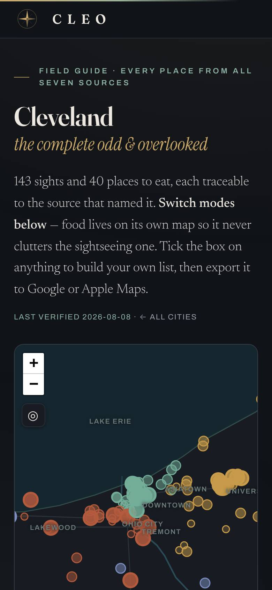 | 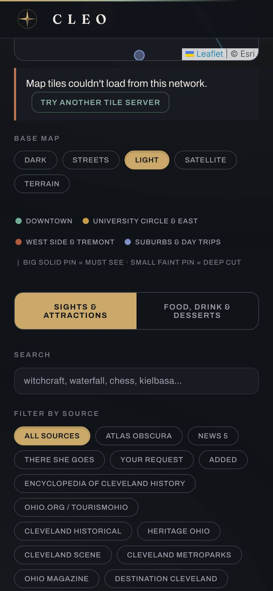 | 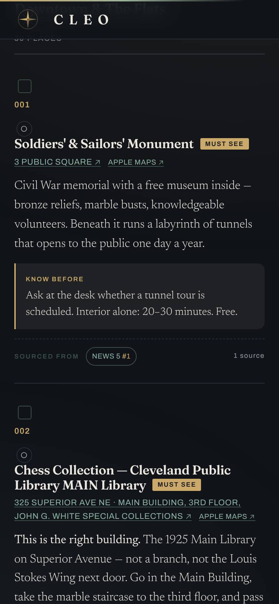 |

| Desktop first screen | Desktop card |
|---|---|
| 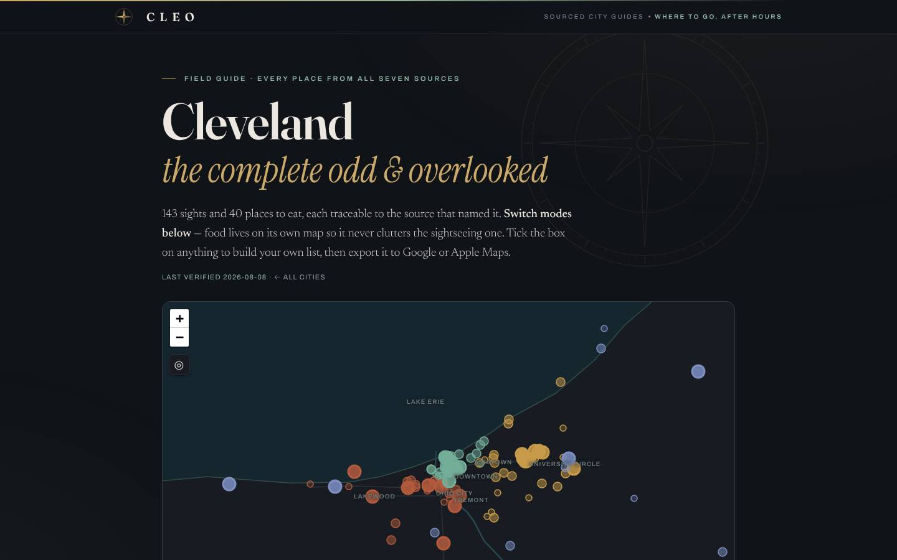 | 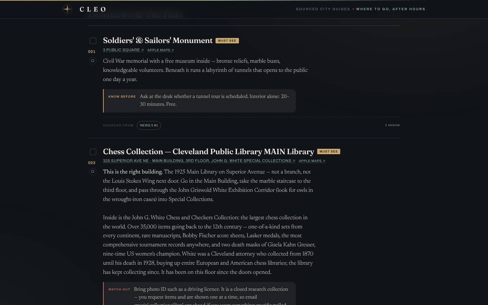 |

**Why it reads as "horrible" against Airbnb or Marriott:**
1. **Same structure, new paint (fails P1).** The DOM order is the live tool's: masthead, map, base-map picker, legend, mode switch, search, a 15-chip source filter, area, collection, rank, sort, visited, quick picks, then the places. Leaders put inventory first (Baymard, Klook, Airbnb). The re-skin could not fix this, because it deliberately left structure byte-identical.
2. **An admin-panel vocabulary (fails P5, P6).**
   - "BASE MAP: DARK / STREETS / LIGHT / SATELLITE / TERRAIN" is the first set of controls under the map.
   - "FILTER BY SOURCE" exposes the audit trail as a primary filter.
   - Uppercase-tracked text nodes **rose from 388 to 701**: the beta replaced monospace with tracked Archivo caps, so the page still shouts.
   - Five families render on the page.
3. **No visual anchor for 183 places (fails P10).** Every card is title, link, paragraph, box. Nothing differs between a Civil War monument and a pierogi counter. On mobile, one card fills roughly a whole screen.
4. **The card leads with machinery.** On mobile a checkbox, "001" and a visited circle stack *above* the name. The address and "APPLE MAPS" links are uppercase. Attribution is a small "SOURCED FROM NEWS 5 #1" chip at the bottom. Trust sits in the footer of the card, while Michelin and Apple Guides put it on the cover (P20).
5. **The mood is night-bar, not wanderlust.** Ink, brass and a compass watermark read as "hotel bar after hours", which the beta README's own positioning confirms ("where to go, after hours"). The brief asks for *fun* and *wanderlust*, with pop culture and food. There is no colour per area beyond pins, no city personality, and no delight (P7, P9).
6. **Desktop wastes the canvas (fails P11).** On 1440 px the list is a ~920 px column. The map scrolls away above the list instead of sitting beside it, which is the split view Baymard recommends.
7. **Trust details are inconsistent.**
   - The masthead's "LAST VERIFIED 2026-08-08" is hand-maintained.
   - Closed places keep their tier badge. The Salon audit found *Heinen's Downtown — CLOSED* still badged **MUST SEE**; the beta inherits this.
   - **Ergonomics:** 832 of 841 controls are under 44 px tall.

What the beta does well, and what should be kept:
- The engine's honesty: Know-before and Watch-out callouts, the chess-collection correction copy.
- A legible serif body.
- A working dark palette.
- An original wordmark with no borrowed trade dress.

### 7.2 The "Salon" proposal (`design/ux-2026-10/`)

| Hub (mobile) | Tokyo (mobile) | Tokyo (mobile, scrolled) |
|---|---|---|
| 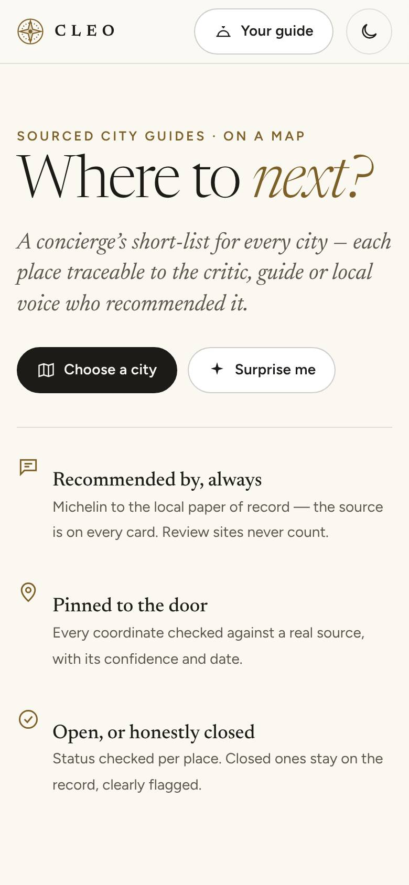 | 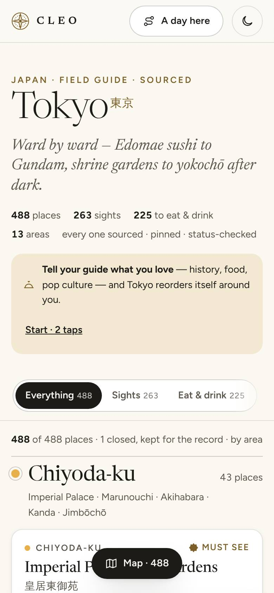 | 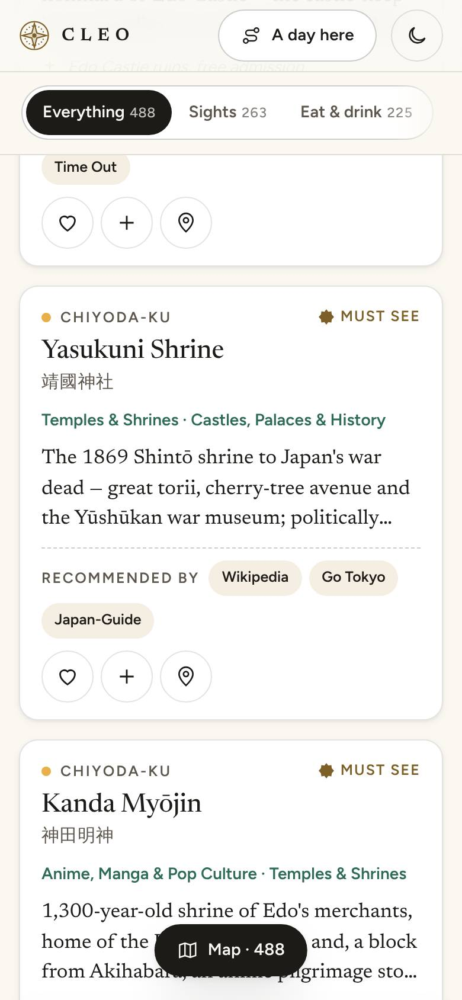 |

| Tokyo desktop (split view) | Place sheet | Map + sheet | Day plan |
|---|---|---|---|
| 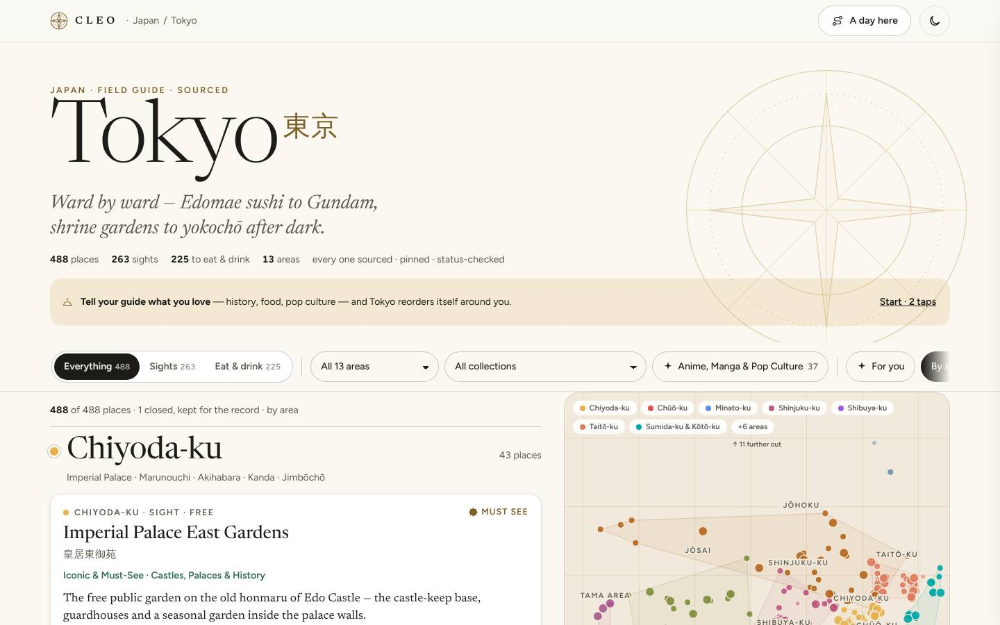 | 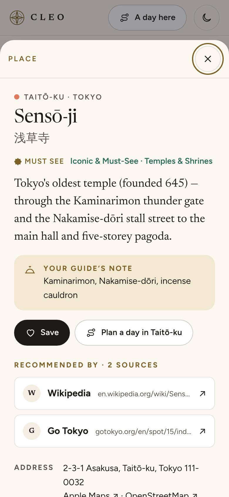 | 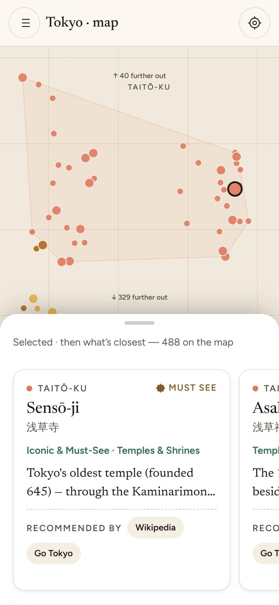 | 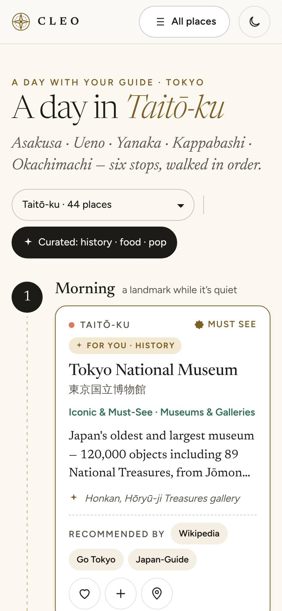 |

**Where Salon meets the benchmarks:**
- **P1:** first place at 0.9 screens, with 14 controls above it.
- **P11:** desktop split view with a sticky map; a mobile map with a carousel sheet.
- **P13:** the place sheet has a visible close, every source with its domain, address with Apple and OSM links, status and pin confidence.
- **P17:** "For you" reorders and never hides.
- **P20:** "Recommended by" on every card.
- **P23:** a day plan by area.
- **P6:** two families, mostly sentence case.
- Infinite scroll in batches of 30 keeps all 488 places reachable. Nothing is trimmed.

**Where it falls short, against the evidence:**
1. **Still a text column (fails P2, P10).** After the masthead, Tokyo is 488 near-identical white cards. There is no collection rail and no cover art, so it reads like a well-set document. Airbnb, Klook and Apple Guides open on *browsable collections*. The ★ anime layer is a chip in the toolbar, not the hero.
2. **The hub shows no city above the fold (fails P1).** The first screen is "Where to *next?*", two buttons and three trust bullets. It is a SaaS-style value proposition, where Baymard and Klook would put the inventory.
3. **The offline schematic reads as a diagram.** Convex-hull area polygons on a beige grid, with "↑ 40 further out" counters, are a good *fallback* but not a first impression. Real Esri or OSM tiles should take over as soon as they load, as Salon intends; hulls overlap (Shinjuku and Chiyoda).
4. **Voice outruns the data (fails P24).** "Your guide's note: *Kaminarimon, Nakamise-dōri, incense cauldron*" voices a keyword field as if it were a sentence. Salon's own audit flagged that `k` is keywords in some cities. A butler that speaks in tags feels broken. Use "Look for:" when `k` is not prose.
5. **The tier is a word, not a ladder (fails P18, P19).** "MUST SEE" in uppercase gilt carries the same weight as the area eyebrow. There are no distinct glyphs for the three tiers and no link to the method.
6. **Sources are equal beige chips (fails P20).** Wikipedia, Go Tokyo and Japan-Guide all look identical, and a chip links out to the source but never in, to "everything this source recommends".
7. **Ergonomic leftovers.**
   - The sticky toolbar clips on mobile ("Eat & drink 225") and on desktop ("By a…") with no scroll affordance.
   - The floating "Map · 488" pill covers card titles mid-list.
   - 99 of 207 controls are still under 44 px.
8. **"Fun" is under-served (fails P7, P9).** Ivory, ink and gilt is a classic luxury-template palette. The only fun signal is one neon-plum accent in the night edition, and there is nothing city-specific: Tokyo and Chicago look the same.

**Verdict:** adopt Salon's **information architecture and trust components**, and replace its **visual layer**:
- typographic and map-art covers
- collection rails
- a tier glyph ladder
- per-city local skins
- functional delight

---

## 8. Recommendations

Each item names its evidence and satisfies the hard rules:
- keep every place
- attribution visible
- nothing fabricated
- content renders without a CDN
- no Google or key-required tiles
- no borrowed trade dress

### Must (the gap the owner sees)

| # | Recommendation | Evidence | Acceptance check |
|---|---|---|---|
| M1 | **Inventory-first pages.** City: masthead ≤ 0.6 screen, then the collection rail, then the first place within the first screen on mobile. Hub: city cards (name, native script, counts, signature dish line) visible above the fold. | P1: [Baymard](https://baymard.com/research-articles/travel-site-ux-best-practices), [Landing Doctor/Klook](https://landingdoctors.com/teardowns/klook-com), [Airbnb](https://www.airbnb.com/2022-summer) | `shots.js`: screens-to-first-place ≤ 1.0. Hub shows ≥ 2 cities at 390×844. |
| M2 | **Collections as the front door.** A rail of cover cards. ★ signature collections (anime, city-unique dishes) come first and largest. Each opens a filtered list and map with an intro. "Show all N" is always one tap away. | P2: [Airbnb Categories](https://www.rentalscaleup.com/video-brian-chesky-airbnb-2022-summer-release/), [Apple Maps Guides](https://macrumors.com/how-to/use-guides-in-apple-maps-ios), [Eater](https://sites.dwrl.utexas.edu/rhetoric-of-food/2017/03/29/1398/) | No collection hides records from the "All" view. Counts are computed. |
| M3 | **Map and list as one object.** Desktop: split view with a sticky map. Mobile: list first, with a "Map" toggle opening a full-screen map and a bottom sheet with detents and a visible close. Pins numbered to match cards. Tap a pin to open the sheet. Cluster only dense zooms. | P11–P14: [Baymard](https://baymard.com/research-articles/accommodations-split-view), [NN/g maps](https://www.nngroup.com/articles/mobile-maps-locations/), [NN/g sheets](https://www.nngroup.com/articles/bottom-sheet/), [Pratt](https://ixd.prattsi.org/2024/09/design-critique-booking-com-ios-app/) | `npm test` no-CDN path still renders the list. The map mounts only via `mountMap()`. Only OSM and Esri tiles (`check-google.py` passes). |
| M4 | **Filter tray.** Search plus 3 primary chips (Sights / Eat & drink / Area) stay visible. Everything else, including source, tier, sort, visited and base map, goes in a tray with "Show N places" and applied-filter chips. | P15: [NN/g faceted](https://www.nngroup.com/articles/mobile-faceted-search/) | Every current filter is still reachable. ≤ 15 controls above the first place. |
| M5 | **Tier ladder and method page.** Three original glyphs on pin, card and sheet. "How we choose" explains the merit bar, ≥2 credible sources, within-area tiers, status and pin checks. Closed places lose the tier glyph and get "Closed: kept for the record" with the source and date. | P18–P19: [Michelin](https://guide.michelin.com/th/en/michelin-guide-inspectors), [Airbnb Guest Favourite](https://www.airbnb.com/help/article/3495), [Trip.Best](https://www.timeout.com/hong-kong/travel/plan-an-unforgettable-trip-overseas-with-trip-bests-recommendations) | `--statuscheck` passes. No closed record renders a tier badge. |
| M6 | **Attribution as navigation.** Card: "Recommended by" with up to 3 source names and "+N", plus an authority mark for Michelin, James Beard and NPS. Sheet: every source, linked. A source page or filter shows "Everything {source} recommends here". `ADD`/`FADD` labelled honestly. | P20: [Apple Maps Guides](https://iphonelife.com/content/how-to-browse-apple-maps-guides-publisher), [Atlas Obscura](https://atlasobscura.com/places/lake-claire-community-land-trust), [NN/g trust](https://www.nngroup.com/articles/trustworthy-design/) | `validate` source invariants unchanged (News 5 ×100, There She Goes ×23). |
| M7 | **Type and colour system.** Two families (a display serif that renders macrons, e.g. Newsreader as Salon found, plus one humanist sans). Sentence case. Tracked caps only for ≤ 1 eyebrow per card. One accent, spent only on actions and distinctions. Tokens for light and night. | P5–P6, P8: [Time Out](https://www.transformmagazine.net/articles/2016/spotlight-on-time-out/), [Aman](https://www.thedrum.com/profile/inviqa/article/aman-boosts-revenue-with-new-digita-experience), [Backpack](https://www.supernova.io/blog/top-design-system-documentation-sites-created-with-supernova) | Uppercase text nodes < 15% of text nodes. ≤ 2 font families plus a CJK fallback. |
| M8 | **Mobile ergonomics.** ≥ 44 px targets for primary actions. No horizontal overflow. No floating element covering content. A sticky bottom action bar in the sheet (Save · Directions · Add to day). | P13, cross-cutting: [NN/g sheets](https://www.nngroup.com/articles/bottom-sheet/), [WWDC21 sheets](https://developer.apple.com/wwdc21/10063) | `shots.js`: overflowX = 0. Primary controls ≥ 44 px. |
| M9 | **No manufactured urgency or popularity, ever.** No "trending", "popular now", fake counts or ratings. | P21: [CMA/CNN](https://edition.cnn.com/travel/article/booking-com-misleading-sales-tactics-cma), [Which?](https://www.which.co.uk/news/article/booking-com-still-misleading-holidaymakers-with-1-room-left-claims-aSNln2j8gkGl), [FTC/Hopper](https://www.consumerfinancemonitor.com/2026/07/16/hopper-reaches-35-million-agreement-with-the-ftc/) | Code review: every number on screen is derived from the dataset. |

### Should (wanderlust and fun)

| # | Recommendation | Evidence |
|---|---|---|
| S1 | **A visual anchor without photos.** Typographic cover cards (large name, native script, area colour field) plus map art from our own verified pins (area silhouettes, route lines). See §6 A + B. | P10: [Louis Vuitton](https://www.livreshebdo.fr/article/nouveau-format-pour-les-guides-de-voyage-louis-vuitton), [Herb Lester](https://metropolismag.com/projects/pocket-sized-maps-part-infographic-part-travelogue/), [OSMF](https://osmfoundation.org/wiki/Attribution) |
| S2 | **Per-city local skin.** One accent colour, one motif and one display flourish per city on the shared tokens, so Tokyo ≠ Chicago ≠ Cleveland. Commission or draw original city motifs. | P7–P8: [The Hoxton/DEPT](https://deptagency.com/en-nl/?p=4251900), [Belmond](https://creativepool.com/matterofform/projects/belmond-for-belmond), [Expedia themes](https://www.codeandtheory.com/work/expedia-group) |
| S3 | **Functional delight.** A small animated glyph per collection (tap to animate) and a satisfying save "stamp". All of it respects `prefers-reduced-motion`. | P9: [Airbnb/Design Week](https://www.designweek.co.uk/it-was-a-bit-nuts-teo-connor-on-designing-the-new-airbnb-app/), [Airbnb a11y](https://airbnb.com/d/accessibility) |
| S4 | **Your list and Your day.** Heart, list sheet, share via URL (no backend), Apple and Google export (exists), "Been there" stamps. Day plan with a numbered route line and straight-line distance labelled as such. Closed places are excluded. | P22–P23: [Google Lists](https://blog.google/products/maps/google-maps-updates-november-2023/), [Michelin lists](https://spark.mwm.ai/en/apps/the-michelin-guide/1541129177), [Wanderlog](https://apps.apple.com/ua/app/id1476732439) |
| S5 | **A concierge voice guide** (a copy doc). Second-person, warm and specific. "Your guide's note" only for real tips, "Look for:" for keywords. Empty states as stated gaps. Microcopy for errors (no tiles, storage blocked). | P24: [Four Seasons](https://www.hospitalitynet.org/news/4085206.html), [Hoxton](https://guests.thehoxton.com/shoreditch/survival-guide/), [Booking B.Writes](https://designproject.io/jobs/ux-writer-ii-organic-marketing-at-booking-com-bq8pr1) |
| S6 | **"For you" that reorders, never hides.** Interests (History & landmarks · Foodie · Pop culture) map to existing collection and cuisine ids. A visible "why this is first" line. | P17: [Ask Bonvoy](https://www.customerexperiencedive.com/news/marriott-bonvoy-ai-powered-search-personalize-vacation/712221/), [Mindtrip/FlowingData](https://flowingdata.com/?p=75091) |
| S7 | **Contextual modules from data we have.** "Near you" (geolocation, opt-in), "Free to visit" (`FREE`), "After dark" (only where a collection says so). Never fake opening hours. | P3: [Marriott](https://www.businesstraveller.com/news/marriott-bonvoy-unveils-app-redesign/), [citizenM](https://www.red-dot.org/project/citizenm-55160) |
| S8 | **Published accessibility statement** targeting WCAG 2.2 AA: contrast tokens, focus, landmarks, a skip link to the first place. | [Hilton](https://www.hilton.com/en/p/accessibility/), [Booking](https://www.booking.com/content/accessibility_statement.en-us.html), [Airbnb](https://www.airbnb.com/help/article/3928) |

### Could (later)

| # | Recommendation | Evidence |
|---|---|---|
| C1 | **Wikimedia Commons images for landmarks**, through an `images.json` registry and gate. TASL captions, freedom-of-panorama check per country, self-hosted standard-width thumbnails, none in Vietnam. | §6 D: [Commons](https://commons.wikimedia.org/wiki/Commons:Reusing_content_outside_Wikimedia), [CC](https://wiki.creativecommons.org/Best_practices_for_attribution), [MediaWiki](https://www.mediawiki.org/wiki/Instant_Commons) |
| C2 | **Offline city pack** (a service worker caching the page and the user's list). It turns a static site into a trip-time utility, and competitors charge for it. | Offline pattern: [Spotted by Locals](https://www.phocuswire.com/Spotted-by-Locals-removes-roaming-woes-with-offline-app), [Wanderlog pain point](https://www.whistleout.com/CellPhones/Guides/wanderlog-group-trip-planning-app) |
| C3 | **Night edition** via tokens, auto-switching at dusk. Optional, since dark mode is not table stakes per the evidence. | [Backpack](https://www.supernova.io/blog/top-design-system-documentation-sites-created-with-supernova) |
| C4 | **A conversational concierge grounded only in the dataset**, with citations to our sources and a visible "may be wrong" line. Needs a backend, so it is out of scope for a static site today. | [Ask Bonvoy](https://www.hoteldive.com/news/marriott-bonvoy-ai-search-personalization/712303/), [Google disclaimer](https://techcrunch.com/2025/03/27/google-rolls-out-new-vacation-planning-features-to-search-maps-and-gemini) |
| C5 | **Collaborative votes on shared lists.** Needs a backend, so defer. | [Google Lists](https://blog.google/products/maps/google-maps-updates-november-2023/), [Vrbo](https://www.rentalscaleup.com/expedia-vrbo-trip-boards/) |

**Suggested sequence:**
1. M1–M4 on one prototype city: fork Salon and replace its visual layer.
2. M5–M7 plus S1–S2.
3. Owner review.
4. Roll the engine out city by city, with `validate`, `test`, `--geocheck` and `--statuscheck` on each.

---

## 9. Reproduce

```bash
cd tools && npm install                     # Leaflet for the harness; first time only
cd .. && NODE_PATH=$(npm root -g) node design/research-2026-10/ux-competitive/tools/shots.js   # screenshots + metrics.json
```

- Competitor evidence: [`evidence/hotels.md`](evidence/hotels.md), [`evidence/otas.md`](evidence/otas.md),
  [`evidence/experiences.md`](evidence/experiences.md), [`evidence/itinerary-photo.md`](evidence/itinerary-photo.md).
  Every bullet carries its URL. Re-run the searches to refresh them, since claims are dated 2026-10-10.
- Content-model figure (29% of records cite Wikipedia): the share of `P`+`F` records across
  `data/*.dataset.json` whose `s` contains a `wikipedia.org/wiki` URL. Cleveland, which lives in `cleveland.html`,
  is not included.
- **Calls made, recorded for the owner:**
  - Salon was assessed as a peer proposal, not a baseline.
  - Unofficial token extractions (webdesignhot, shadcn.io, superdesign) are marked "unofficial" and used only as colour, not as proof.
  - The matrix records only what evidence showed. "·" means unknown, not absent.
